Mi nombre es Iñaki. Informático de profesión y viajero de devoción, siempre me he sentido atraído por los paisajes diferentes al de mi Asturias natal, tal vez por la búsqueda del exotismo de lo diferente. Desde hace muchos años he encontrado en la bicicleta la herramienta perfecta para viajar, la que me proporciona la velocidad adecuada para moverme. A la <em>velocidad de las mariposas</em>, que diría el gran Álvaro Neil. Aunque a veces es difícil olvidar el ritmo vertiginoso de la competición y centrarse únicamente en viajar, conocer y aprender, cada vez me cuesta menos pedalear despacio y disfrutar del entorno. Y olvidarse del reloj. <em>Ustedes tienen los relojes, nosotros el tiempo</em>, recitan como un mantra por algunos pueblos árabes.

> Ustedes tienen los relojes, nosotros el tiempo.

Siento devoción por los desiertos, y he tenido la suerte de pedalear por el Sáhara, el Gobi y el desierto de Arabia y el Namib. Por la Capadocia, entre las montañas del Kirguistán y sus yurtas, desde los 427 metros bajo el nivel del mar en la costa jordana del Mar Muerto hasta los 5.600 metros en el Khardung La, la carretera más alta del mundo, en la India.  Siempre he opinado que los viajes dan sabiduría, y aún tengo mucho que aprender. Y como no hay viajes sin cronistas (dicen) aquí va mi pequeña aportación con este blog de viajes en bicicleta.

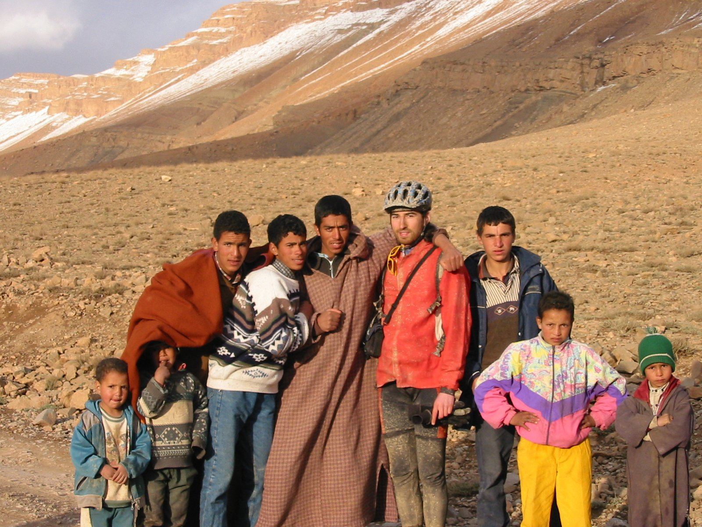

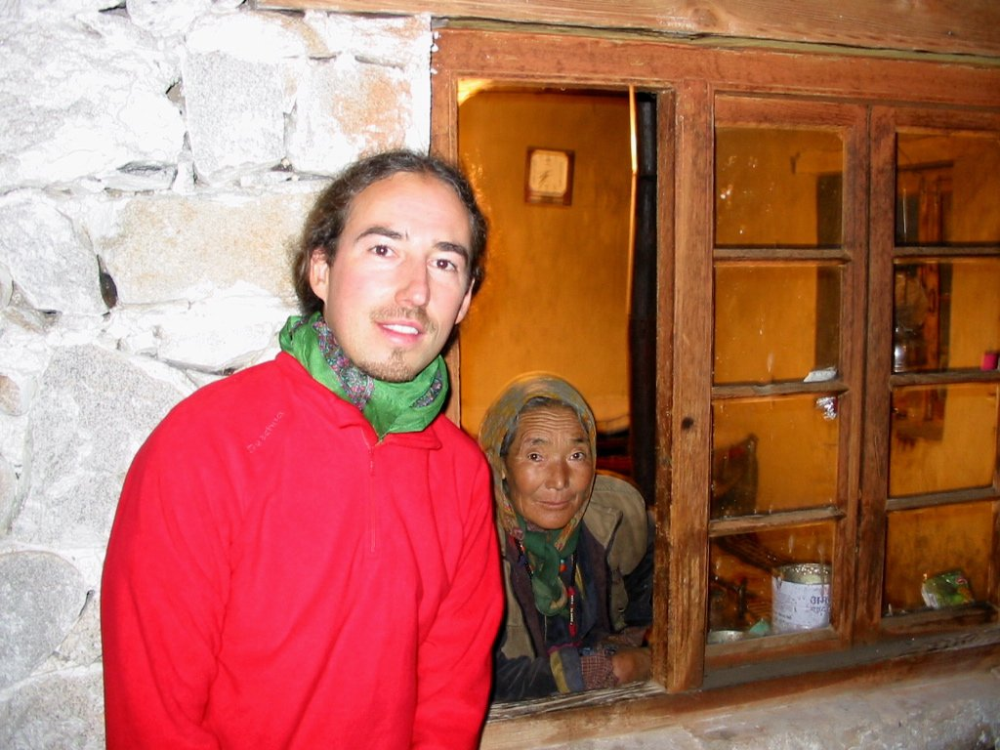

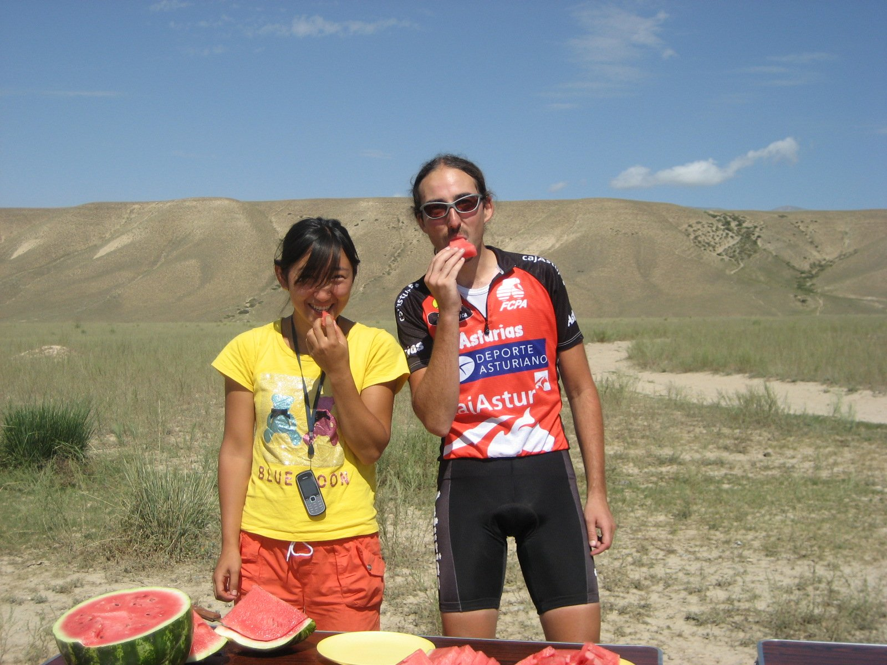

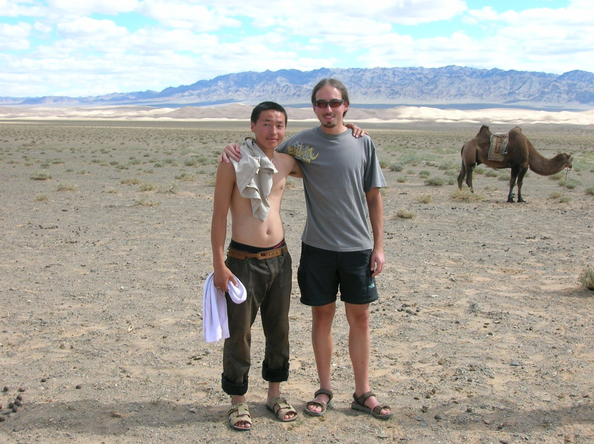

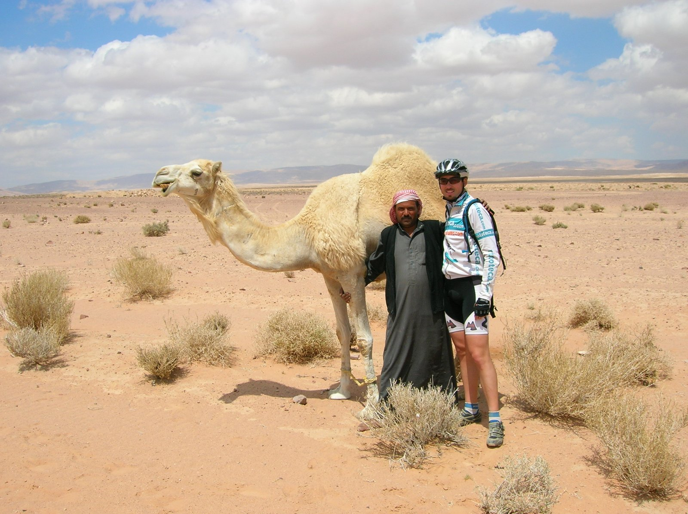

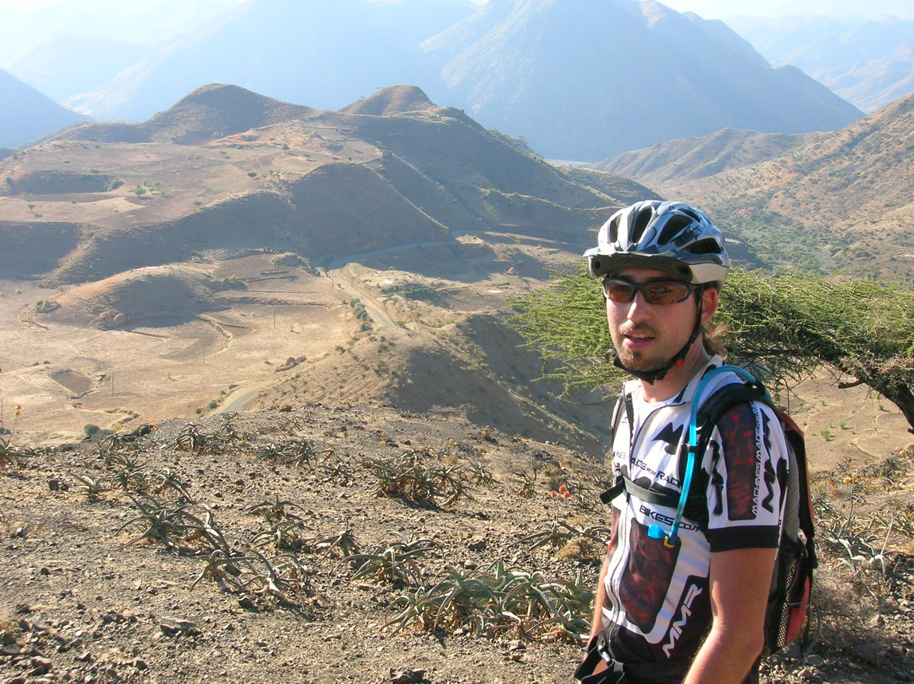

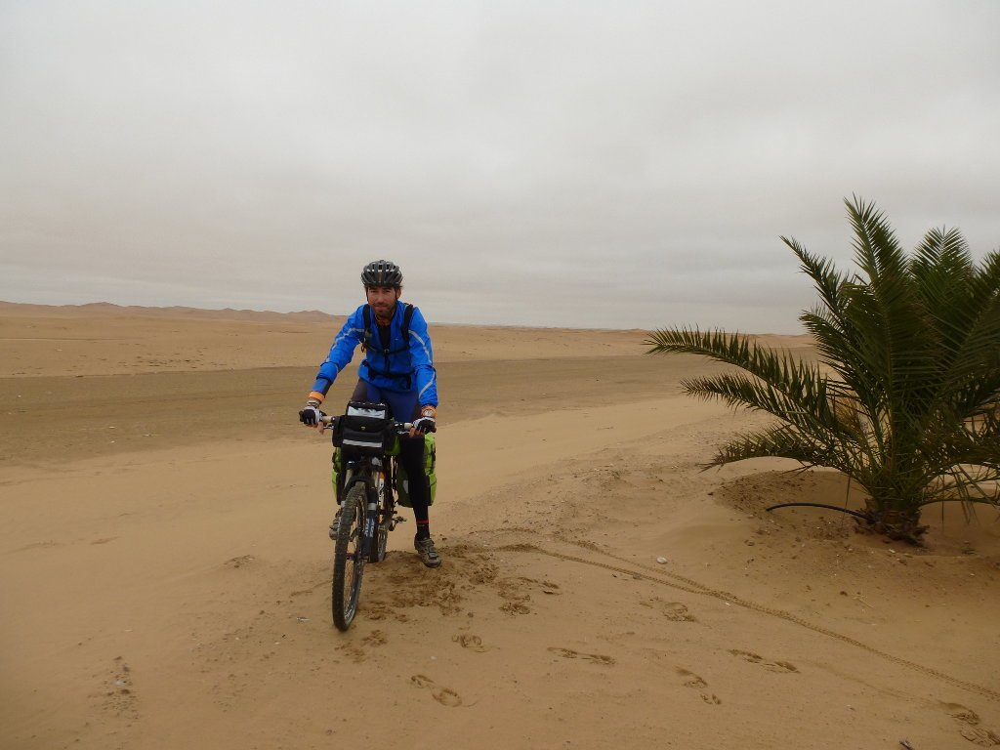

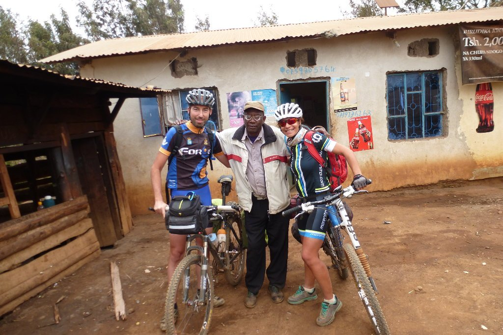

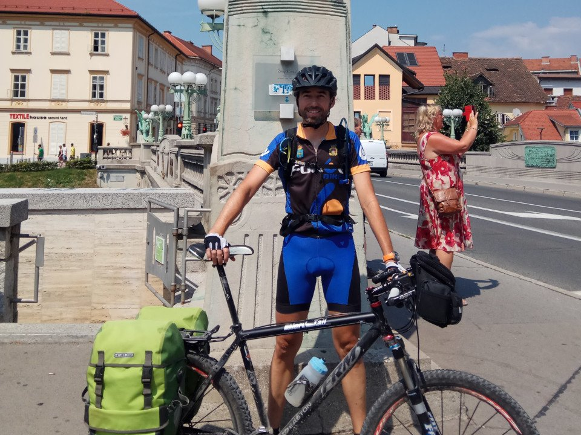

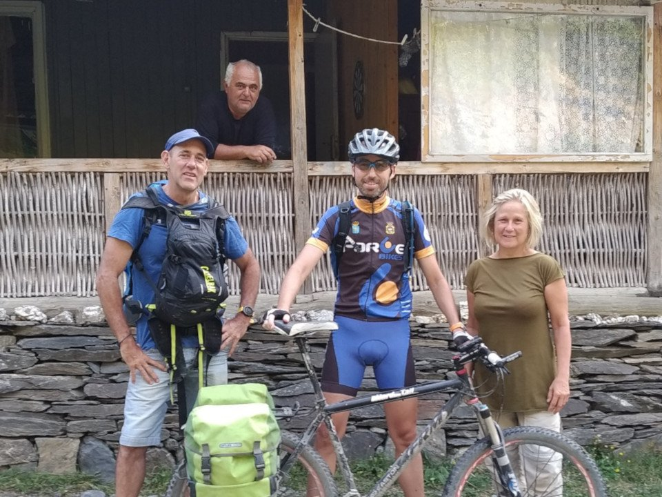

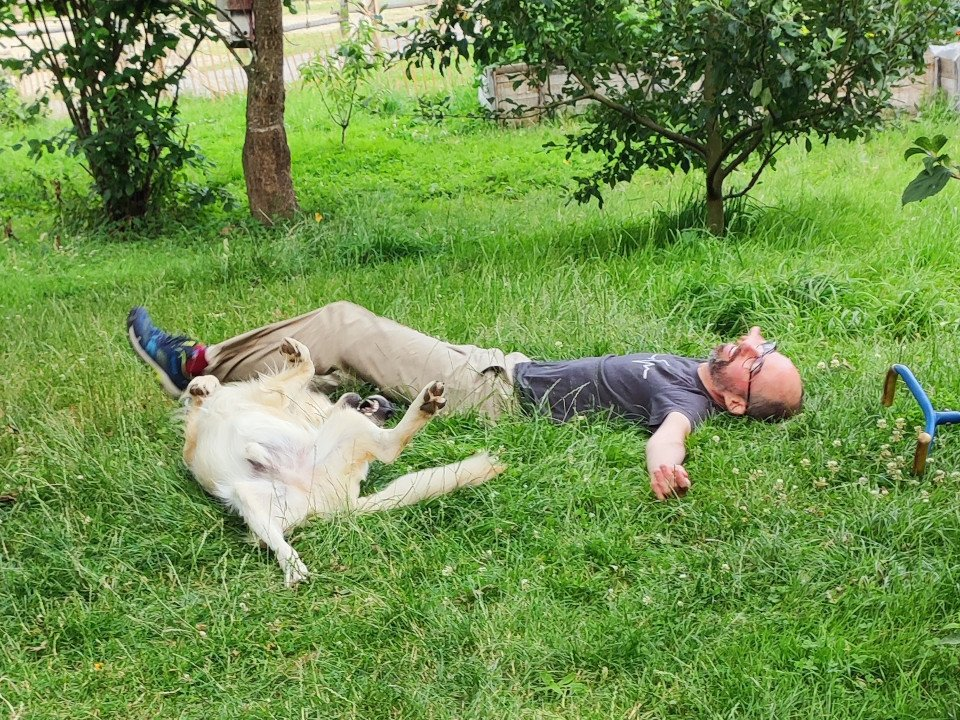

