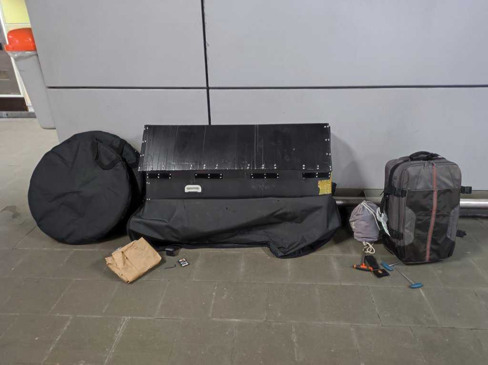
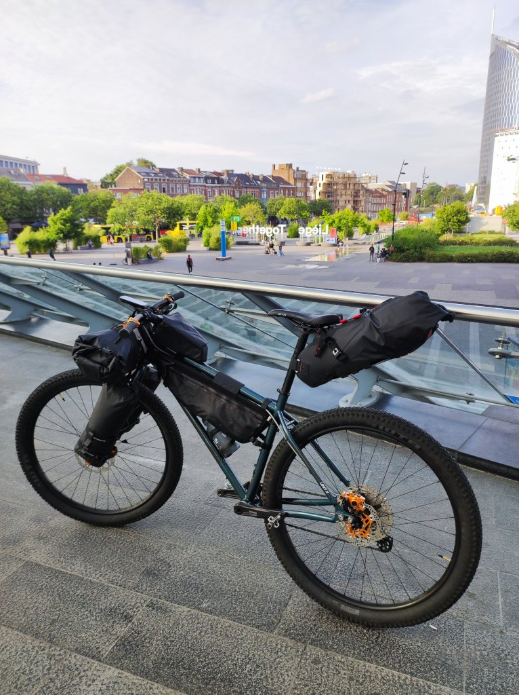
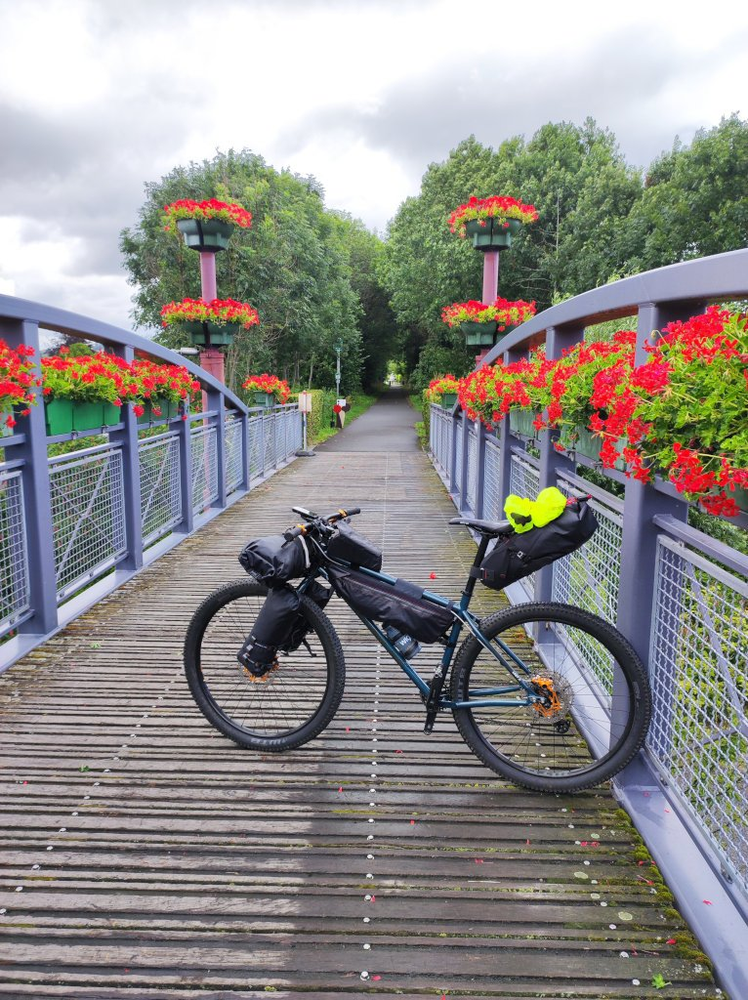
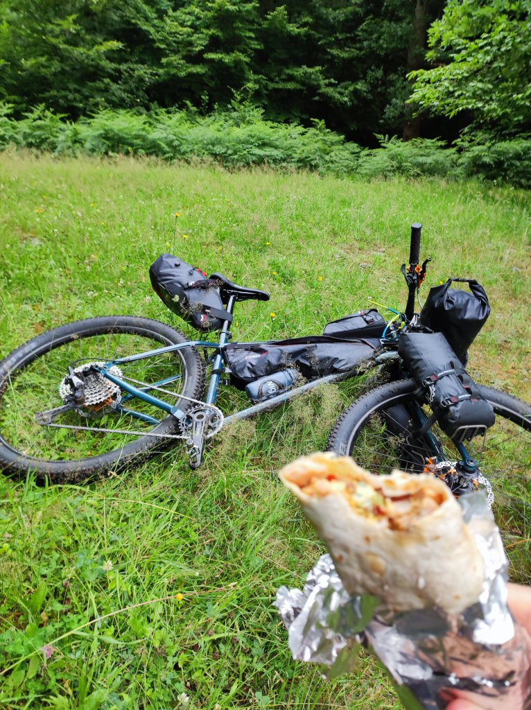
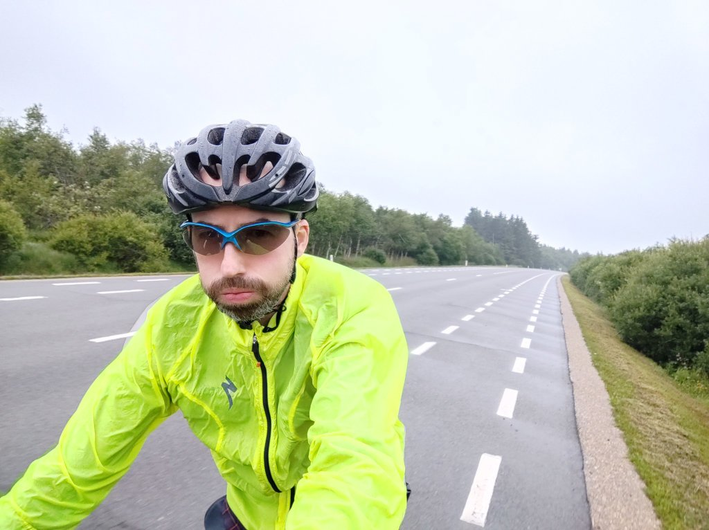

Creo que esta era una deuda pendiente. No puede ser que mi afición al ciclismo aún no me haya llevado a Bélgica. Por un motivo u otro he visitado diferentes partes del mundo, pero me quedaba uno de los países con más tradición ciclista. Si no el que más.

No me costó mucho organizarlo. Con intención de partir desde Lieja, llegué con mis bártulos al aeropuerto de Bruselas. Para todo aquél que no lo conozca le diré que tiene, al menos, dos cosas buenas. Uno, taquillas grandes donde puedo dejar la caja de la bici. Y dos, acceso directo al tren. Y con estas, nada más llegar me dispuse a montar la bici, guardé las maletas en la taquilla y cogí el primer tren dirección Lieja.

En viaje es rápido. Aún haciendo cambio de tren a medio camino, llegué a Lieja en menos de dos horas. Por fin iba a estrenar mi nueva bici y mi nuevo sistema: adios alforjas, ¡hola bikepacking!

Me alojé en un pequeño hotel de Lieja y al día siguiente, bien temprano, arranqué mi viaje.

No puedo decir que el arranque haya sido el mejor. A primera hora llovía muchísimo. Así que hice un poco de tiempo tras el desayuno y, una vez hubo amainado, salí dirección Málmedy.

Los primeros kilómetros fueron sencillos, y pude disfrutar de primera mano de los famosísimos carriles bici que unen los pueblos de Bélgica. Kilómetros y kilómetros de de asfalto destinado únicamente a las bicicletas, muy transitados, que te llevan casi a cualquier lugar. Y además, muy cuidados.

Por fortuna apenas me llovió y, aunque el tiempo distaba mucho de ser bueno, la ropa no llegó a calarme. Abandoné los carriles bici para adentrarme en una red de bonitos senderos, muy divertidos. Y así llegué a Limburgo, donde pude esquivar los <em>frietkoten</em> o freidurías y agenciarme un dürüm para comer un poco más tarde. Con su forma cilíndrica, su envoltorio de papel de aluminio y lo bien que se conserva después de recién hecho, he descubierto en este viaje que son ideales para llevar en la bici y poder degustar <em>más adelante</em>.

Y así, poco a poco, fui haciendo camino mientras el cielo se oscurecía y las nubes cada vez se cerraban más. La temperatura comenzó a bajar, no a lo loco, pero si lo suficiente para plantearme... ¡porqué tengo que ir tan abrigado en pleno Julio! Ay, vacaciones de verano, ¿dónde estáis?

En este punto ya me empezaban a sobrar los kilómetros. Siempre trato de ir bien preparado en cuanto a la ruta a realizar, y nunca he considerado un <em>deshonor</em> el coger un atajo o evitar alguna zona si es difícil de transitar, se me hace tarde, o simplemente no me apetece. Y ese día había un trozo que se preveía totalmente encharcado (y seguramente embarrado) y, honestamente, no me apetecía comenzar así.

En esa situación, los últimos kilómetros los realicé por carretera. Tan sólo una pequeña parada en lo que parecía un bar de carretera pero se convirtió en un restaurante elegante a los que no les hizo mucha gracia que un tipo empapado con ropa de colorines les mojase el suelo por un mísero café. Dejé propina.

El plan para hoy era quedarme en el camping de Malmedy. Incluso me lo llegué a plantear, pero un pequeño vistazo desde la entrada me hizo reconsiderar mis planes. El camping estaba totalmente encharcado, y no parecía que fuese a parar de llover. Así pues, me busqué un hotel en Malmedy, donde pude lavar (y secar) mis ropas y dormir en una cómoda cama. Estoy acostumbrado a la lluvia, pero espero que mañana salga el sol. Eso sí, ¡me lo he pasado genial!
