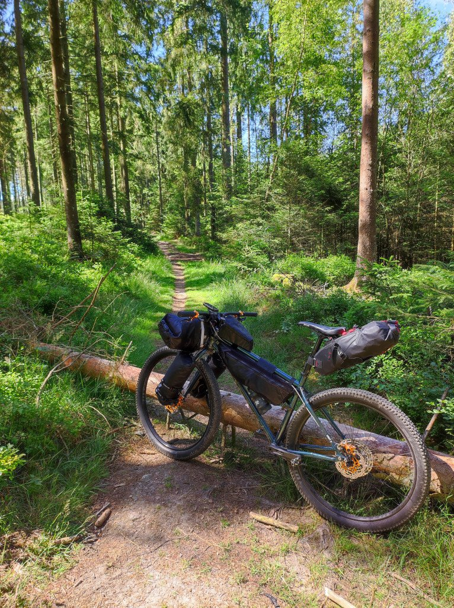
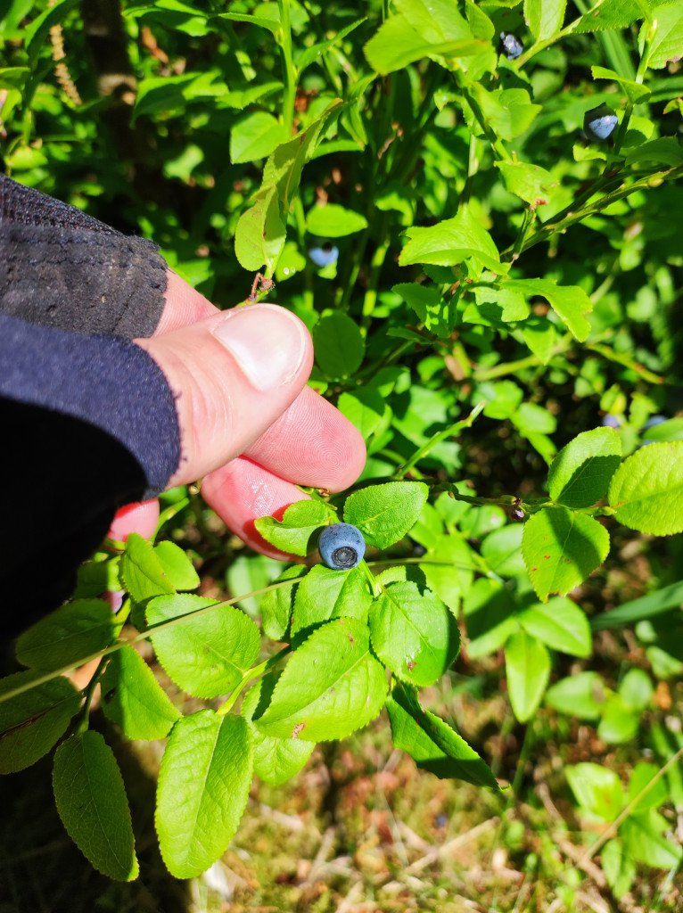
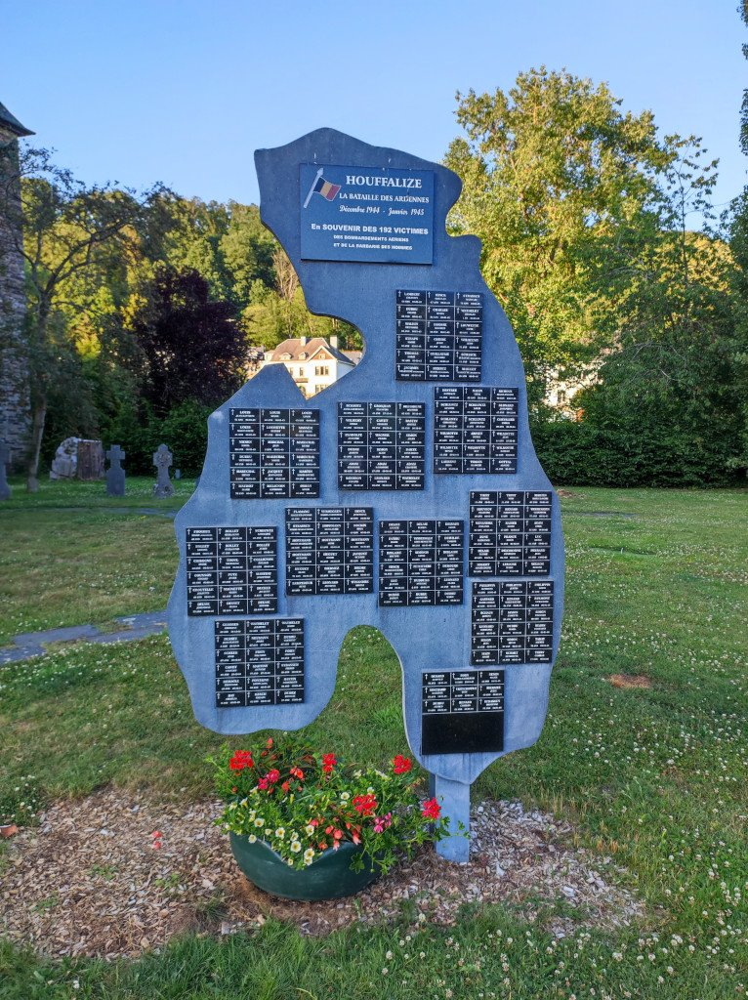

¿Cómo iba a amanecer hoy? Sorpresa... de las buenas. Aunque frío, el día amanece despejado, lo que anima mucho a pedalear. Al poco de salir de Malmedy ya me meto en bosques. Discurro toda la mañana por estrechos senderos que me llevan de un bosque a otro, cruzados de tarde en tarde por una carretera, y vuelta al sendero. ¡El sueño de cualquier ciclista!

Me salgo de los senderos un momento para uno de los vicios ciclistas más extendidos: tomar un café con un pastel. Cual sería mi sorpresa cuando, una vez me había acostumbrado al <em>bonjour</em>, al entrar en la cafetería me saludan con un <em>guten morgen</em>. Sin darme cuenta había entrado en zona de habla alemana. Lo cierto es que, de cara al viajero, tiene su gracia.

Después de la pausa para el café vuelvo a los senderos. Esta zona es especialmente bonita. Los senderos están limpios, los árboles me permiten rodar a la sombra...

... y hasta tengo arándanos grátis.

Una cosa que me llama la atención es que, de las pocas veces que me salgo de los senderos, es para atravesar una carretera o un pequeño pueblo y rara es la vez que no paso al lado de un cementerio militar. Los cementerios militares belgas tienen su origen en los trágicos acontecimientos ocurridos durante las dos guerras mundiales del siglo XX. Bélgica fue un escenario importante de combates y conflictos durante ambas guerras, lo que llevó a la pérdida de muchas vidas de soldados de diferentes nacionalidades. Estos cementerios militares son lugares de gran importancia histórica y conmemorativa, y se mantienen como recordatorios de los horrores de la guerra y el sacrificio de quienes lucharon por la libertad y la paz.

El último de estos cementerios que visitaré se encuentra en Houffalize, destino final de mi ruta en el día de hoy. Tras montar mi tienda de campaña en el camping y antes de irme a dormir, aplaco mi hambre a base de freuduría belga. Sin duda, una mala elección para una cena. Pero había que probarla.
