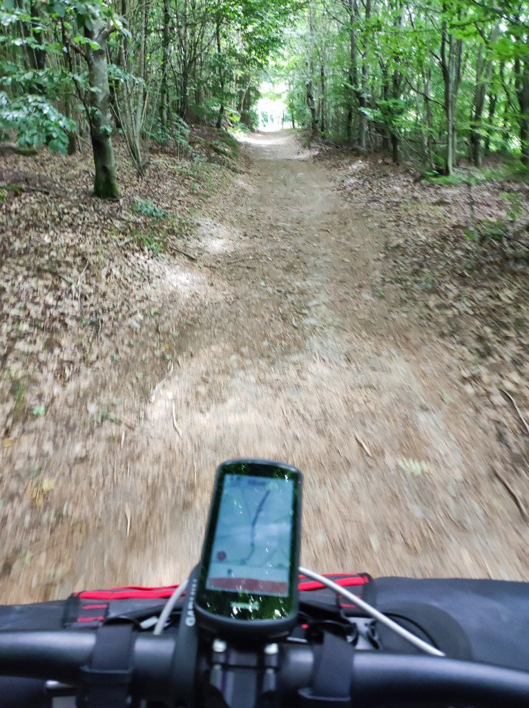
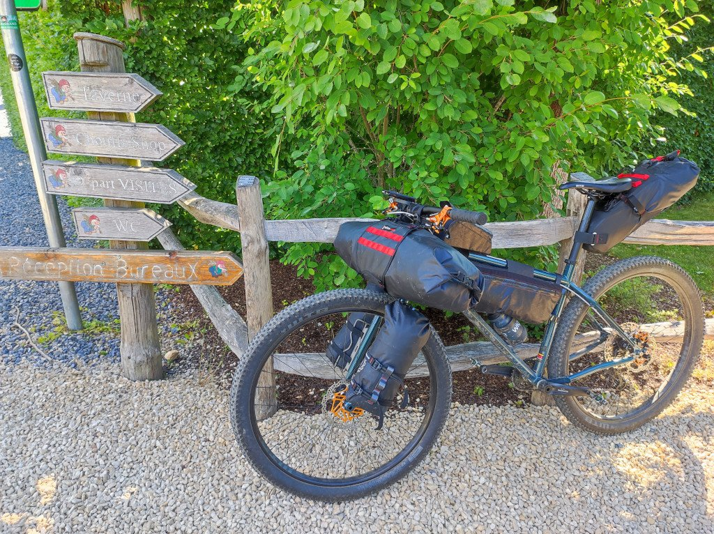
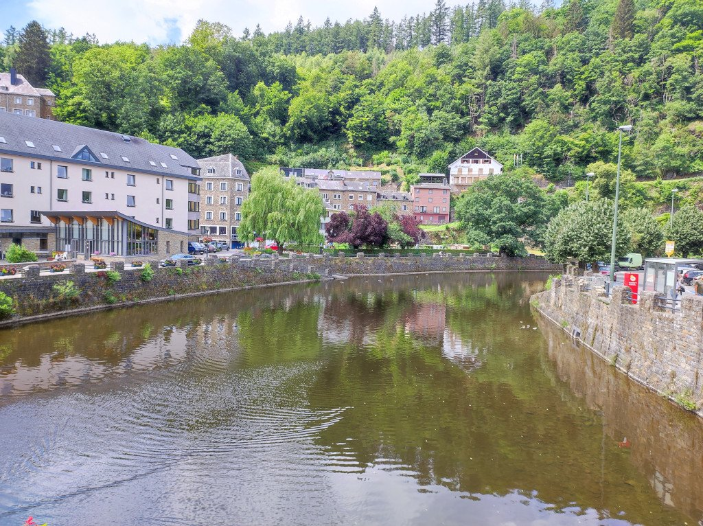
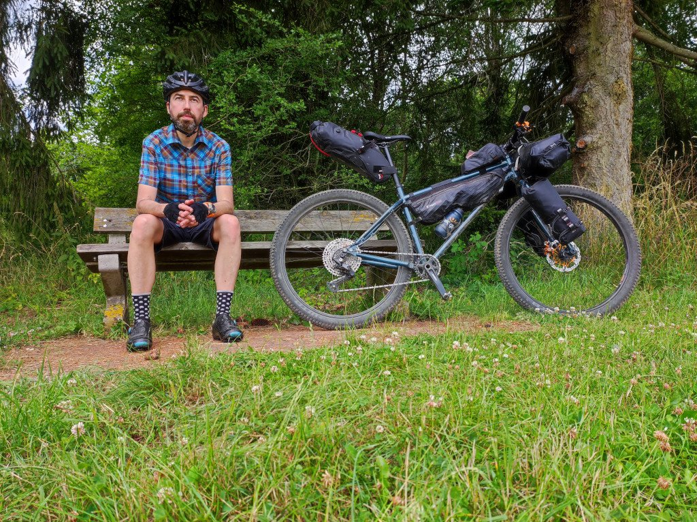

Pero, ¿Bélgica no era todo llano? Nada más salir de Houffalize (donde, por cierto, conviene llevar buena ropa de abrigo si vas a pasar la noche) la ruta me lleva por kilómetros de bosques y más bosques. De estrechos caminos a pequeñas pistas, me siento perdido en los bosques de Bélgica. Aunque hoy en día, con la ruta cargada en el GPS, lo de perderse se hace complicado.

Aunque sabía que hoy iba a pasar por <a href="https://chouffe.com/es/beer/la-chouffe/">La Chouffe</a>, lo cierto es que encontrármela fue una pequeña sorpresa. Aficionado como soy a la cerveza en general, es curioso que mi primera visita a una fábrica sea tan lejos de casa. Aproveché para visitar el entorno de la fábrica y, como no, la tienda de regalos. Y por si queda alguna duda... ¡demasiados kilómetros por delante como para tomarme una! Ya habrá tiempo después.

En este punto empecé a encontrarme a gente corriendo, con dorsales. ¡Qué suerte la mía encontrarme con una carrera de montaña, en sentido contrario de mi marcha, por caminos tan estrechos! Afortunadamente nuestros caminos se separaron antes de provocar un accidente, y me dirijí rápidamente a La-Rocher-en-Ardenne donde volví a sucumbir a los encantos de la fritanga belga para la hora de comer. No lo voy a negar, ¡es todo un vicio!

A la postre fue un mal plan. Nada más comer tuve que enfrentarme a la rampa más dura de toda la ruta. Aún con el estómago lleno (¡y de qué manera!) tuve que pedalear primero, y empujar después, mi bici bien cargada hasta lo alto.

Afortunadamente, desde ahí, una sucesión de cortas subidas y bajas por single tracks me dejarían muy buen sabor de boca.

Según me voy acercando a Saint-Hubert, muy cerca de mi destino, el sol empieza a apretar muchísimo. Es llamativo el calor que puede hacer en esta zona. El sol golpea como un lanzallamas, y ya llevo un buen rato sin ver una sombra.

Mi plan es quedarme en un camping cerca de Saint-Hubert. Cuando llego al camping veo que, afortunadamente, hay buenas sombras y muchas plazas libres.

Para mi sorpresa, veo muchos coches que parecen venir del camping. Se acercan al restaurante que hay en la entrada, e incluso a los baños. Extrañado, pregunto sobre ello y me dicen: <em>¡Este camping tiene 22 hectareas!</em> Me doy un paseo por el camping y, efectivamente, las parcelas son enormes y las distancias, interminables. Nada que ver con los campings a los que estoy acostumbrado.
