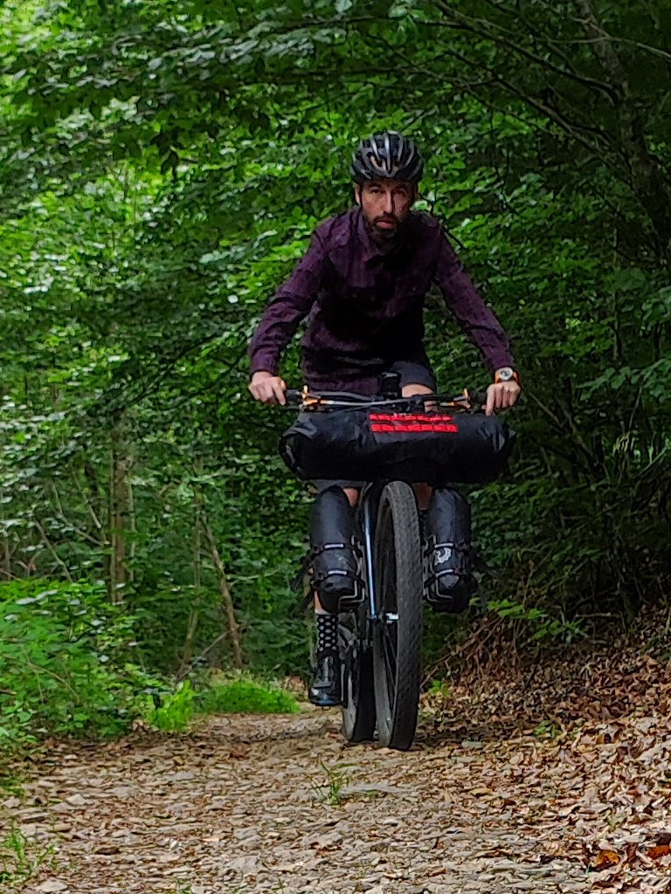
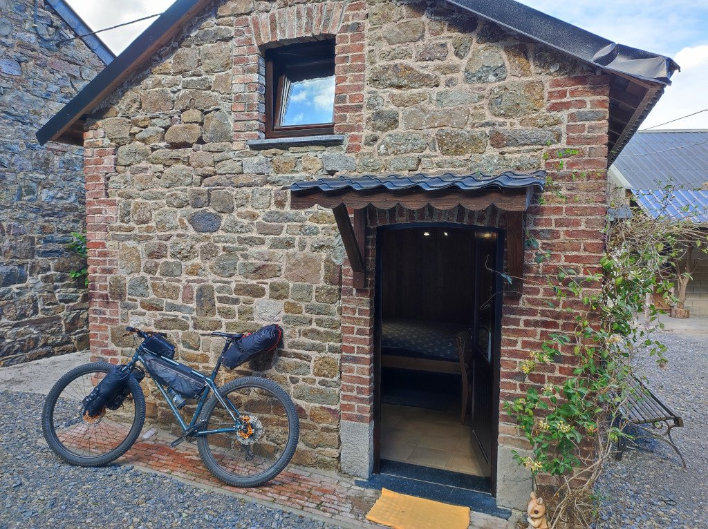
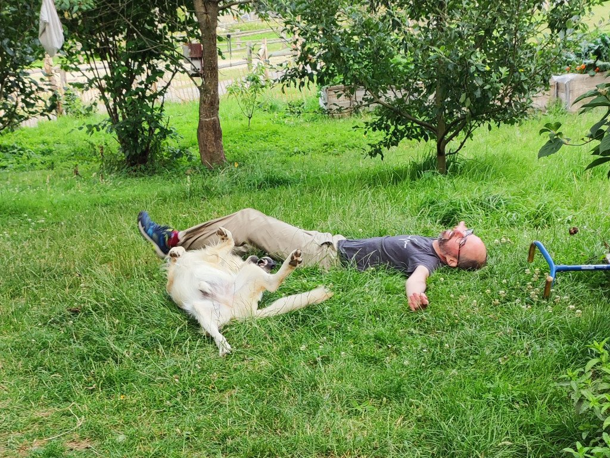

El siguiente fue el peor día de todos, sobre todo en el inicio. Me desperté con migraña. No terrible, porque no me habría dejado continuar, pero sí bastante fuerte. Demasiado tarde para tomar algún medicamento. Desmonté la tienda con pocas ganas y bajé al pueblo, donde traté de desayunar algo. A duras penas me metí un café y medio croissant, ya que a mis migrañas les suelen acompañar las náuseas, e intenté continuar. A pesar de todo, aún me quedaron ganas de sacar algunas (pocas) fotos.

Por fortuna la migraña fue remitiendo poco a poco hasta desaparecer, lo que me permitió disfrutar de la ruta. Las fuerzas estaban justas, pero pude llegar a destino. Y en este caso, el destino mereció la pena.

Finalmente pude disfrutar de la hospitalidad de la familia francesa dueña de este alojamiento, de su comida (tremendo desayuno) e incluso jugar hasta caer agotado (literalmente) con su perro. Un cachorro que, sin duda, tenía más energía que yo.

