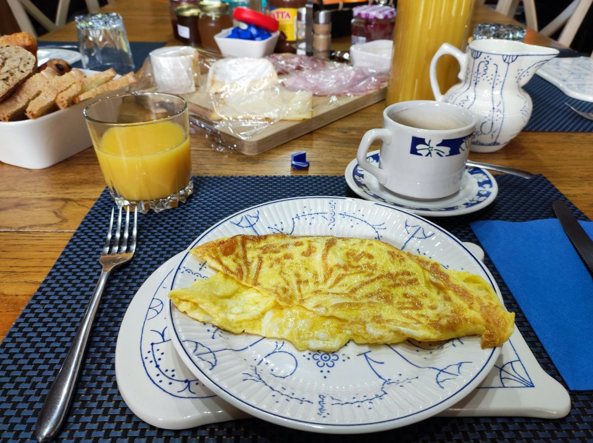
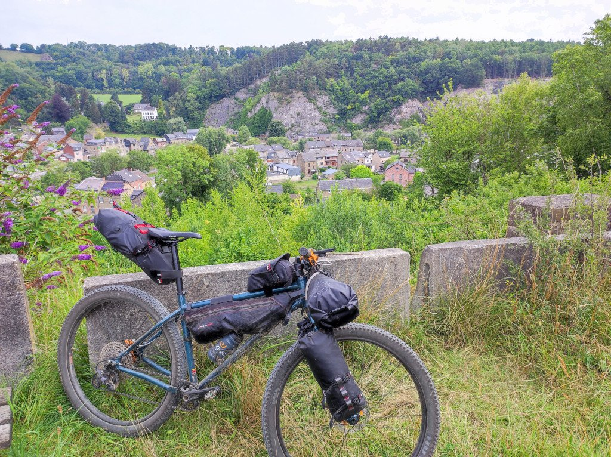
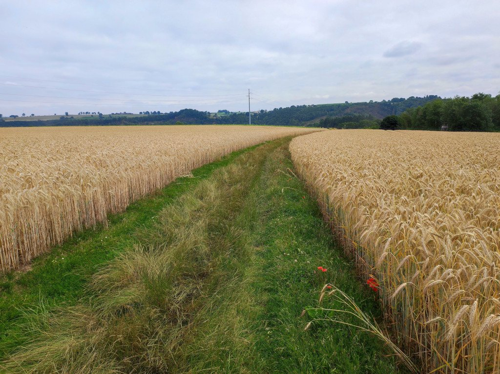
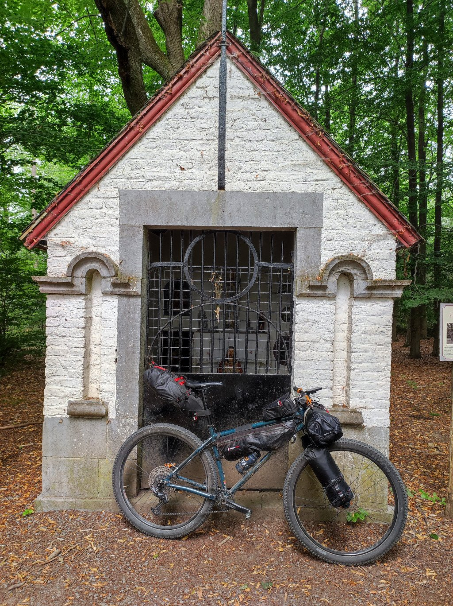

Como ya comenté en la entrada anterior, la hospitalidad del alojamiento era casi insuperable. Y el desayuno... en fin, os dejo una muestra.

Menos de 60 kilómetros me separaban de Lieja. Esta sería la última etapa, sencilla a priori, que me llevaría de nuevo al punto de partida. Así me quedaría un día tranquilo para visitar la ciudad, antes de volver a casa. Durante el camino de vuelta atravesé varios pueblos.

Me sorprendió ver plantaciones de trigo como esta. Pensaba que una zona tan húmeda no sería la más adecuada para el cereal... pero al parecer, me equivocaba. Es algo que no estoy acostumbrado a ver y, la verdad, muy divertido de atravesar.

No hubo mucho digno de mención en esta etapa. Caminos, pueblos, y poco más.

Hasta que ya casi al final, cuando estaba a pocos kilómetros de Lieja, me metí en un sendero al lado del río que al principio era divertido, después estaba un poco cerrado, más tarde había algún árbol atravesado... poco a poco me fui metiendo en un lío, pensando que ya era demasiado tarde para dar la vuelta porque me quedaba poco para llegar al final. Y en parte era cierto, quedaba poca distancia. Lo que no sabía era lo mucho que me iba a costar esa pequeña distancia. Sin duda debería haber dado la vuelta, es fácil saberlo ahora. Pero allí, no veía más salida que avanzar. Superado el que consideraba el punto de <em>no retorno</em> escalé una pila de troncos pensando que ya era el final del camino. Pero me equivoqué. Un enorme derrumbe a continuación me cortaba el paso. Acabé escalando derrumbe arriba para sortear otra pila de troncos y arrastrarme nuevamente derrumbe abajo de forma totalmente desesperada, llegando incluso a pensar que tendría que abandonar allí la bicicleta para poder salir. Finalmente vislumbré, tras una nueva pila de troncos, una casa. Sólo quedaba escalar una última vez y conseguí salir de allí. Sucio, magullado y muy cansado. Pero pude salir.

Finalmente, sólo restaba un sencillo carril bici hasta Lieja para finalizar esta bonita ruta por las Ardenas. Belgica, ¡volveré!
