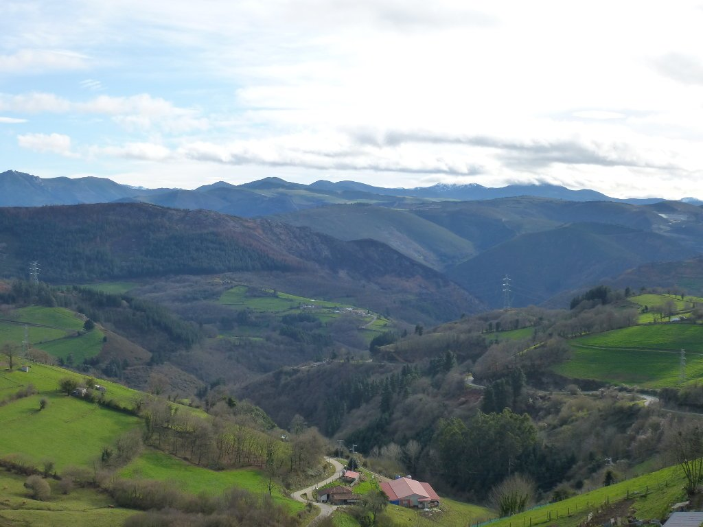
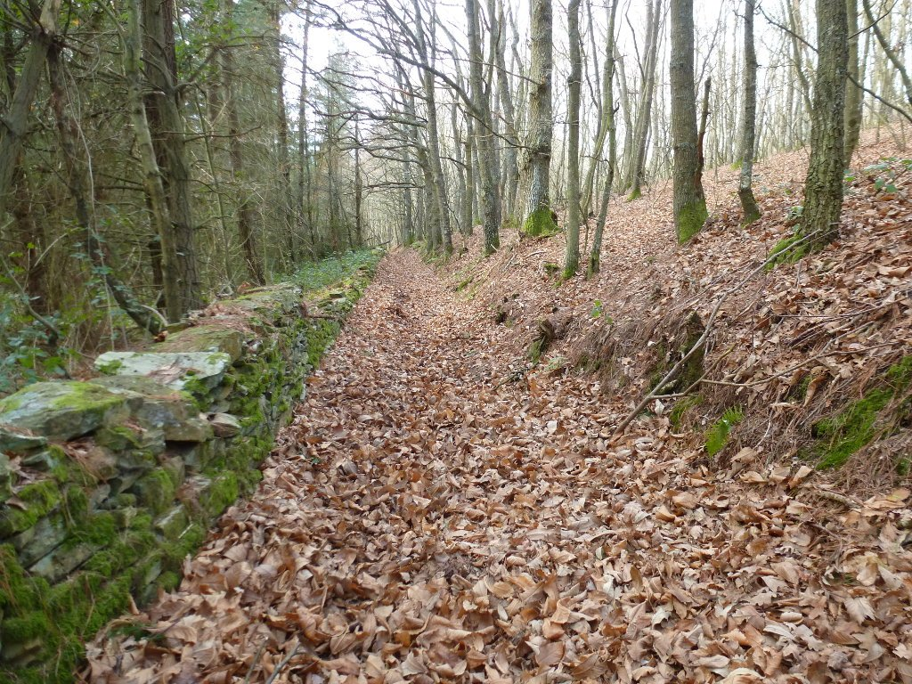
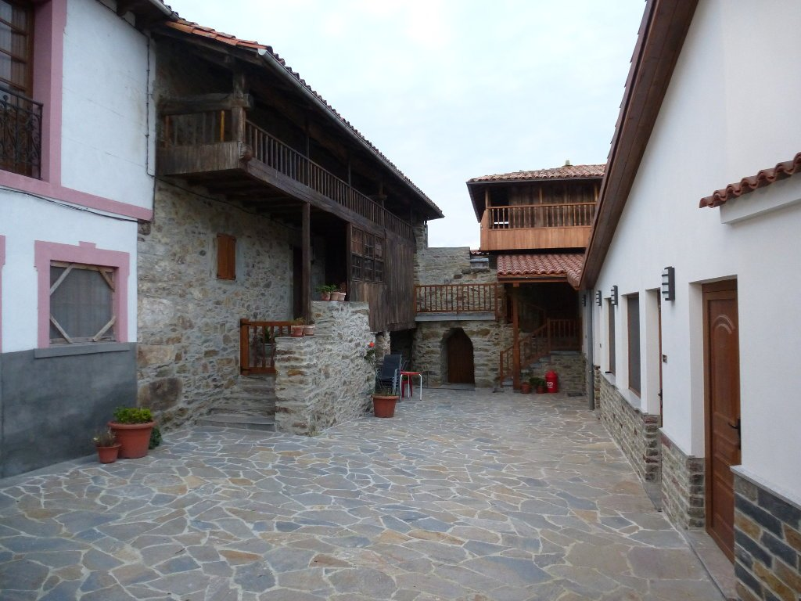

Parece extraño que, viviendo en una ciudad de paso del Camino de Santiago, nunca me haya animado a hacerlo... pero así es. Aprovechando el invierno tan suave que estamos teniendo, escogí unos días a principios de febrero y me animé a hacerlo. Esta época del año te permite hacer el camino sin agobios en los albergues de peregrinos.

Siendo de Oviedo, lo más lógico parecía empezar desde aquí y realizar el camino primitivo. He planificado cuatro etapas, veremos si es posible cumplirlas. En esta primera etapa mi padre decidió acompañarme unos kilómetros. Son las 9 de la mañana y sopla un viento bochornoso que presagia agua. El camino que nos lleva a Grado siempre me ha encantado, hace mucho que no lo hago y hoy lo disfruto como un niño. Las nubes se disipan y sale el sol, un sol que calienta con ganas, sobre todo pensando en la época del año en que nos encontramos. Disfrutamos de unos bonitos senderos hasta la primera parada, en Grado, donde quitamos ropa como locos. Nos sobra todo, empiezo a pensar que no habría estado mal traer ropa corta.

Nos despedimos, mi padre se vuelve para Oviedo y yo sigo viaje en solitario. Subo la Cabruñana con un tremendo calor. Me sobran las botas de invierno y el pantalón largo, pero es lo que hay. No puedo cargar con ropa de invierno y de verano si no quiero ir con exceso de equipaje y, a decir verdad, ni me lo había planteado. La subida es dura, por asfalto pero muy empinada. Una vez arriba, bajo rápidamente hasta La Doriga y, en Cornellana, hago otra parada para reponer fuerzas. Hay que subir La Espina y esto ya es serio, es la primera subida dura de verdad y los kilómetros del día se empiezan a notar. Salgo por un precioso camino, duro, roto y húmedo. Tengo que bajarme a empujar un par de veces.

Salgo a la carretera y vuelvo a coger otro camino, embarrado al principio y seco después de unos cientos de metros. Desde ahí, carretera hasta Tineo. Y vaya cómo se pega. Sopla un viento en contra muy fuerte y avanzo muy despacio. Hago una parada en Tineo a comer, el plan es ir a dormir a Campiello. Salgo de Tineo evitando el camino, se desvía por un monte muy empinado y ya voy escaso de fuerzas, sólo me desvío de la carretera cuando el camino es claramente descendente. En uno de estos desvíos me meto en una especie de carril de bobsleigh cubierto de hojas hasta los ejes de las ruedas, tan bonito como peligroso dado lo desigual del terreno.

Adelanto a un peregrino, el único que he visto en todo el día, y llego a Campiello. El albergue Rodrigo es muy bonito y confortable, y lo tengo todo para mí solo. Un poco frío por la noche tal vez, pero no me impide dormir como un lirón. Mañana, más.

