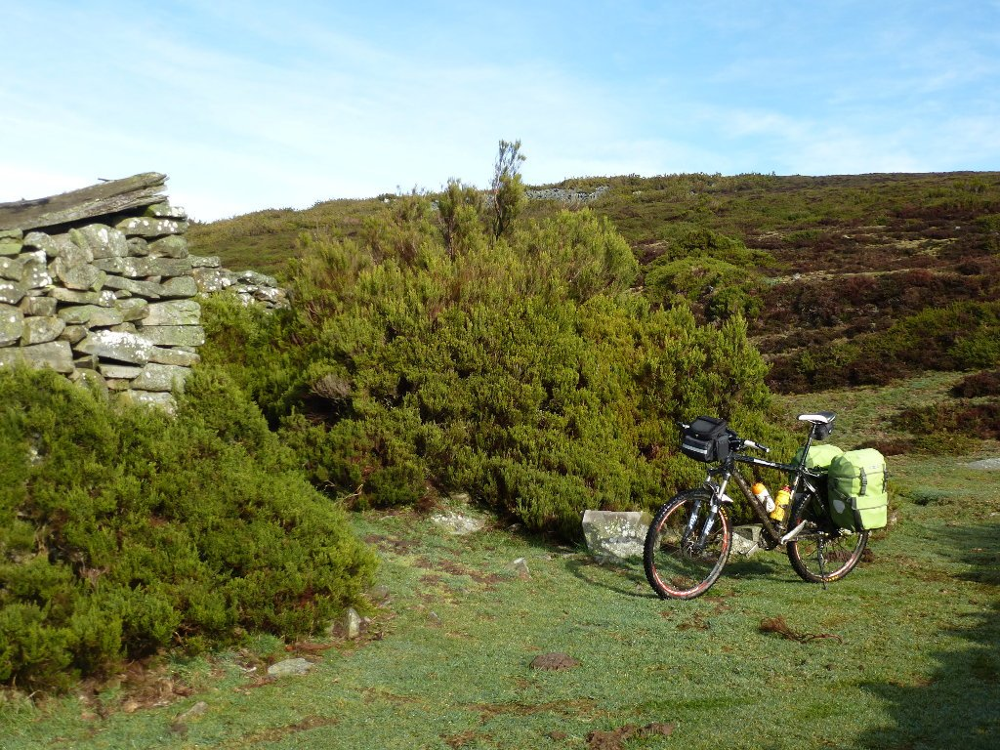
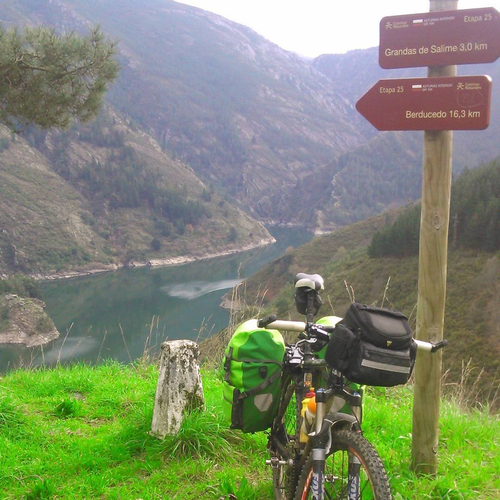

Puntualmente, a las 9 de la mañana, salgo de Campiello. La mañana es muy fría, así que salgo con toda la ropa. Pero antes de salir paso a despedirme de los dueños del albergue, a los que les suelto una mentira piadosa para que no se queden preocupados.
<blockquote>Tranquilos, voy a bajar a Pola de Allande y subir el puerto del Palo, no voy a subir por Hospitales</blockquote>
Mentira. Me han hablado muy bien de la variante de Hospitales y tengo intención de utilizarla. No hay nieve, no hay niebla... y la subida me vendrá bien para entrar en calor. En Borres me desvío a la derecha y cojo esta preciosa ruta. Esto me evita bajar a Pola de Allande y tener que subir el puerto del Palo, en su lugar me mantengo en altura para coronar desde lo alto. Pero el hecho de mantenerse en altura no lo hace más fácil. Las subidas son duras, de hecho son tan duras que algunas son imposibles de hacer con las alforjas. En una ocasión, ni empujando la bici soy capaz de subir, por lo que tengo que quitar las alforjas, subir la bici sin las alforjas y, una vez arriba, bajar a por ellas. No obstante, la ruta merece la pena. Las vistas son impresionantes.

Una vez coronado el puerto del Palo, empieza la bajada. La niebla es densa, así que me abrigo bien y me dejo caer. Rápidamente llego a Berducedo, donde puedo comer algo. Pido un pincho de jamón y me traen un bocata enorme, creo que me vendrá bien llenar la barriga. Berducedo es un pequeño pueblo situado justo al inicio de la bajada a la presa de Grandas de Salime. Desde aquí hay un camino que baja hasta la presa, pero veo que el tiempo se me echa encima. La variante de Hospitales me ha llevado mucho tiempo y aún tengo que subir hasta Fonsagrada, así que opto por seguir por la carretera. Bajo a la presa y comienzo la subida.

La subida es dura y larga. Parece que termina en Grandas de Salime, pero no. Sigo ganando metros y haciendo kilómetros por carretera y finalmente llego a Fonsagrada. Me he ganado una buena ración de pulpo, ¿no?
