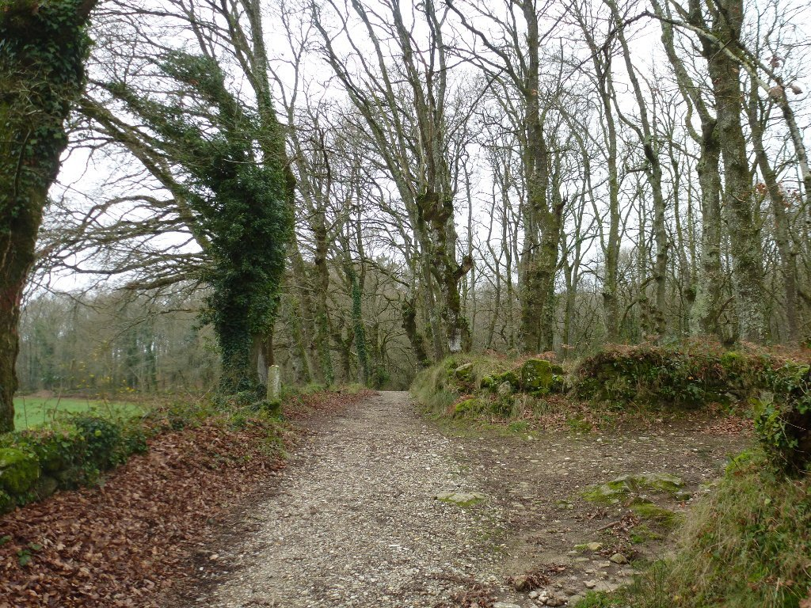
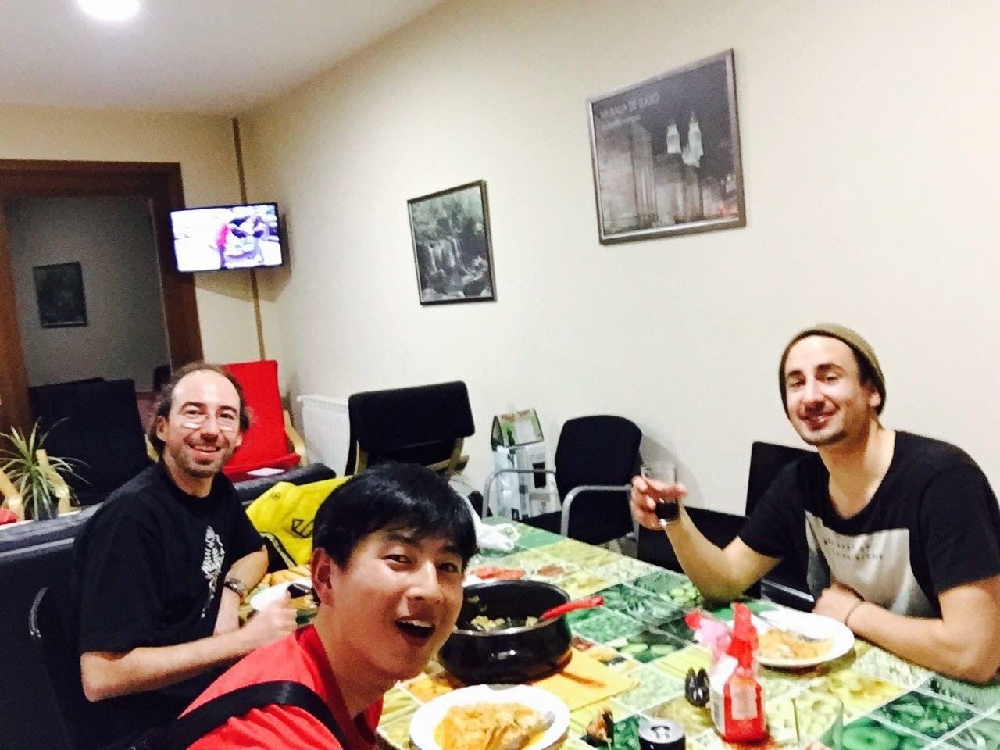

Nuevamente, a las 9 de la mañana salgo puntualmente de Fonsagrada. Y me cuesta arrancar. He pasado muy buena noche en un albergue genial, y la mañana es fría y húmeda. Estamos casi a 1.000m y la densa niebla hace que el simple acto de moverse te haga acabar mojado. Pero la etapa de hoy será larga, quiero hacer una buena tirada para acercarme lo más posible a Santiago. Mañana quiero llegar a Santiago, cuanto antes mejor, así que cuanto más cerca me encuentre menos tardaré en llegar.

Así pues, arranco por la mañana sin dilación, intentando hacer kilómetros. Empiezo por un sube-baja de carretera, esquivando los caminos. El primer camino que he pisado estaba muy embarrado, si continúo por ahí voy a ir muy despacio. Creo que lo mejor será mantenerme por la carretera hasta perder altura y meterme en caminos más firmes.

Finalmente voy perdiendo altura y los caminos son mucho más transitables. Entro en una zona de caminos de piedra con muy buen firme y muy, muy bonitos, por los que es fácil pedalear y disfruto como un niño. Está siendo una de las partes del camino más divertidas para rodar con las alforjas.

Estos caminos me acercan a Lugo, una ciudad que me gusta mucho y tengo ganas de volver a visitar. Además, en el centro de la ciudad hay una quesería especializada, <a href="http://www.queixeriaprazadocampo.es/">Queixería Praza do Campo</a>, en la que tengo intención de pararme a hacer unas compras. Una vez localizada, hago mis compras y aprovecho para comer algo.

El día es frío y la parada me afecta, se me mete el frío en el cuerpo y, unido a la paliza, me deja un poco tocado. Creo que se me nota en la cara porque allí donde paro a comer un pincho me ceban literalmente, dándome varios pinchos de esos que vienen gratis con la consumición. Se lo agradezco un montón de veces y arranco rápidamente dirección Melide, quedan muchos kilómetros y pocas horas de luz, no puedo pararme demasiado. Pero ya sabemos que la prisas no son buenas consejeras.

Para quien no conozca Lugo le diré que está en lo alto de una colina. Con las prisas, bajo la colina... por donde no es, dirección a Fonsagrada. Con el cabreo en el cuerpo vuelvo a subir la colina para tomar la dirección correcta, y aprieto bien para tratar de entrar en calor.

Y voy entrando en calor, al menos todo lo que me deja la intensa humedad de este día. Me centro en pedalear, si quiero llegar de día no me puedo despistar, así que no paro a sacar fotos y voy comiendo sobre la marcha. Lo que sobre el mapa parecía una ruta fácil se convierte en un sube-baja bastante tortuoso, aunque bonito, con una subida casi al final a una zona de molinos de central eólica. Desde aquí diviso Melide a lo lejos, así que sólo queda bajar por una bonita pista. A las 6 de la tarde llego a un confortable albergue donde por fin puedo quitarme la ropa húmeda y darme una ducha.

Tras salir a comer y comprar algo, vuelvo al albergue donde dos caminantes, un coreano y un suizo, me invitan a cenar. El coreano ha preparado pasta con marisco a su estilo (picante como el infierno) y yo aprovecho para sacar los quesos comprados en Lugo para corresponder con la invitación. Una cena inesperada en un magnífico día.

