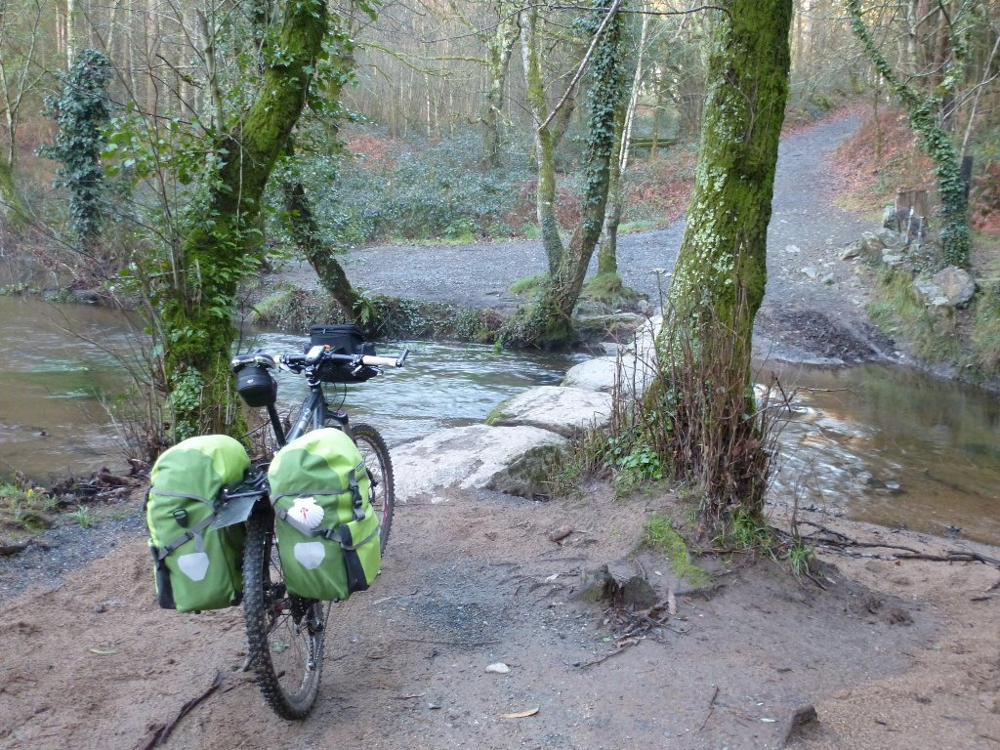
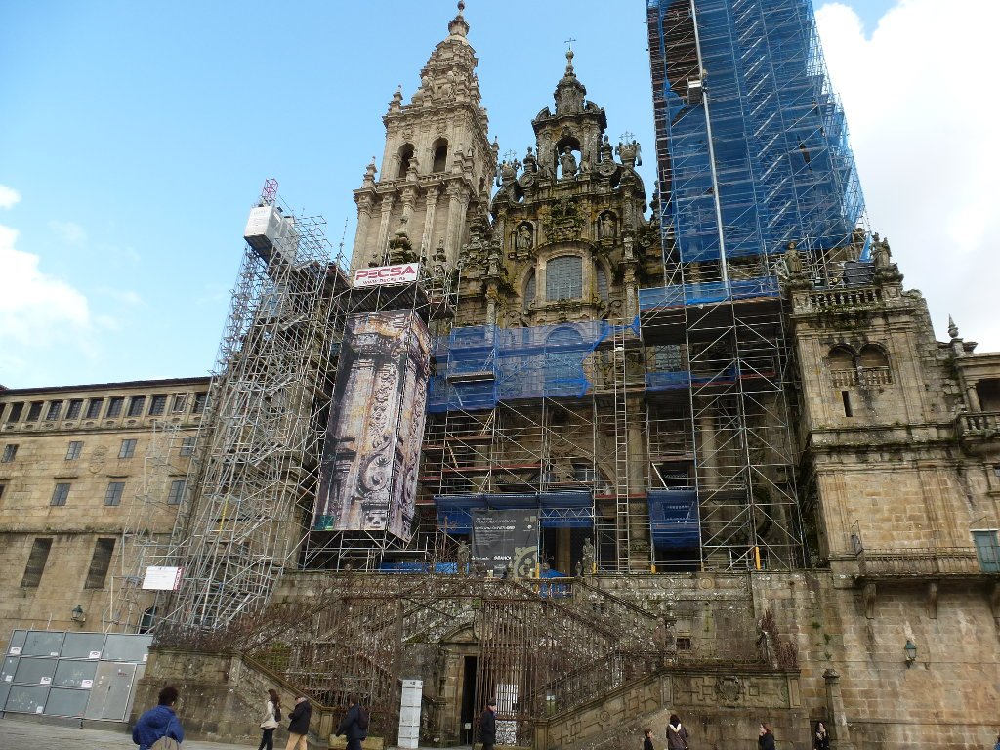
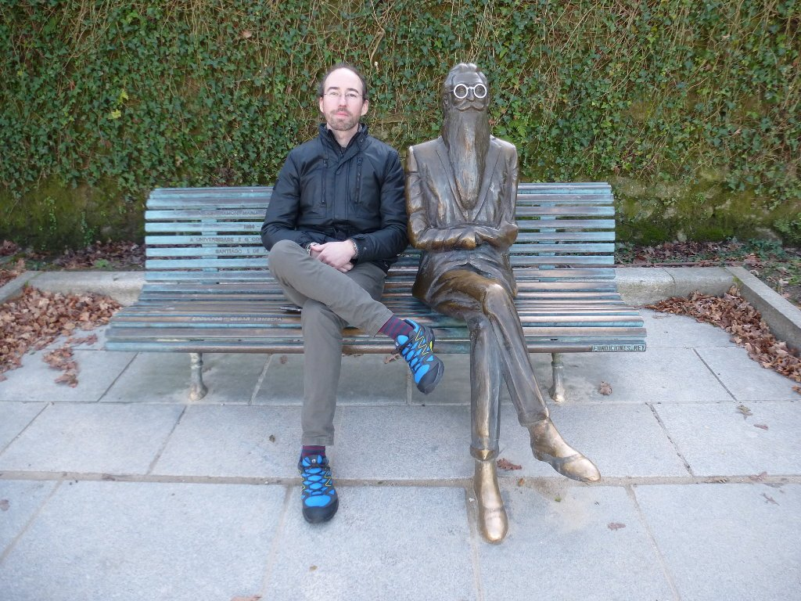

Tras la gran cena de ayer y un buen descanso, me lanzo al alba dirección a Santiago de Compostela. La idea es llegar lo antes posible, así que pedaleo con ganas y me paro lo justo. Pocos kilómetros me separan ya de mi destino, 55 kilómetros que pasarán volando.

Ahora ya, coincidiendo con el Camino Francés, me encuentro gente a cada poco. El Camino Primitivo es menos transitado, y en esta época del año, menos aún. El frío, la lluvia y la dureza echan para atrás, pero el Francés es otra historia. A cada poco me encuentro con un grupo de peregrinos y ya no tengo esa sensación de soledad del Primitivo.

La mañana es fría pero soleada, pronto el sol empieza a calentar y tan sólo las zonas sombrías de bosque me recuerdan que estamos en invierno.

Los caminos son sencillos y bonitos hasta unos pocos kilómetros de Santiago de Compostela, donde las pequeñas carreteras se hacen constantes. Y así, casi sin darme cuenta, llego a Santiago.

Mi primer camino ha terminado. Sólo queda disfrutarlo con marisco y Ribeiro, que para algo estamos en Galicia. Han sido cuatro días, fríos y duros, pero muy, muy bonitos.

