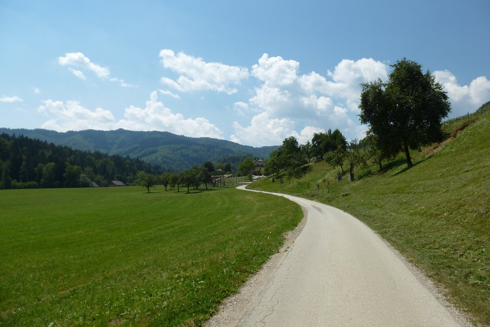
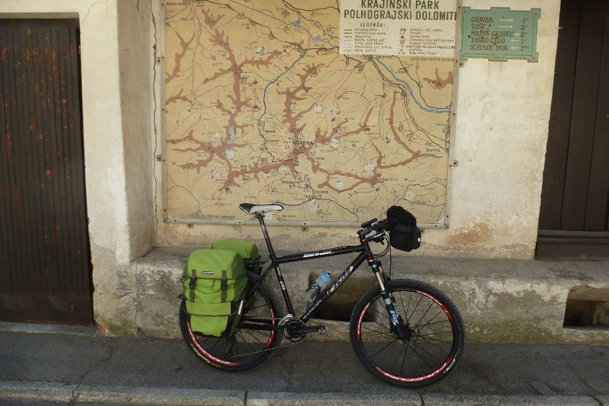
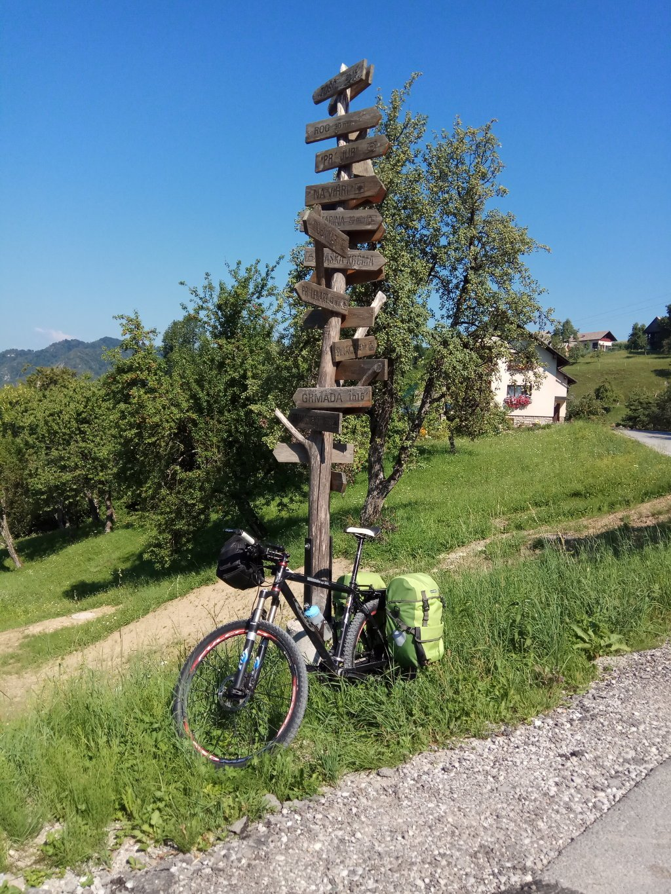
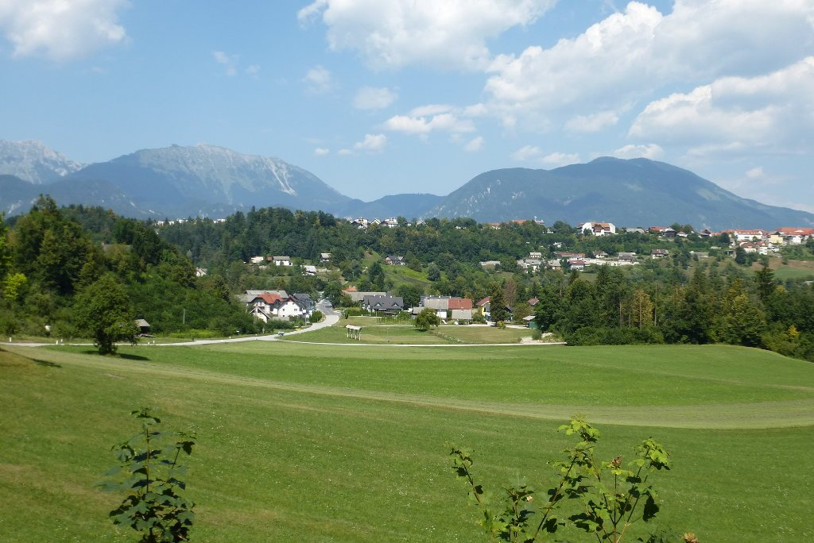
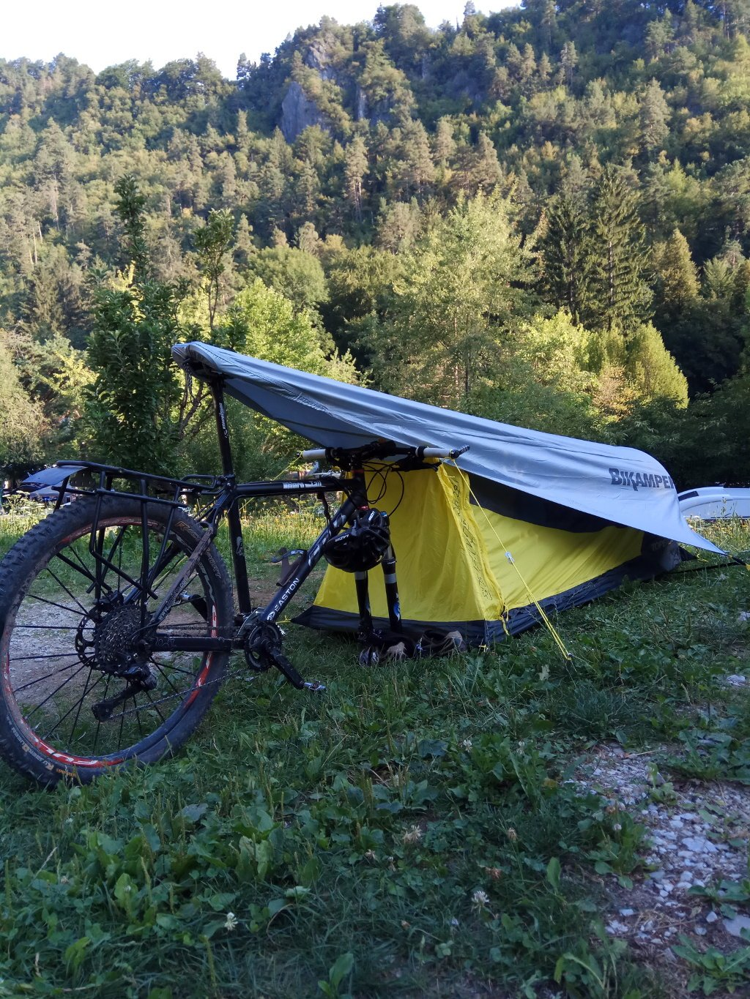

Primer día, toma de contacto con mi nuevo viaje en solitario por Eslovenia. El plan para hoy es viajar tranquilo. La distancia es corta y el perfil no parece demasiado abrupto, así que pedalearé con calma hasta el lago. Como llegaré con tiempo. la idea es visitar el entorno del lago para, más tarde, buscar dónde dormir.

Rápidamente cojo un carril bici que, aunque confuso en ciertos momentos, me saca de Ljubliana de forma segura, sin juntarme demasiado con el tráfico. Estos carriles bici se agradecen, puedes moverte por la ciudad siguiendo las calles más directas y rápidas, pero sin mezclarte con el tráfico.

Una vez fuera de la ciudad, el nivel de tráfico desciende al mínimo. Me cruzo con algún coche de cuando en cuando, eso es todo. Eso sí, la carretera se va poniendo dura y empiezan las primeras subidas fuertes. En pocos kilómetros salgo de la carretera y me adentro en pistas forestales, también poco transitadas. Y así, poco a poco, paso el primer puerto. Vuelvo al valle y ya veo los montes al fondo. El paisaje es muy verde y muy, muy bonito. Dado que la etapa no es muy larga, y parece sencilla, no cojo agua en el camelback. Intento apañarme con el bidón.

Después del valle vuelvo a las pistas forestales y empieza la odisea. La vegetación cierra el camino totalmente, es imposible pasar. Me voy desviando por otros caminos por los que sí se puede pasar durante un rato, pero se cierran más adelante. Intento alejarme lo menos posible de la ruta principal, pero no es sencillo. A veces me encuentro a escasos 20 metros de la pista principal, pero es imposible pasar. Y llegar a la pista principal tampoco me garantiza nada, porque la cruzo en algunos tramos y está totalmente bloqueada. Todo esto, unido al peso y al volumen de las alforjas, hace que avance muy despacio.

Sin darme cuenta van pasando las horas, me quedo sin agua y empiezo a pensar que la mejor idea habría sido dar la vuelta.

De repente, se abre un claro en el bosque y llego a una casa. Bien, al menos podré conseguir agua. Allí vive una señora que no habla ni una palabra de inglés, y sobra decir que yo no hablo esloveno, con lo que me explico como puedo y me da agua suficiente para el resto del día. Compruebo que el camino que lleva hasta la casa baja al valle contrario al que yo quiero ir, parece que la mejor opción es seguir adelante. ¡Pues adelante!

Aún me quedaba otra hora de más de lo mismo. Al fin, la vegetación se abre y llego a un camino. Después carretera, coches... y Bled. Sitio turístico donde los haya, el tráfico y el bullicio contrastan con las horas de soledad que he vivido durante el día de hoy. Busco el camping, que está a la orilla del lago, y monto mi tienda. Un baño, una buena cena y a descansar, los 70 kilómetros han hecho mella, especialmente los kilómetros de empujar la bici. Mañana tendré que mirar donde me meto, tal vez la ruta que he descargado no está actualizada. Pero que no se me malinterprete: he disfrutado como un niño.

