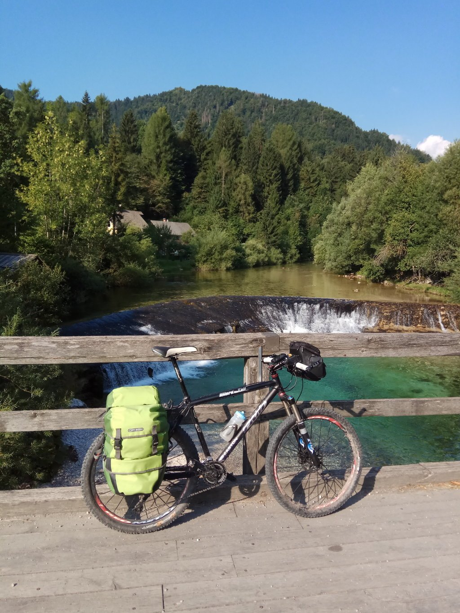
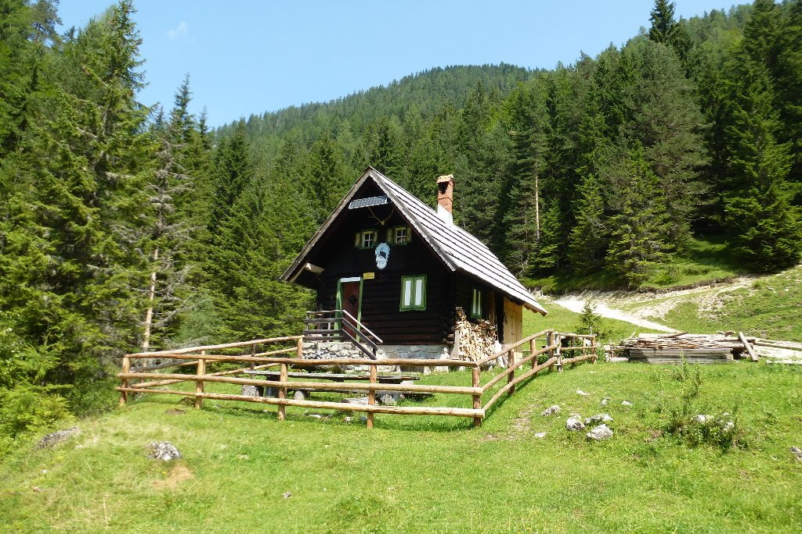
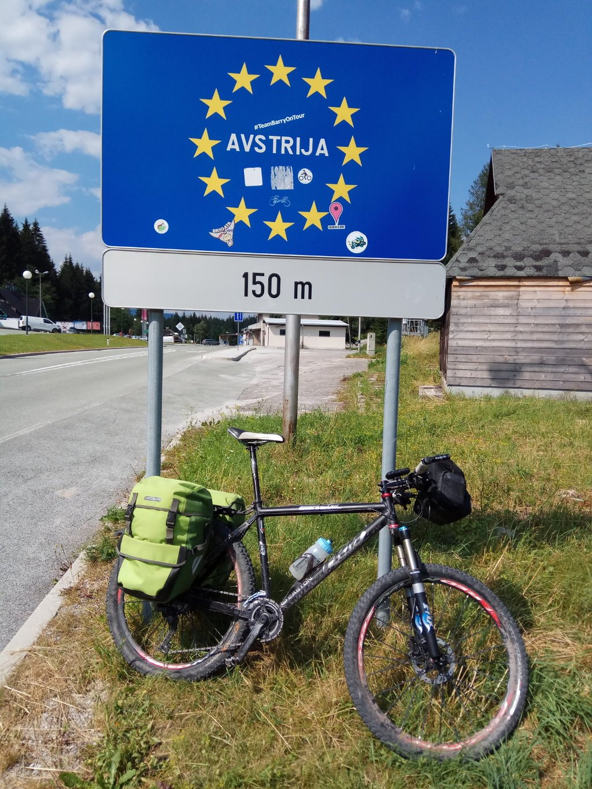

Después del tute del día anterior me propuse seriamente escapar de cualquier <em>emboscada</em> posible. Sabía que la etapa sería dura,. Me propuse cruzar a Austria y, para ello, tenía que cruzar la cadena montañosa que representa la frontera natural entre Eslovenia y Austria. El desnivel no me lo iba a quitar nadie, pero intentaría evitar en todo lo posible volver a empujar la bici. Y lo conseguí durante los primeros 35 kilómetros, en los que rodé mayoritariamente por un carril bici (sí, había kilómetros y kilómetros de carril bici) ligeramente ascendentes, pero muy sencillos. Todos ellos por un precioso valle, en el que tuve la suerte de ver el entrenamiento de verano de los esquiadores de fondo. Por desgracia, no pude sacarles una foto.

En menos de dos horas llegué a Mojstrana, un pequeño pueblo en la ladera de la montaña, donde aproveché para coger agua y tomar un café. A partir de aquí empieza la subida, que previsiblemente dura, que me llevará a lo alto de las montañas que separan Eslovenia de Austria.

Poco más adelante empieza la subida. Dura, como esperaba. Pero el firme es bueno y voy ganando altura a buen ritmo. Empiezo en 750 metros por una pista ancha con firme irregular. me lo tomo con calma, no tengo ninguna prisa y el calor aprieta de lo lindo. La pendiente es muy pronunciada, me alegro mucho de haber cambiado los desarrollos para este viaje y disponer de un piñón tan grande. No lo quitaré en unas horas.

La pista está cada vez más rota, y la pendiente sigue en aumento. Los kilómetros pasan, y las horas también. Eso sí, la subida es bonita y, de vez en cuando, te encuentras con algo de civilización.

La pista ya se pone imposible, entre la cantidad de piedra y el peso de las alforjas, es imposible subir montado. Paro a comer algo y sigo empujando. Justo lo que no quería hacer, empujar. Pero ya queda poco, esto se tiene que acabar en breves...

Pero no es así. La pista se acaba y empiezo el monte a través. Sigo empujando la bici y esto parece que no termina nunca. Tras dos horas y mil metros de desnivel, me rindo. Este paso es evitable, y una ligera vuelta por la carretera me llevará a destino. Me duele rendirme, pero esto es un sinsentido. La posición del equipaje hace complicado empujar la bicicleta, y pesa demasiado como para hacerlo durante horas. Me duele todo, así que doy la vuelta.

Durante la bajada me encuentro con dos daneses que pretenden hacer la misma ruta que intentaba hacer yo. Ellos van más ligeros de equipaje (y son más jóvenes, que también es importante) pero que también están cansados de empujar la bici. Les informo de lo que queda, al menos de lo que yo he visto, pero de momento deciden seguir.

Yo sigo bajando y llego a la carretera. Avanzo dirección al puerto que me llevará a Austria, y paro en un bar a cargar agua. El calor aprieta muchísimo y no paro de beber, de hecho ya me voy sintiendo encharcado. El alquitrán de la carretera se va haciendo pegajoso, se nota el calor que desprende y apenas se mueve el aire. ¡Comienza puerto!

He de reconocer que no saqué ninguna foto de la subida. Muy dura, con un desnivel constante del 18% y mucho calor. Eso, sumado a la paliza del día, hizo que no me hiciese mucha gracia el puñetero puerto. Pero todo es cuestión de constancia, y finalmente llegué a la cima. Y sí, me hizo ilusión cruzar la frontera en bicicleta.

La bajada hacia Austria tiene un desnivel brutal. En 5 minutos perdí 500 metros que tanto me había costado ganar. Antes de llegar abajo ya había decidido que mañana no iba a subir por aquí. Aún no sabía qué iba a hacer, pero ya tenía claro qué no iba a hacer.

Desde ahí, aún me quedaban unos 15 kilómetros de carretera hasta el camping donde tenía pensado acampar. Pero lo cierto es que me duele todo, y sólo pensar en tener que montar la tienda de campaña y dormir en el suelo se me hace muy duro.

De camino al camping paso por un hotel y no me lo pienso dos veces. Hoy, hotel y cama. Finkenstein será mi final de etapa improvisado. 75 kilómetros con más de 2.000 metros de desnivel han acabado conmigo, especialmente las zonas en las que he tenido que empujar la bici.

Ducha y cena. Mañana será otro día.
