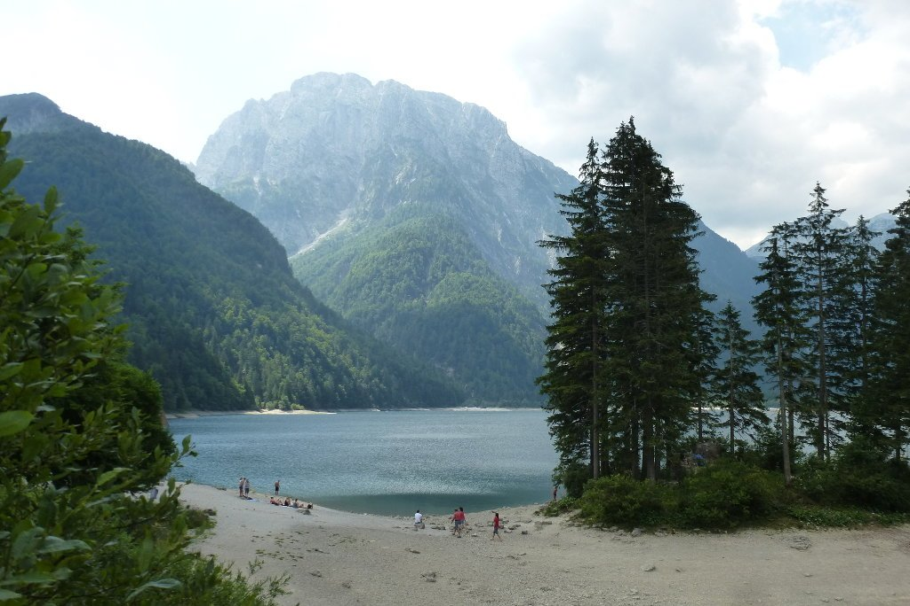
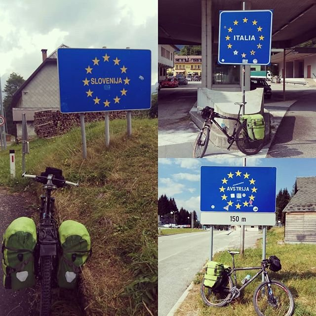
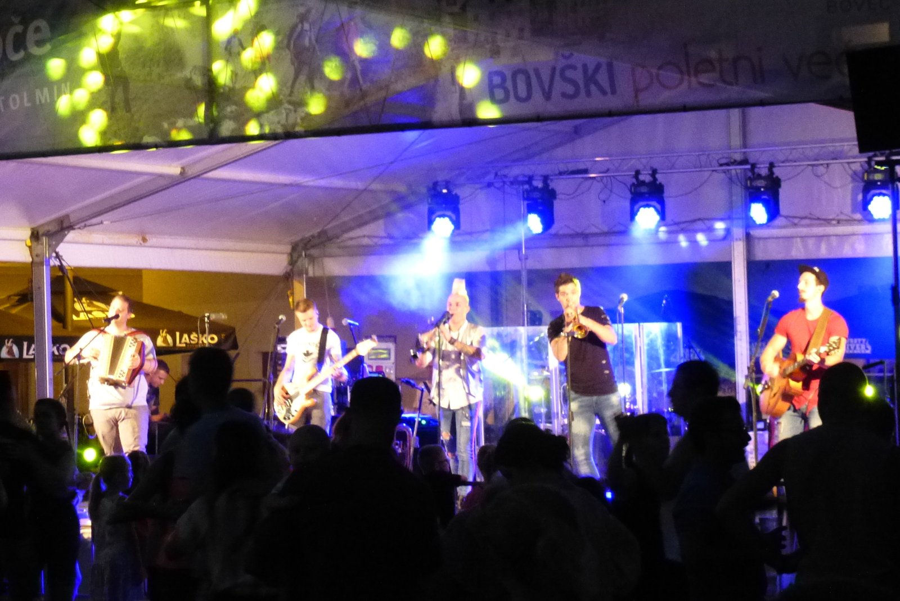
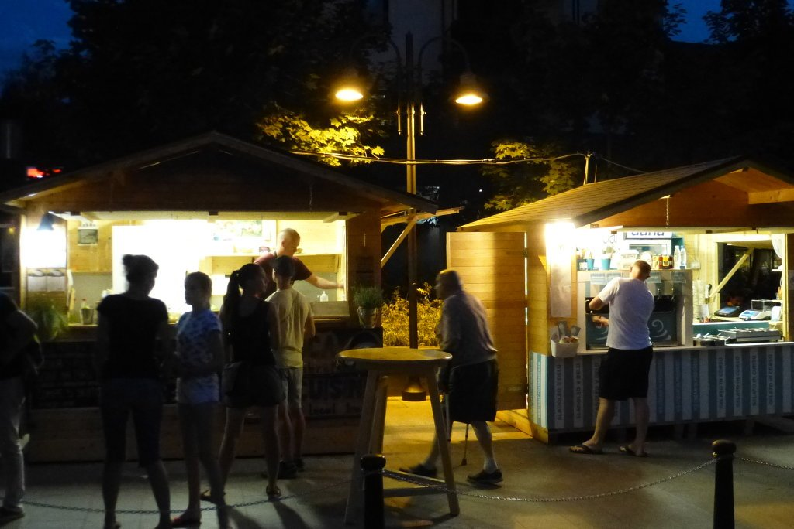

Dormir en un hotel ha sido una buena idea. Aunque el colchón y el saco de dormir son confortables, nada como una buena cama para recuperar fuerzas. Y como no, cargar el depósito. El desayuno del Gasthoh Feichter es fantástico. Lo cierto es que es un alojamiento poco habitual para cuando viajo. Pero vaya, un día es un día.

Lo que no voy a hacer es seguir la ruta original. El día de ayer fue muy duro y me pasó factura, pero no quiero acortar la ruta, así que buscaré algún atajo. Pregunto en la recepción del hotel por la forma más rápida y sencilla de llegar a Bovec, la cual me llevará por Italia hasta Tarvisio antes de volver a Eslovenia.

Al poco de salir del hotel entro en un carril bici. Salgo de Austria y entro en Italia por el Coccau Valico, utilizando aún el carril bici. Hay kilómetros y kilómetros de este tipo de vías, muy alejadas del tráfico y muy cuidadas. Todo un lujo.

Paso por Tarvisio en mi vuelta a Eslovenia y subo el Paso del Predil, un bonito puerto de montaña junto a un lago.

Me paso el día cruzando fronteras (lo que me hace cierta ilusión, no lo voy a negar), y en poco más de tres horas he llegado a destino.

Hoy he pedaleado durante poco más de 55 kilómetros y mil metros de desnivel, todo por carretera. Un día tranquilo y relajado para recuperar fuerzas y disfrutar de la etapa de mañana. Será dura, sobre todo en su primera parte.

Bovec es el centro turístico para actividades deportivas de la zona. Creo que podrías pasar una semana entera, realizando actividades diariamente, sin repetir deporte. He llegado bastante temprano, así que tengo tiempo para conocer el pueblo y hacer algo de turismo.

La noche está muy animada y me quedo un rato a ver a la banda. Parecen ser conocidos en Eslovenia...

Pero lo cierto es que su música no me resulta muy interesante. Aprovecho el mercadillo de la zona para probar la polenta, a la que le doy un notable alto, y me voy para el camping. La música de la banda se oye perfectamente desde la cama, así que leo un rato hasta que se les acaba el repertorio. He de decir que me estoy acostando todos los días bastante temprano.

Ahora sí, estómago lleno y piernas relajadas. Mañana tendré un día intenso.

