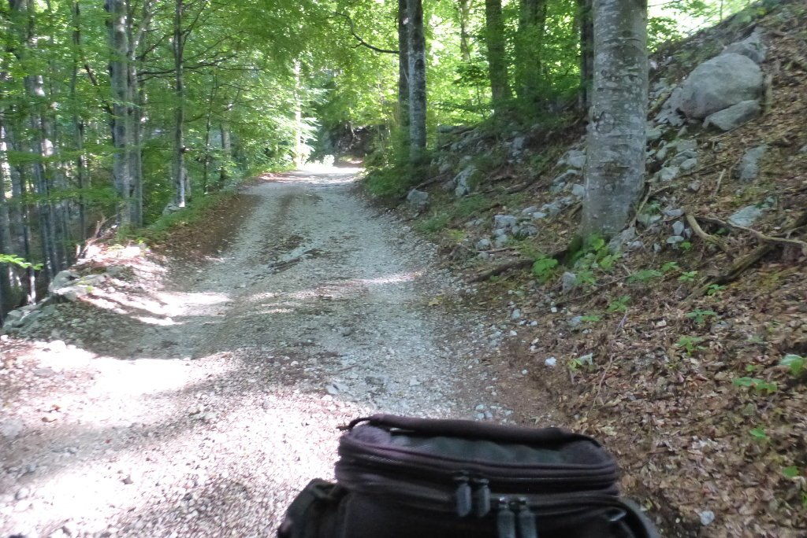
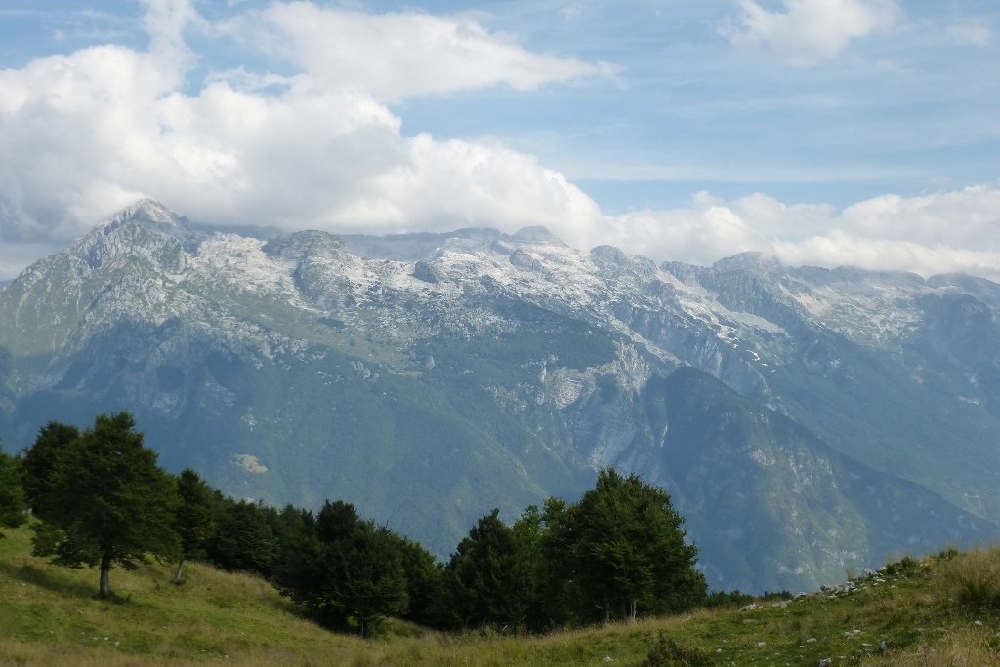
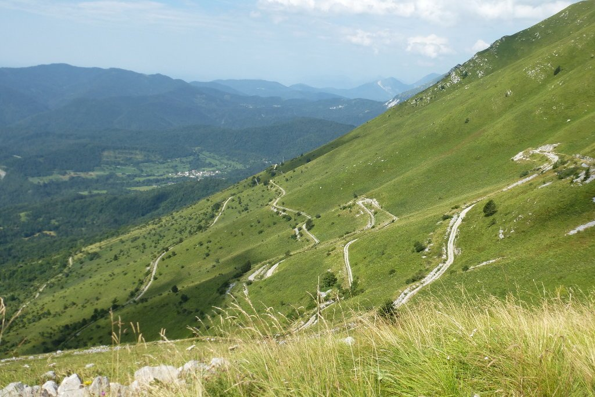
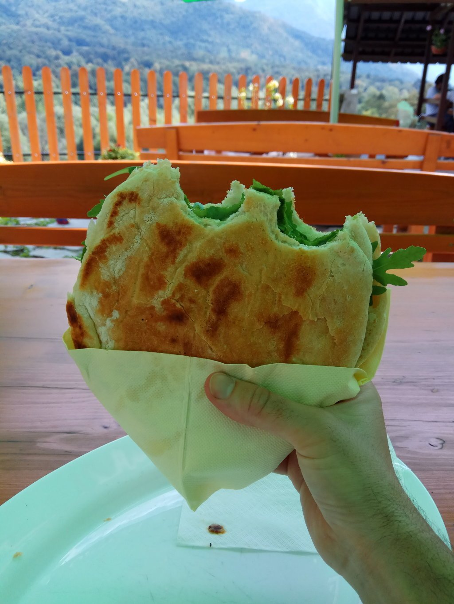
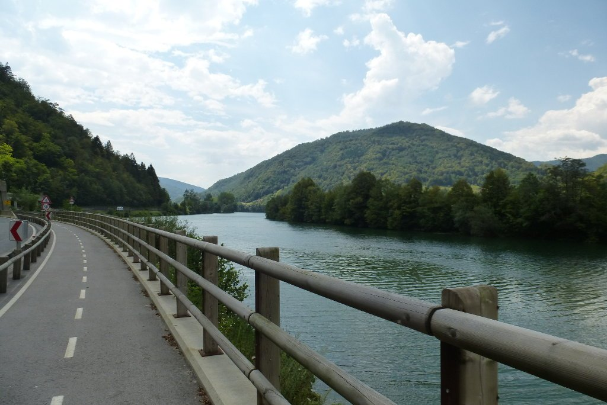

La etapa de hoy va a ser larga y el calor va a apretar, así que intento madrugar y salir al amanecer. La salida de Bovec es por carretera, cuesta abajo, y hasta tengo un poco de frío que agradezco. En menos de 10 kilómetros empiezo a subir por carretera, y poco después me desvío por una pista que debería llevarme hasta la cima del monte Stol. La pista tiene un firme desigual, pero no demasiado rota.

La pendiente no es demasiado pronunciada y, prácticamente, toda la subida la hago a la sombra. Dado que la velocidad es muy baja y no hay absolutamente nada de tráfico, me permito el lujo de subir sin casco.  Llegar a la cima me lleva casi dos horas y puedo decir que ha merecido la pena. Las vistas son espectaculares.

Me siento durante un rato a comer algo y me preparo para la bajada. He leído que la bajada del Stol es la mejor bajada de Europa. Bueno, no creo que sea para tanto... aunque sin duda, va a ser divertida. Las alforjas no me van a permitir bajar todo lo rápido que me gustaría, pero vaya, ¡no tendría mucho sentido perder mi equipaje en la bajada!

Una sucesión de <em>zetas</em> me esperan, para perder en poco tiempo los metros que tanto me ha costado ganar.

Desde ahí, mucha carretera y carril bici. Y sobre todo, mucho calor. Se nota que he perdido metros (el resto de la ruta ronda los 200 metros sobre el nivel del mar) y que estoy metido en un valle (el valle del Soča). Poco más adelante, por una carretera poco recomendable para montar en bici (mucho tráfico y sin arcén) me detengo a beber algo en un Grill-Bar de carretera. La intención era simplemente beber algo, con este calor apetece poco comer, y mucho menos meterme un trozo de carne a la parrilla. Eso mismo le digo al camarero, pero me sorprende con una pregunta: ¿qué tal una hamburguesa vegetal, con verduras a la parrilla? Creo que todos conocemos ese momento en el que tu boca empieza a segregar saliva y algo dentro de ti te dice que no puede aguantar un minuto más sin comer. Así que, tranquilamente, le digo al camarero que coja mi dinero y me traiga mi hamburguesa.

Con la panza llena sigo ruta, y el calor aprieta cada vez más. Me desvío en cuanto puedo de esta carretera para volver a otro carril bici. Sigo alucinando con la cantidad, y calidad, de estos carriles. El río está justo a mi lado, así que busco una zona tranquila para darme un chapuzón. Esperaba un agua muy fría, ya que por mucho calor que haga el agua de río suele mantener su temperatura. Pero no, lo cierto es que la temperatura es muy agradable.

Finalmente llego a Kanal, no sin antes pasar por la emboscada del día donde nuevamente me toca empujar la bici. Hoy me alojaré en un pequeño guesthouse muy confortable.

90 kilómetros con 1800 metros de desnivel, ¡nada mal! Aprovecho lo que queda de tarde para dar una vuelta por Kanal. Eso sí, ¡por la sombra!
