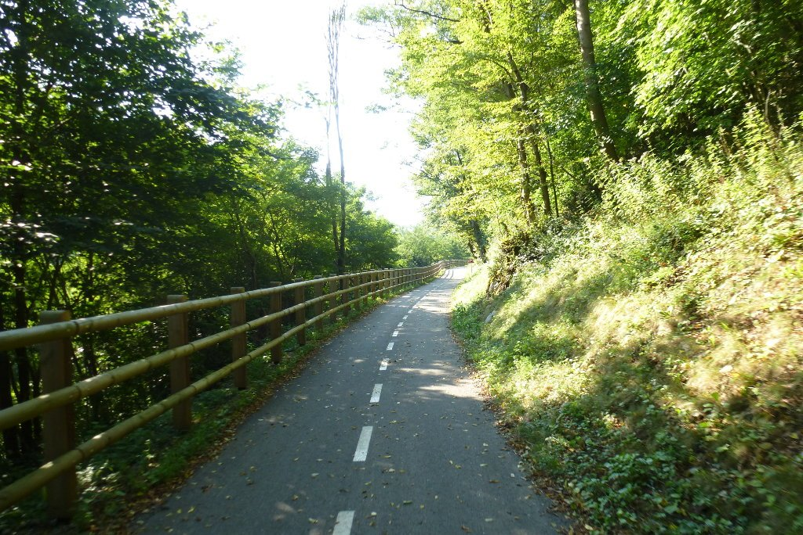
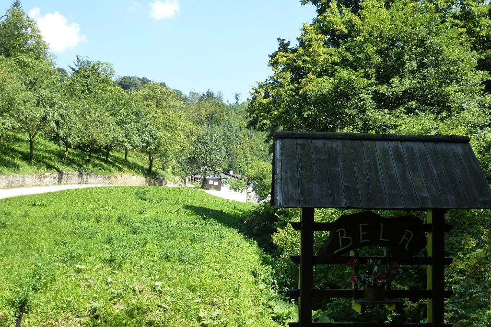

Mi intención era, al igual que el resto de días, madrugar y salir temprano. Y así lo hice, madrugué. Pero me quedé un buen rato charlando con los dueños del guesthouse. Me recomendaron que hiciese una parada a mitad de ruta para comer en una granja donde servían un buen almuerzo. Aún me duele no haberles hecho caso, pero lo cierto es que ni esa granja estaba a mitad de ruta ni me quedaba cerca, tenía que desviarme unos 10 kilómetros. Bueno, algún sitio encontraré para comer.

Nuevamente, kilómetros y kilómetros de carril bici. No dejan de impresionarme.

Hoy ha sido uno de los días donde el calor me está haciendo más daño. Prefiero el calor al frío, pero todo tiene un límite. El recorrido de hoy es un continuo sube-baja de caminos y carreteras secundarias, con una buena subida al final.

Atravesé un montón de pueblos y pequeñas ciudades, y creo que paré en todos y cada uno de los ríos que encontré para refrescarme un poco. El calor está siendo asfixiante, y las zonas de sombra no abundan en exceso. La parte final transcurre por la zona vinícola de Eslovenia, y atravieso multitud de viñedos.

Estoy llegando al final y parece que hoy no va a haber emboscada. Y no, emboscada no hubo, pero a cinco kilómetros del camping de Postojna se me colaron dos abejas en el casco, que evidentemente me picaron, dándole un poco de emoción al final del día.

Y así, tras casi 90 kilómetros, llego al camping de Postojna. Mañana, día de descanso para visitar las cuevas de Postojna y el castillo de Predjama y hacer un poco de turismo.
