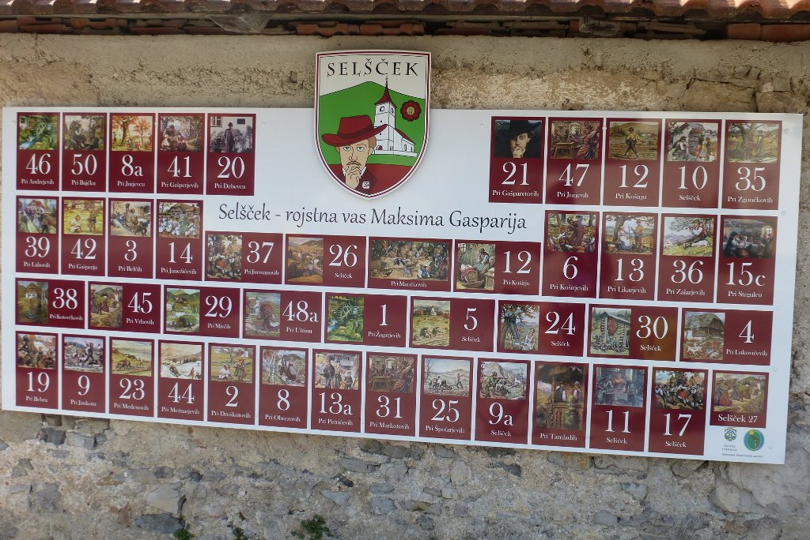
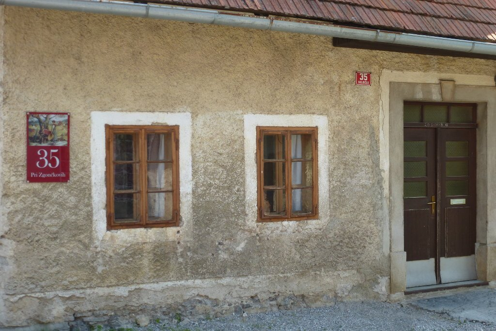
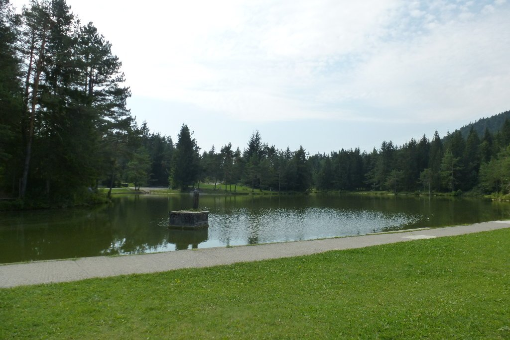
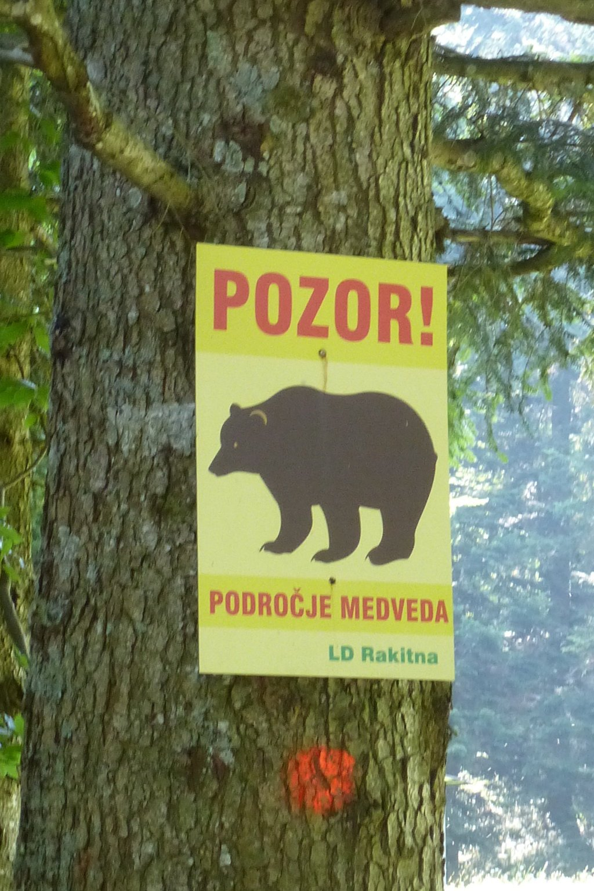
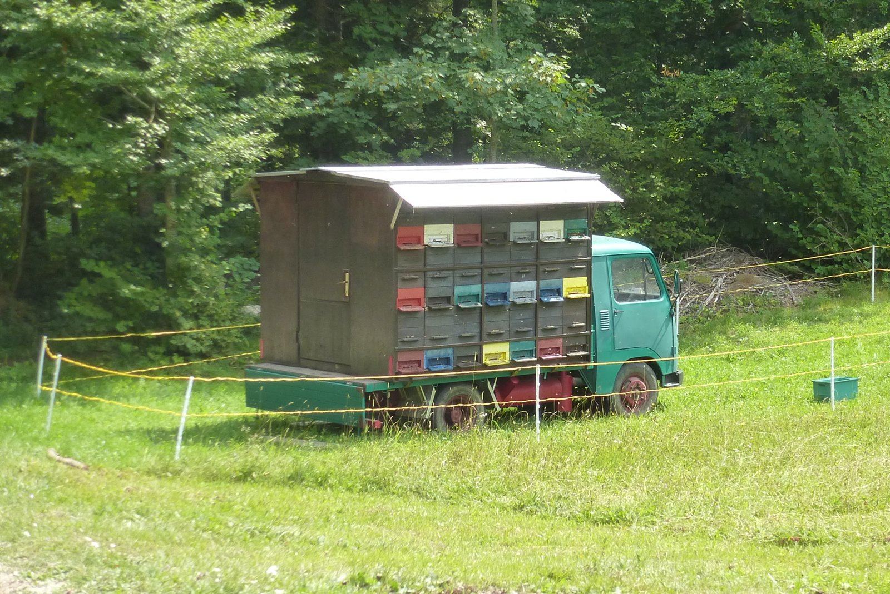
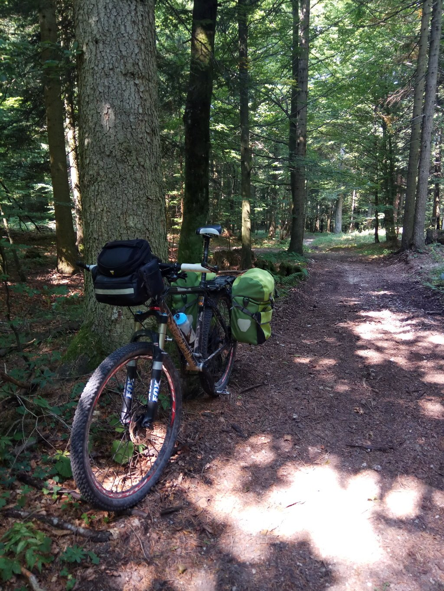
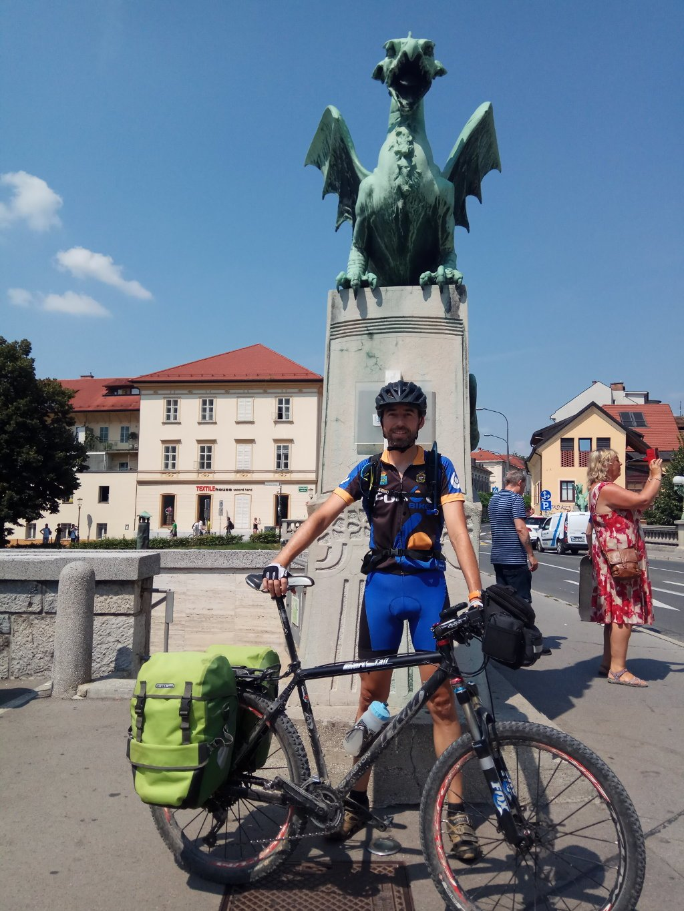

Nuevamente salgo al alba para evitar el calor. Voy a salir de la zona de viñedos para entrar de lleno en la zona de apicultura hasta llegar a Ljubljana. Durante el día de ayer me picaron dos abejas, y hoy va a ser complicado que libre otro picotazo.

Atravieso muchos pueblos muy bonitos. Hay mucha vida rural en Eslovenia y eso se nota en lo cuidados que están los pueblos y sus casas. Una muestra de ello es Selšček, donde a cada casa le correspondía un número y un nombre. A la entrada puedes consultar qué casas hay en el pueblo, con su correspondiente imagen.

Hago unos cuantos kilómetros por carretera pasando zonas de abejas. Es algo que nunca había visto, están al lado de la carretera y se me van estrellando contra el cuerpo. Por tanto, muchas se estrellarán contra los coches. Bueno, de momento voy librando las picaduras.

Llega la zona de pistas. Al poco de entrar me encuentro con este cartel. No hablo ni palabra de esloveno, pero no hay mucha duda de su significado.

No podía haber día sin emboscada. Espero no tener que escapar de un oso. Y yo que me quejaba de las abejas...

Poco más adelante me encuentro nuevamente con estos ¿panales de trashumancia? Están al lado de los caminos y esta vez no consigo evitarlas, una se me cuela en el casco y me vuelven a picar. Tengo suerte que no soy alérgico ni me afectan demasiado, así que la molestia es breve, ¡aunque intensa!

Entro en una zona de bosque donde me encuentro la emboscada del día, para variar. Vuelta a empujar la bici, y nuevamente el camino desaparece y tengo que andar tirando de GPS para buscar la ruta. Caminos cerrados y maleza son la norma. Así que, una vez que vuelvo a la pista principal, sigo por la pista sin abandonarla.

El resto del día es una sucesión de bosques, caminos y pueblos. Paro de vez en cuando a comer o beber algo, tengo tiempo de sobra y el calor vuelve a apretar. Tras 73 kilómetros llego a Ljubljana.

Ha sido una vuelta total de 450 kilómetros y 9.000 metros de desnivel. Unos paisajes excepcionales y unas emboscadas de campeonato han puesto la guinda de este pastel. Ahora, un par de días para descansar en Ljubljana, una perla por descubrir para muchos, que os recomiendo encarecidamente. Bonita, acogedora y con muchas cosas que ver y hacer.

Aún con alguna emboscada de más, un viaje que ha sido todo un acierto. ¿Que si echo de menos los paisajes africanos, los desiertos, y las zonas más inhóspitas? Pues sí, habrá que cargar pilas para el siguiente viaje.

Eslovenia, esto ha sido todo.
