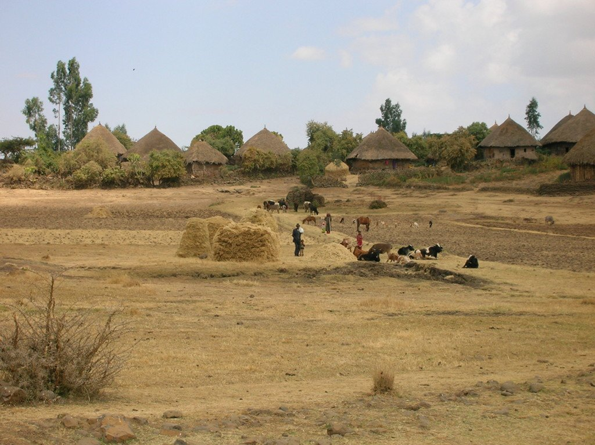
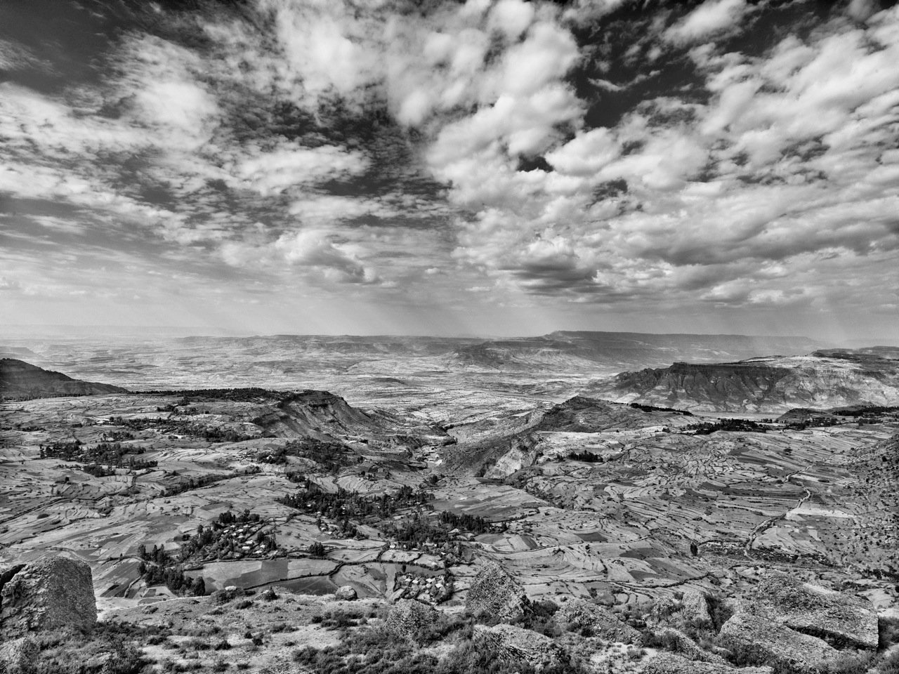
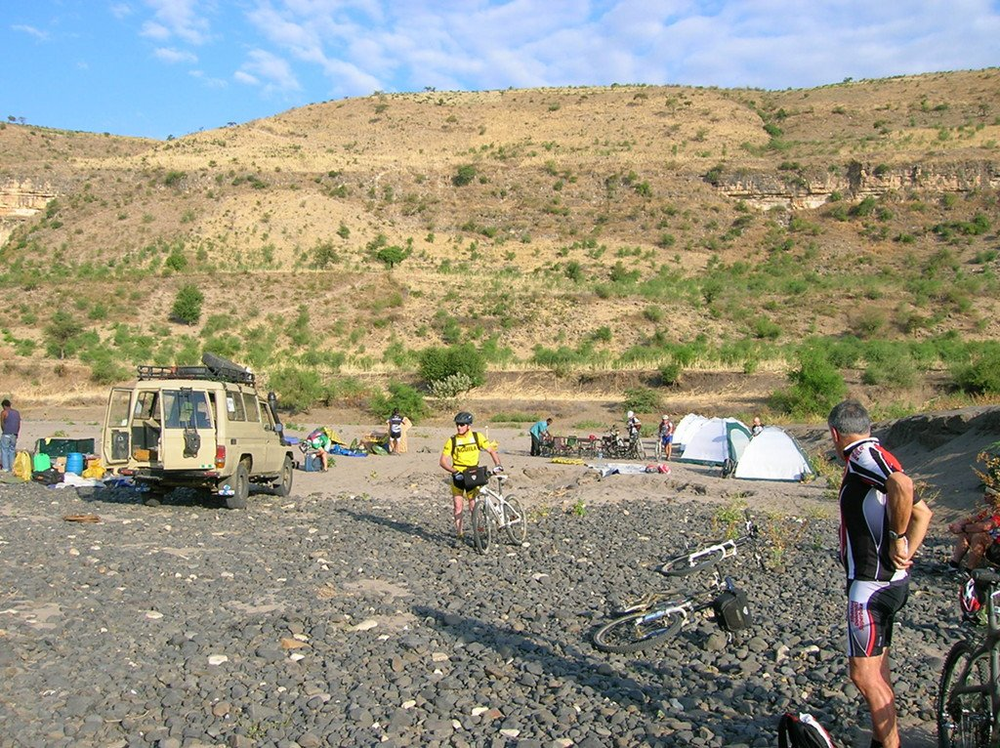

Tenía muchas ganas de visitar África. Había estado en el norte, pero nunca había visitado la auténtica África, esa África negra con la que sueña cualquier viajero. Pobre, seca, virgen e indómita. Pero ahí estábamos, un grupo de ciclistas con ganas de descubrir un <em>nuevo mundo</em> para nosotros, de mezclarnos con la gente y, cómo no, de dar pedales.

Salimos a las 6:30 de la mañana, en autobús, con rumbo norte para alejarnos lo suficiente de la capital, Addis Abeba, situada en un altiplano a 2.500m de altura. Una vez nos hemos alejado lo suficiente bajamos de los vehículos, montamos nuestras bicis y comenzamos a pedalear por una pista ancha y pedregosa. Aunque parezca mentira, este es el camino a Lalibela. El paisaje cambia rápidamente, y pronto nos damos cuenta de la pobreza del país en el que nos vemos inmersos. Las casas de adobe y paja se adueñan del paisaje.

A mitad de ruta nos detenemos a comer, y por primera vez somos conscientes del maravilloso paisaje que nos rodea. Nosotros, a 2.500m de altura. Y allí abajo, a unos 1.200m, el cauce del Nilo. El paisaje es sencillamente espectacular, nos deja a todos sin palabras...

Ahora que lo pienso, ¿no tendremos que bajar allí abajo, verdad? Pues sí, las continuas subidas y bajadas nos acompañarán a lo largo de toda la ruta. El descenso es rapidísimo, perdemos altura a mucha velocidad y vamos notando cómo sube la temperatura, parece que descendemos a los infiernos... Ya abajo, a 1.200m, montamos el campamento y aprovechamos la cuenca del río para asearnos. Una buena cena, y cómo no, un estupendo café, y a dormir. ¡Mañana hay que recuperar altura!

