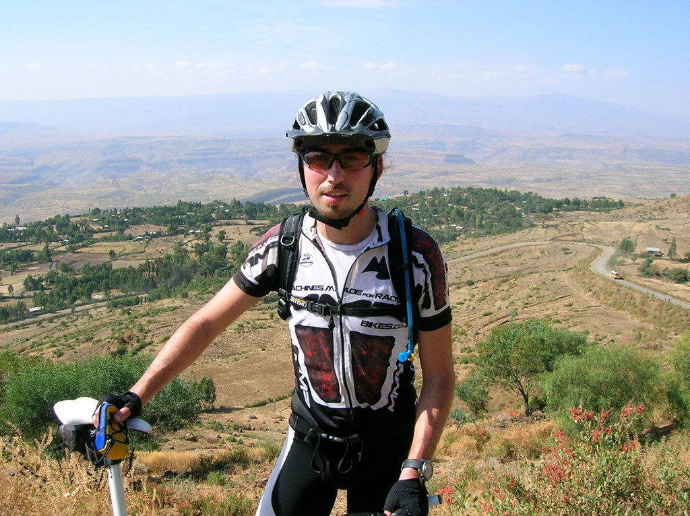
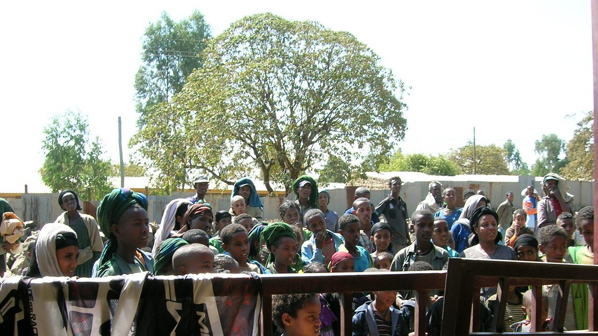

La noche ha sido muy calurosa, creo que este saco no es el más apropiado para Etiopía. De hecho, ningún saco es apropiado para Etiopía. Desayunamos fuerte, un largo ascenso nos espera nada más salir para remontar desde los 1.300 metros de altura a que nos encontramos hasta los 2.150 metros. Me junto con José María, un gran ciclista tarraconense y vamos ganando altura poco a poco. El sol aprieta de lo lindo y es difícil mantenerse hidratado.

Finalmente llegamos a la cima, donde se encuentra el pueblo de Fetra. Sus animadas calles nos esperan, aunque lo que más nos apetece es beber algo fresquito. Ni que decir tiene que nuestra visita revoluciona el pueblo, y todos quieren ver qué hacen esos <em>marcianos</em> que han llegado a su pueblo.

Hacemos una interesante visita al mercado del pueblo. Opino que los mercados son el lugar que mejor te enseñan cómo vive la gente. Qué compra, o mejor dicho, de qué dispone.

Todos los niños del pueblo (sí, todos) nos acompañan, mientras los más espabilados nos hacen de guía. Se muestran muy orgullosos de su iglesia. En Etiopía hay cristianos y musulmanes, los cuales conviven sin problemas, muchas veces en el mismo pueblo puedes encontrar una iglesia y una mezquita. Curioso, ¿verdad?

Después del refrigerio y la visita al pueblo continuamos viaje. La combinación de altura y calor me está doblegando, la cabeza me duele (nuevamente) como si me fuese a estallar. Volvemos a perder altura hasta el cauce de un río, lugar elegido para acampar. El río apenas tiene agua y nos avisan de que hay cocodrilos (cierto, es el Nilo) pero necesitamos refrescarnos y nos vamos al agua. Apenas cubre y el fondo es fanganoso, pero apreciamos ese baño como si estuviésemos en el mejor hotel del mundo. De hecho, no se me ocurre un lugar mejor para pasar la noche.
