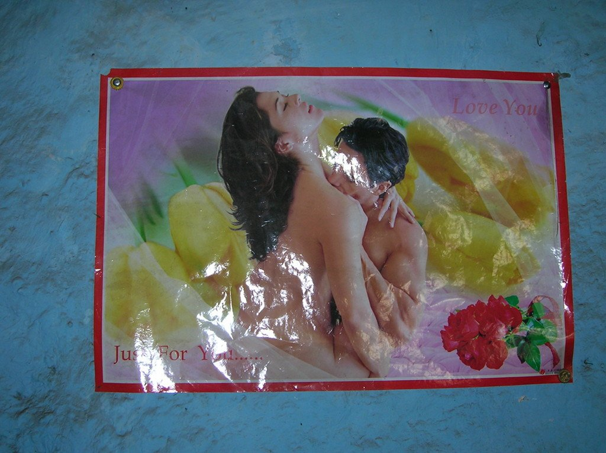
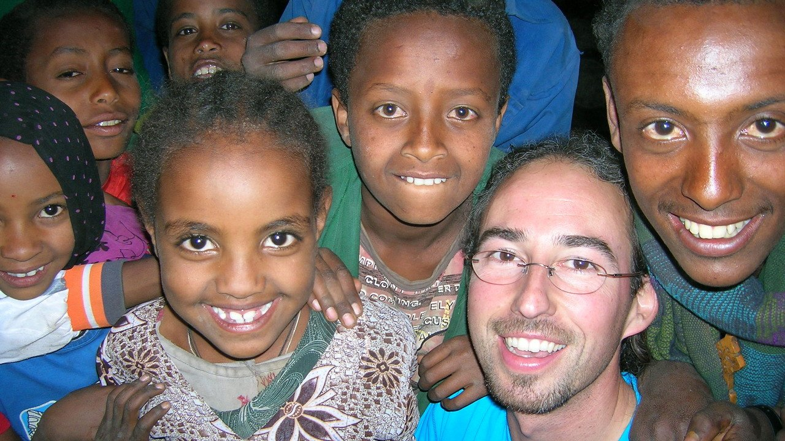

La mañana nos recibe con un calor asfixiante. La etapa será corta, pero el calor y la orografía la harán muy dura. Y parece que lo de los cocodrilos no iba en broma, allí donde nos bañamos el día anterior había un par de cocodrilos <em>tomando el sol</em>. Espero que ya hayan desayunado...

Volvemos a subir hacia arriba, el calor aprieta y la subida no da un respiro. No es muy empinada, pero sube, y sube... hasta un pueblo donde decidimos parar a tomar un refrigerio. La etapa va a ser corta, así que decidimos dejar la comida para el destino. La decoración del lugar donde paramos a comer es... digamos que las noches deben de ser interesantes.

La estancia en el pueblo se alarga bastante. Yo peco de inocente aireando el dinero y dejándolo descuidado. Cuando me quiero dar cuenta, el dinero ha volado. Era un buen fajo de billetes que al cambio no sumaban más de tres euros. Viene la policía y ocurre algo muy curioso. Le van pidiendo a la gente sus billetes, y los huelen. Asombrado, pregunto qué hacen, y me dicen que nosotros, los blancos, olemos diferente, y que pueden oler si hemos tocado los billetes. Me parece increíble, es cierto que olemos diferente pero el hecho de identificar un sucio y manoseado billete por el simple hecho de que yo lo haya tocado y metido en mi bolsillo me parece tan increíble como los programas de los hackers de las películas de Hollywood. Adiós, dinero.

En fin, tras el revuelo continuamos la ascensión y nuevamente un montón de niños salen con nosotros, y ganamos altura hasta llegar al poblado de Midda, donde el Hotel Africa nos espera.

Aprovechamos la tarde para hacer turismo. La gente sale a nuestro encuentro y nos acompañan de paseo por las calles del pueblo, nos enseñan orgullosos su iglesia y su escuela. De repente, a las seis de la tarde el pueblo cobra vida: ya hay corriente eléctrica. Al parecer tienen unos generadores con los que proporcionan corriente eléctrica desde las seis de la tarde hasta... bueno, hasta que dure. El barbero arranca las maquinillas, se oye ruido de taladros en el mecánico y hasta una pequeña tienda de música anima el ambiente. Pero si hay algo que nos llama poderosamente la atención es que, en la plaza del pueblo, hay un pobre pidiendo limosna. A nosotros, acostumbrados a las bondades y crueldades de las ciudades, nos cuesta diferenciar los diferentes niveles de pobreza. Pero los hay, es algo que nos encoge el corazón y nos da una lección de humildad. <em>No es más feliz quien más tiene, sino quien menos necesita.</em>

