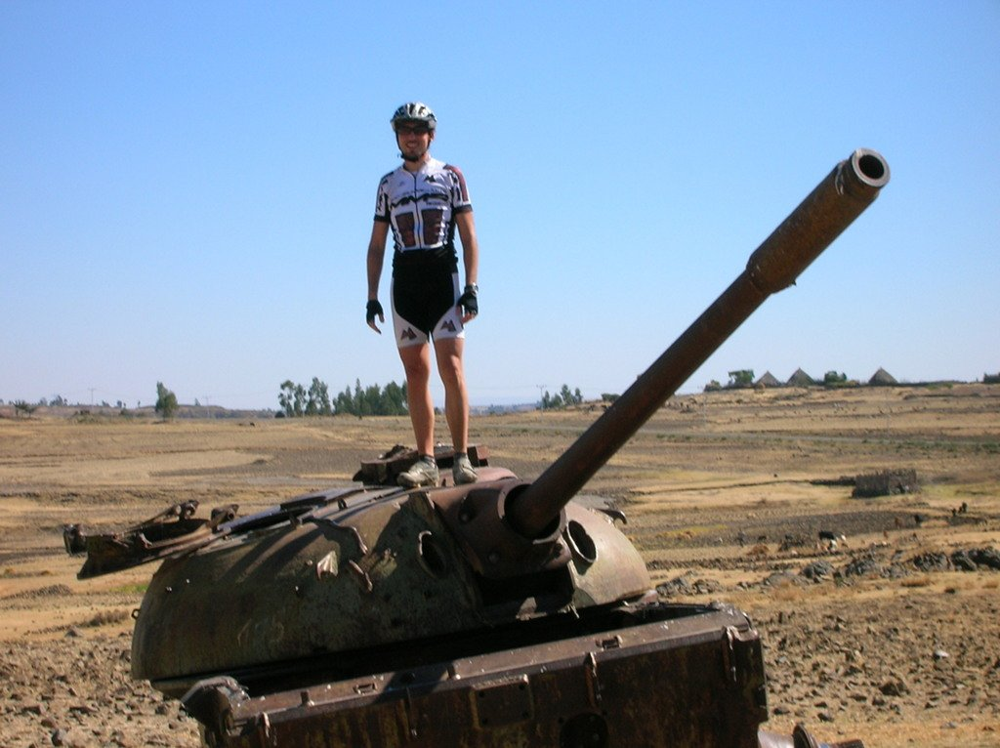
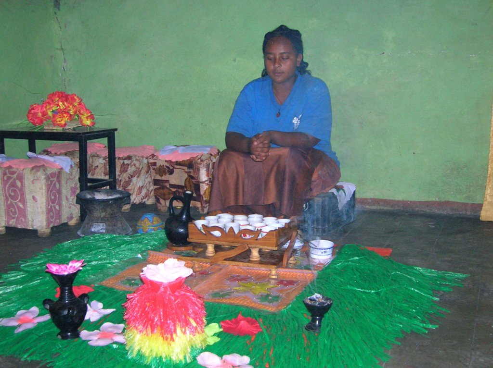

Hoy hemos dormido a más altura, por lo que la noche no ha sido tan calurosa y hemos podido descasar mucho mejor. La cama del Hotel Africa era conformable, la he aprovechado para dormir como un bebé.

Salimos de Midda en dirección a Wereliu. La etapa será larga, pero bastante llana. Las pistas son cansinas, con mucha piedra, pero el paisaje es muy bonito. Atravesamos varios pequeños poblados de casas de adobe y paja,  mientras los restos de la guerra nos recuerdan que este bonito lugar también tuvo su oscuro pasado.

Paramos a comer en Degolo, un pequeño pueblo en el que aprovechamos para tirarnos a la sombra y reponernos del intenso calor que aprieta nuevamente. Y qué mejor forma que tomando un auténtico café etíope.

El camino acaba en el bonito pueblo de Wereliu, donde un pequeño hotel nos espera. Wereliu es un lugar interesante. No es muy grande, y tiene una iglesia y una mezquita. Aprovechamos la noche para acercarnos al bar del pueblo, y lo que en principio parece una simple visita a un bar para tomar una cerveza fresquita se convierte en una noche muy interesante. El <em>jefe</em> del bar no deja que la cosa se desmadre y la verdad es que se está muy a gusto, en cuanto uno se pasa con la bebida lo larga fuera. La gente se acerca a hablar con nosotros, se interesan por nuestro viaje y se sacan fotos. Queda patente que no hay mucho turismo por la zona... Uno de los que se acerca a hablar con nosotros es el policía del pueblo, que con su kalashnikov en mano nos da la bienvenida y nos informa de que él está ahí y podemos estar tranquilos. La verdad es que no estábamos nerviosos. Agradecemos el gesto invitándole a una cerveza que rechaza en un primer momento sin mucha insistencia, y que finalmente accede a beber. Incluso nos acompaña de vuelta al hotel. Una vez más lo mejor del día ha sido la convivencia con los locales del pueblo.
