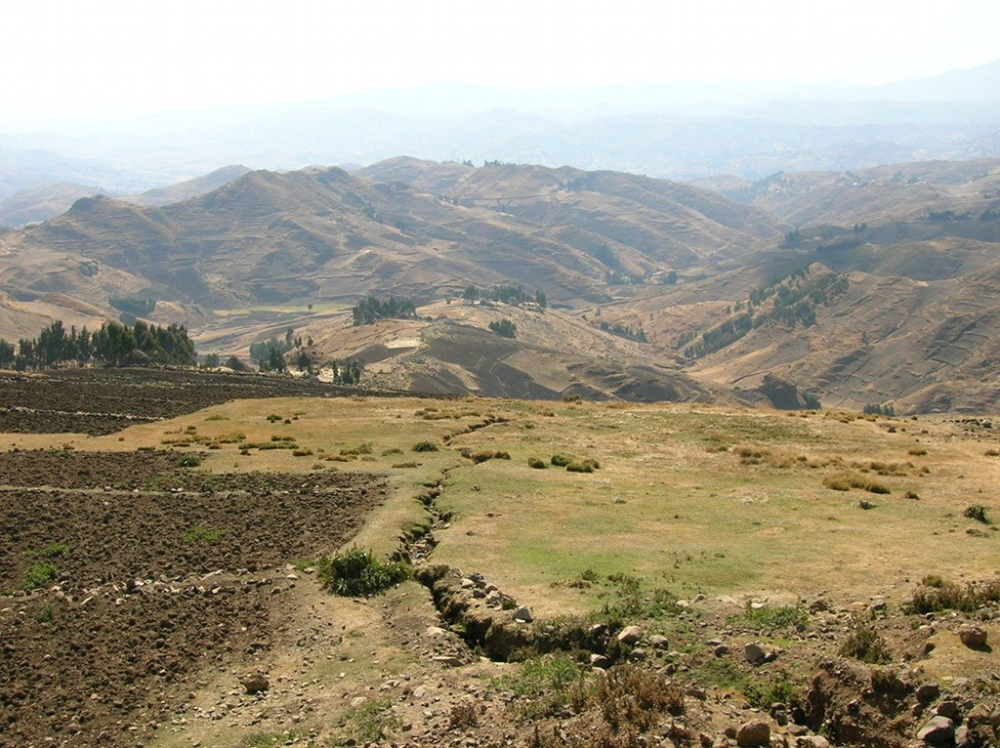
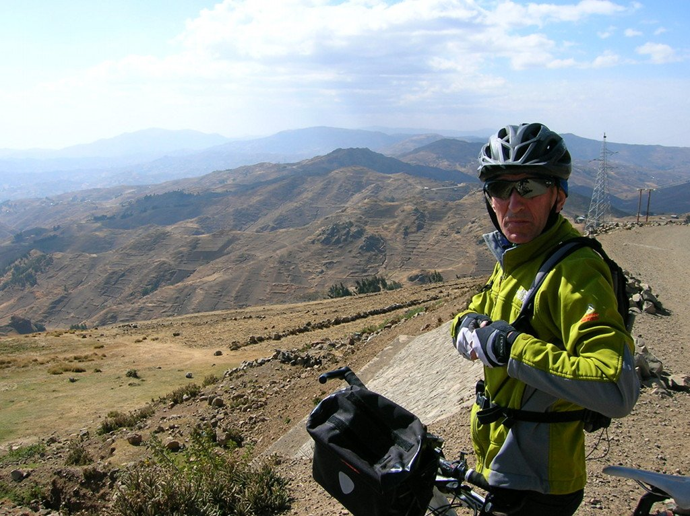
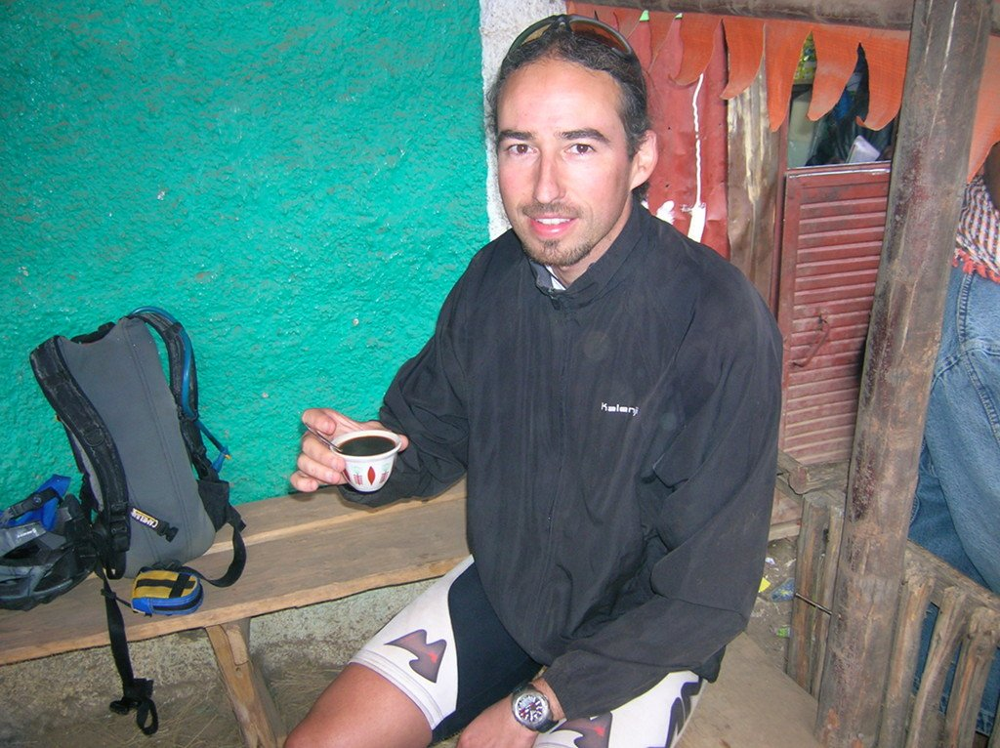

Ha sido una noche confortable... hasta las 5 de la mañana, hora a la que el imán del pueblo ha considerado que ya habíamos dormido suficiente y se ha puesto a rezar. Sinceramente, parecía que estaba rezando en la habitación. Supongo que con el tiempo uno se acostumbra...

Nos da pena dejar este bonito pueblo, pero estamos ansiosos por ver el recorrido de la etapa de hoy. 77 kilómetros en (casi) contínuo ascenso, tocando techo a 3.700 metros de altura, sobre un majestuoso altiplano a 3.500 metros de altura. Hoy sí que se nota al altura, pero el paisaje da alas y queremos tocar techo. Lentamente ascendemos por los preciosos paisajes etíopes.

Este increíble paisaje nos revela otro secreto de Etiopía. Y es que hicimos bien trayendo ropa de abrigo, en Etiopía también hace frio!

La bajada es rápida, aunque no es muy pronunciada y ciertamente se empieza a hacer pesada. Sopla un fuerte viento en contra que hace que avanzar sea una tarea difícil, aunque finalmente llegamos a destino, en el pueblo de Ginchiro. Nos informan que por detrás la gente viene muy rota, así que tendremos que esperar un poco. Nuevamente la, en principio, pesada espera en el pueblo se convierte en otra gran experiencia. Aunque mi compañero de viaje no parece muy convencido por la, digamos, falta de higiene del lugar, paramos en una pequeña <em>cafetería</em> etíope donde una una agradable chica nos prepara un café, nuevamente, sin prisa. Vemos como nos tuesta los granos (de café), los muele, los vierte en la cafetera con agua y la hierve lo justo y necesario para que ese agua coja todo el aroma y sabor de tan fantástica materia prima. Nos sirve el café en las típicas tazas chinas que, por extraño que parezca, se hicieron tradición en Etiopía durante la etapa comunista.

Cae la noche y la temperatura baja. Tal vez le saque partido a mi saco de dormir, después de todo.
