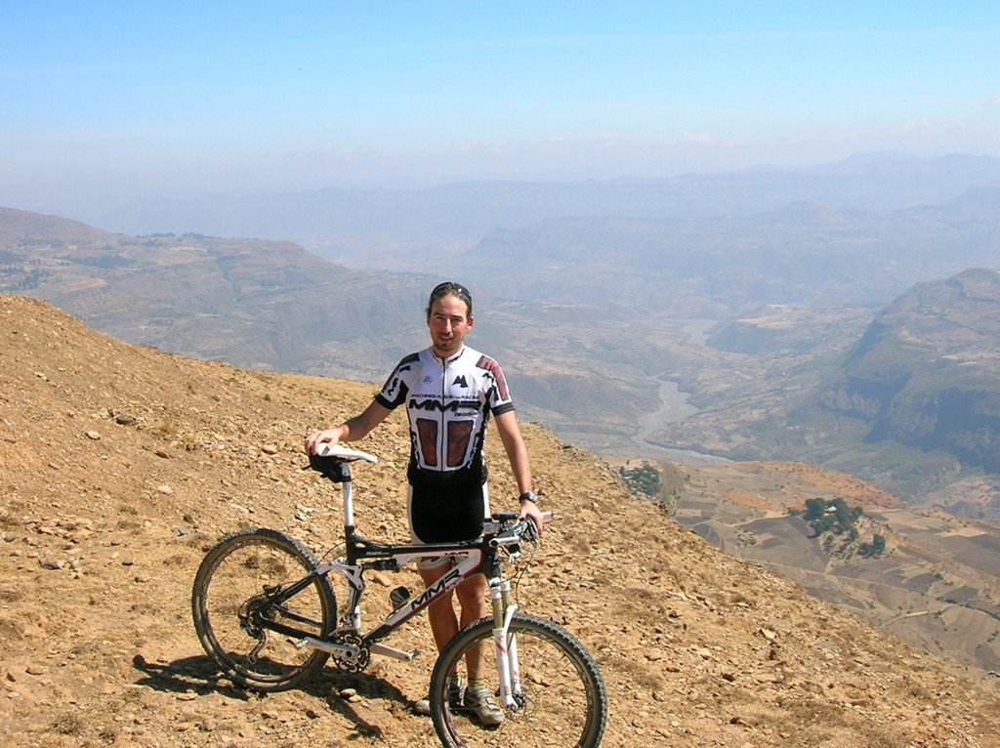
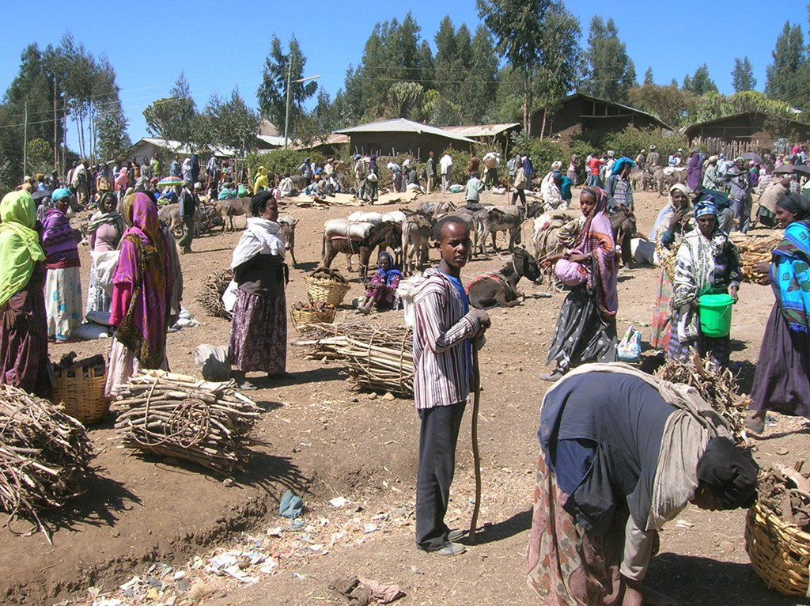
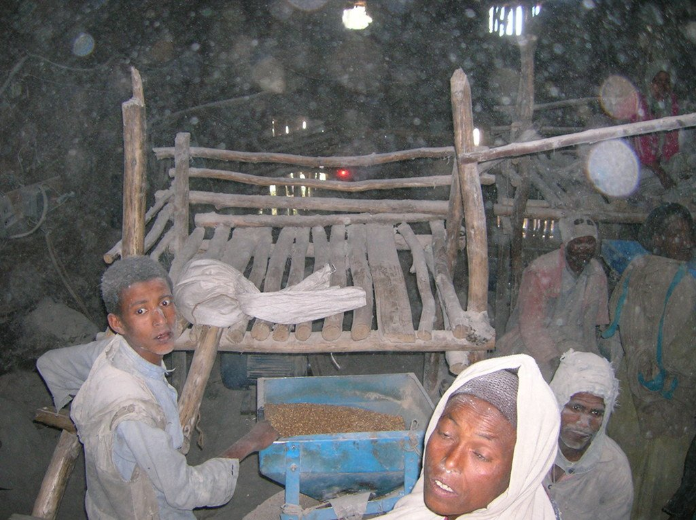
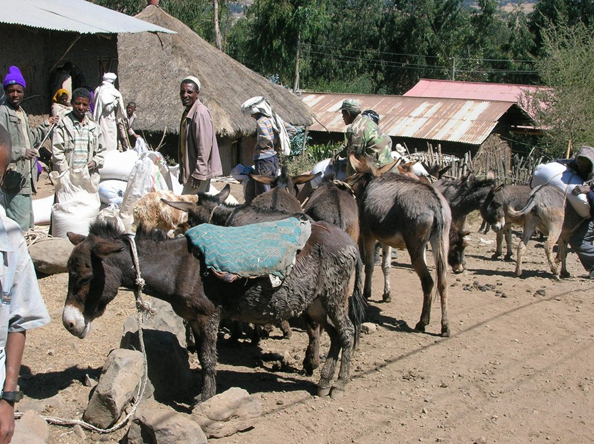
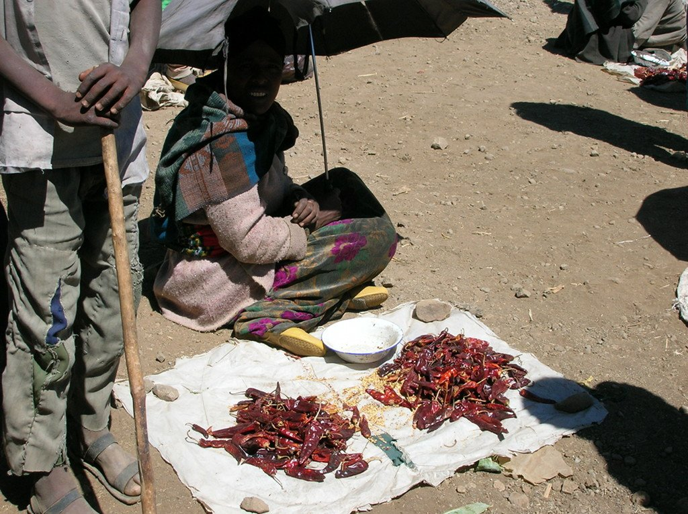
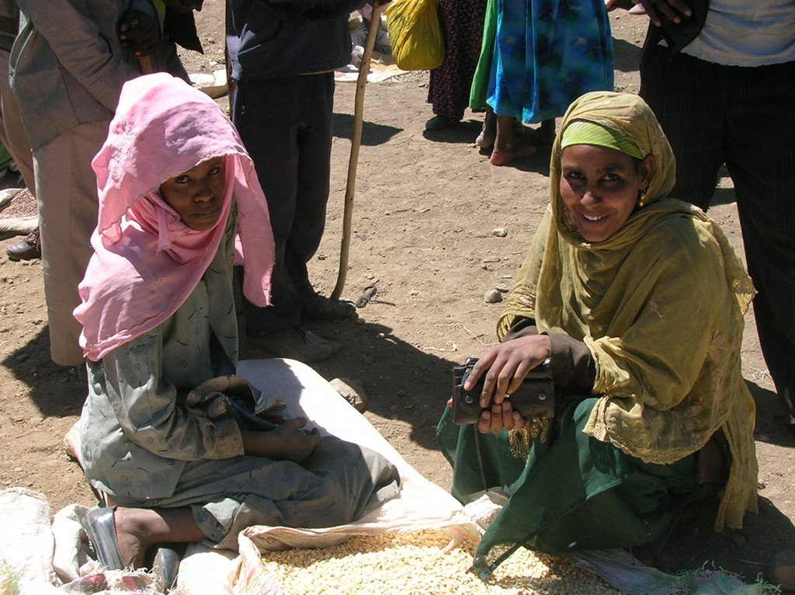
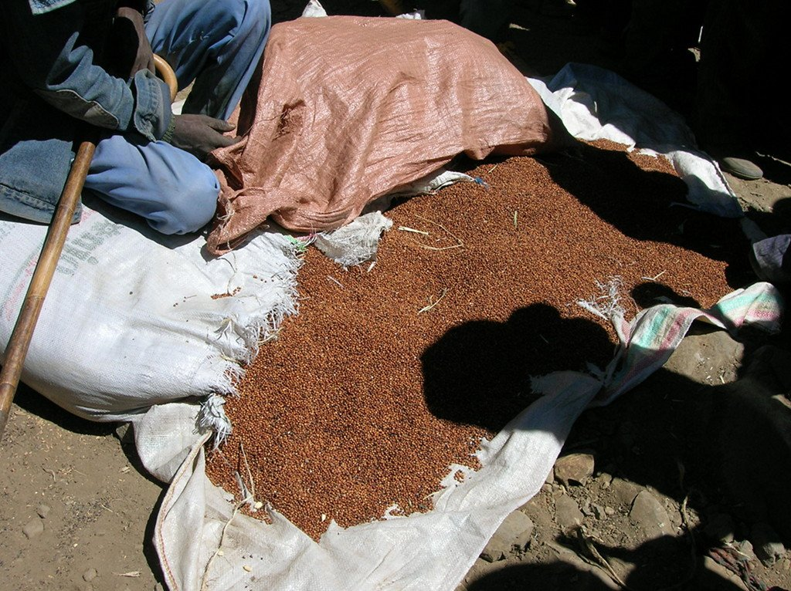
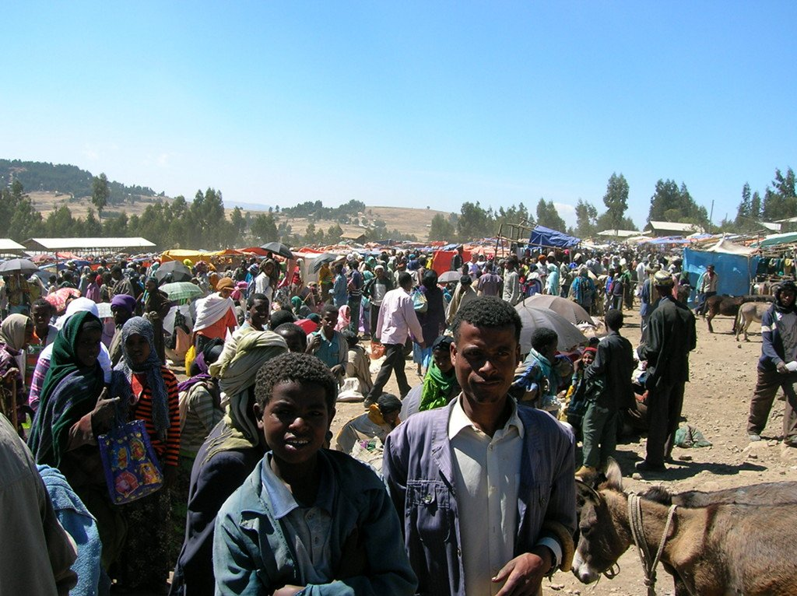
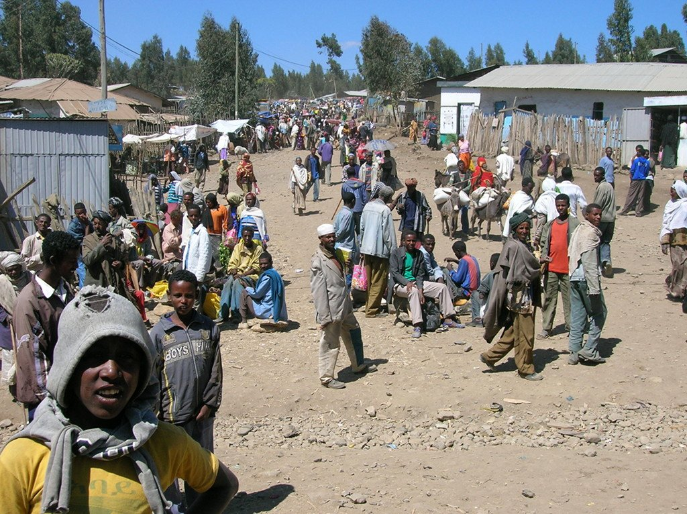
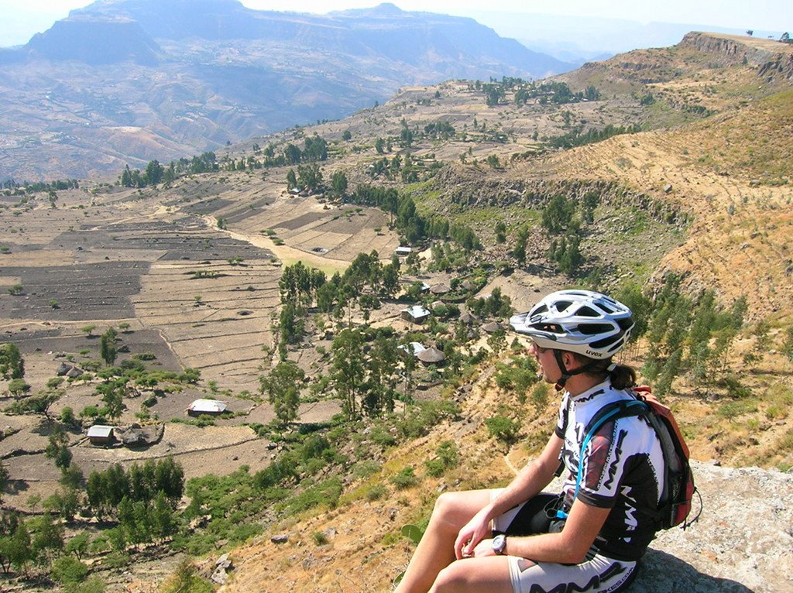

¡Qué frío! Hoy hemos dormido en altura y realmente ha hecho frío, ese saco que ha sobrado durante los días de calor ha sido mi salvación esta noche. Dentro de la tienda de campaña la temperatura ha bajado hasta casi los cero grados, lo que no está nada mal comparado con las anteriores noches a 25 grados.

Hoy nos espera una etapa fácil, 77 kilómetros de descenso desde los 3.250 metros hasta los 1.650  metros del destino, en la encrucijada con el río Bashilo. Esta sencilla etapa nos iba a desvelar uno de los paisajes más bellos de Etiopía, tanto por sus paisajes como sus gentes.

Al poco de salir, otro soleado día nos permite ver con claridad, desde los más de 3.000 metros del altiplano por el que circulamos, lo más hondo del valle, a menos de 1.300 metros de altura. Nuevamente Etiopía deleita nuestra vista con otro magnífico regalo.

La vista es increíble, nuevamente se hace patente que el viaje ha merecido la pena. Pero aún quedan más cosas interesantes.

Más adelante nos encontramos con el poblado de Tenta. He de reconocer que siento debilidad por los poblados bulliciosos, llenos de vida y gente, y Tenta tiene ambas cosas. La plaza del pueblo nos saluda y nuestra visita no genera el revuelo de pueblos anteriores, lo que nos indica que esta encrucijada recibe visitantes de muchos lugares. Nos adentramos en el mercado, y lo que vemos nos apasiona. La zona de <em>carga y descarga</em>, con los burros como único medio de transporte. La zona de las verduras, de la sal, de la electrónica, de la ropa... incluso hay un molino en el que conseguimos entrar, algo que al capataz no le hizo mucha gracia y nos sacó de ahí a escobazos.

Nos vamos acercando a Lalibela y los poblados se van haciendo cada vez más habituales. Hasta que llegamos a destino, una zona verde a la orilla de un río más caudaloso de lo habitual, que nos permite darnos un baño en toda regla y reponer fuerzas para la etapa de mañana.

