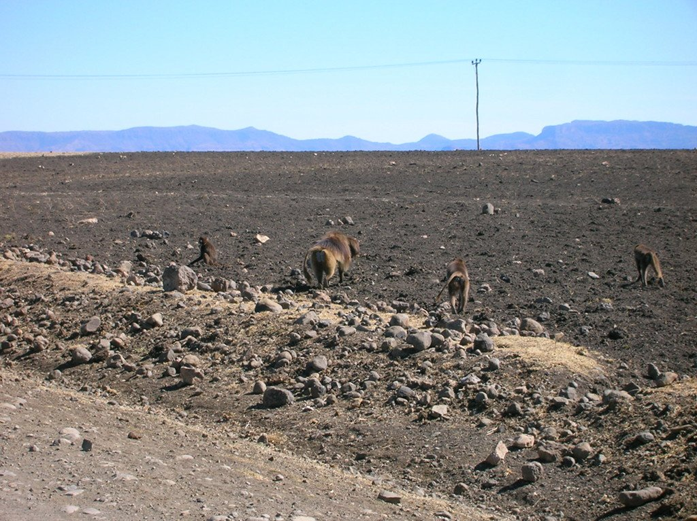
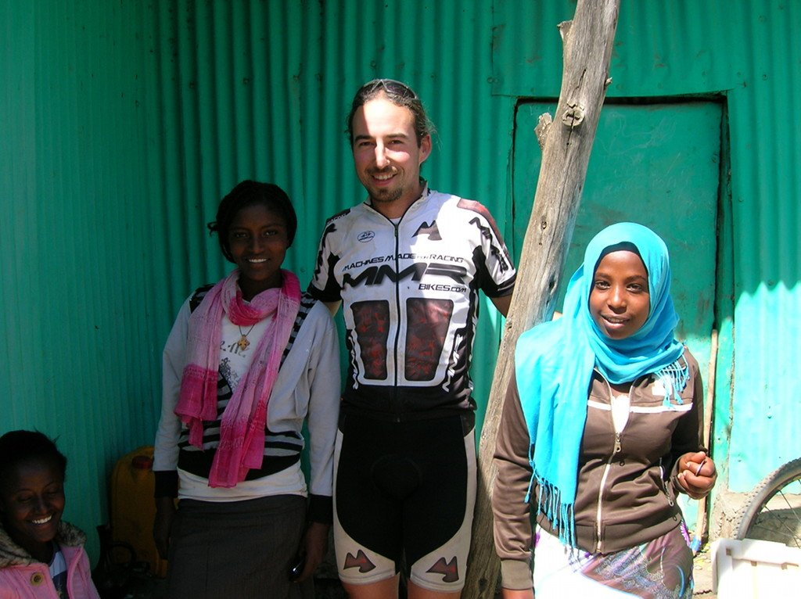

Un amanecer caluroso, presagio de un día de calor infernal. Y así iba a ser. Nada más salir la pista asciende desde los 1.650 metros a los que nos encontramos hasta los casi 3.000 metros. La pista, con buen firme y sin demasiado desnivel, nos eleva, durante los 23 kilómetros de subida, hasta un paisaje nuevamente idílico. En este caso, además del bonito paisaje, la fauna local sale a nuestro paso. Aún no tengo claro si a saludarnos o a ver si encontraban algo de comer, los monos <em>gelada</em>, característicos por su triángulo rojo en el pecho, se mantienen en la distancia, salvo algún macho que se acerca para, creemos, vigilar el territorio.

El calor vuelve a apretar de lo lindo y aprovechamos para hacer una parada en Wegel Tena para comer y tomar algo fresquito servido por las lindas camareras del poblado.

El resto de la etapa discurre por pistas rocosas con bonitos paisajes, hasta que vuelve el rápido descenso hasta la cuenca del río, esta vez más caudaloso que el anterior y con un puente en mejor estado de conservación. Parece un buen lugar para montar el campamento.
