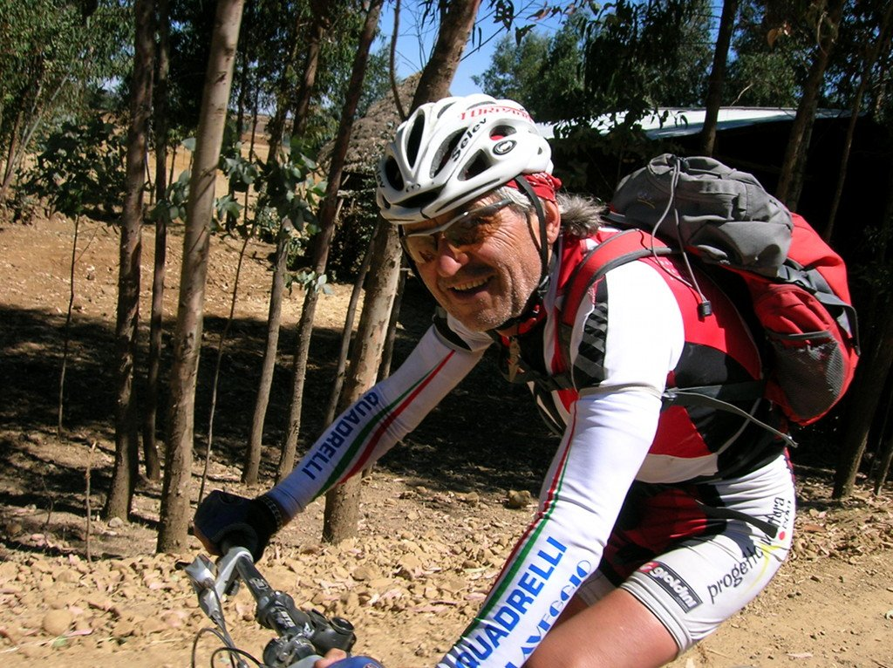
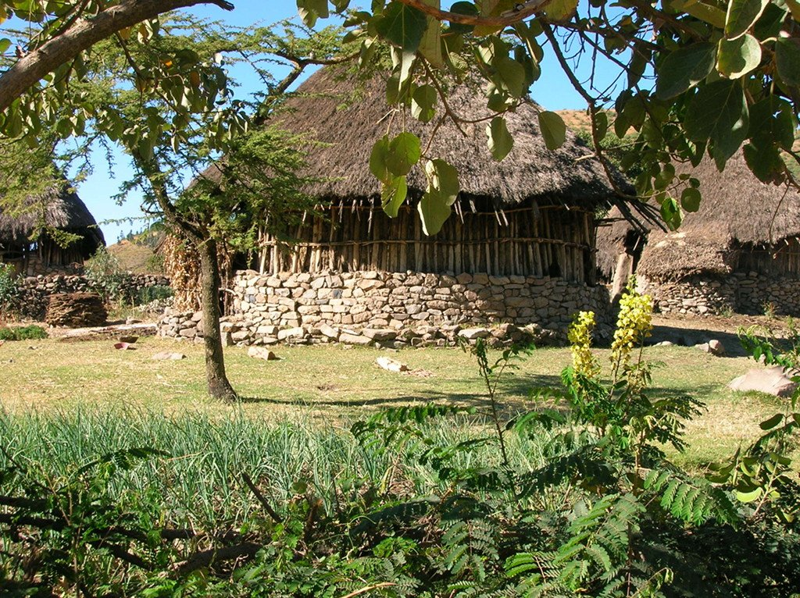

La mañana amanece nuevamente calurosa y apetece dar pedales, aunque el cuerpo empieza a estar cansado. El perfil de la etapa es similar al que hemos visto estos últimos días, un continuo ascenso a la salida para volver a bajar al cauce del río al final. El paisaje, aunque bonito, ya no tiene la majestuosidad de etapas anteriores y los pueblos que atravesamos comienzan a estar más <em>maleados</em>. Los niños ya no salen a saludarnos como antes, sino que ahora se divierten jugando al tiro al blanco, nunca mejor dicho. Creo que nuestras ropas de colores ayudan a que no fallen ni un tiro, la cosa se pone bastante fea y decidimos mantenernos juntos, al menos durante el paso por los pueblos.

Durante un periodo de tranquilidad antes del almuerzo aprovecho para charlar con uno de los italianos del grupo, que a sus 70 años continúa dando pedales a muy buen ritmo. Y no me refiero a buen ritmo para tener 70 años, no. A buen ritmo. Durante la charla descubro que fue ciclista profesional. Y es que dicen que el que tuvo, retuvo. Y además de todo esto, es un gran tipo.

Llegamos al pueblo de Gashena, lugar elegido para tomar el almuerzo. Es un pueblo feo, pero lleno de vida. Lo atraviesa una de las pocas carreteras asfaltadas de Etiopía, y la primera que vemos en varios días.

Aprovechamos nuestra visita al pueblo para recargar energías y seguimos rumbo norte. El paisaje es cada vez más verde y menos pobre, por decirlo de alguna forma. Al menos la gente dispone de una tierra más o menos fértil en la que cultivar sus alimentos.

El camino está siendo largo, pero estamos muy cerca del destino. El río Lalibela nos espera para proporcionarnos un bonito lugar donde colocar nuestro campamento. El último campamento de este viaje.
