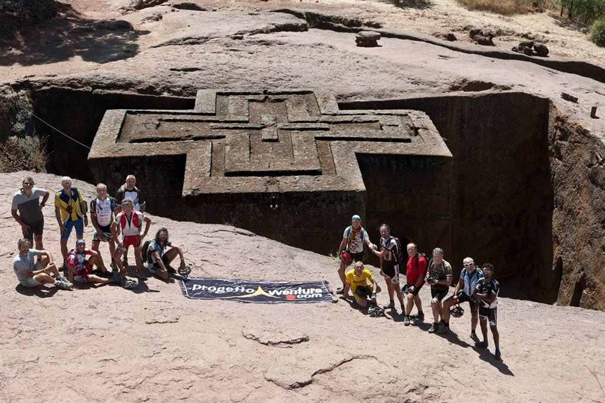

Último desayuno. Desmontamos el campamento por última vez y nos lanzamos a por la última etapa, sencilla, que nos llevará a Lalibela. Hay ganas de llegar, y a la vez tristeza porque tan bonito viaje llegue a su fin. Han sido nueve días pedaleando, desde Addis Abbeba hasta Lalibela, donde hemos visto paisajes y gentes increíbles. Y aún nos quedan varios días de disfrute en Lalibela, visitando sus magníficas iglesias y disfrutando del día grande, la festividad de San Jorge. Pero estos días no habrá bici, así que habrá que dejarlo, tal vez, para otro blog.

Os dejo un vídeo de producción propia, para que veáis el ambiente de Lalibela.

<iframe src="https://www.youtube-nocookie.com/embed/cvVNK7qOrTY" title="YouTube" loading="lazy" allowfullscreen></iframe>

