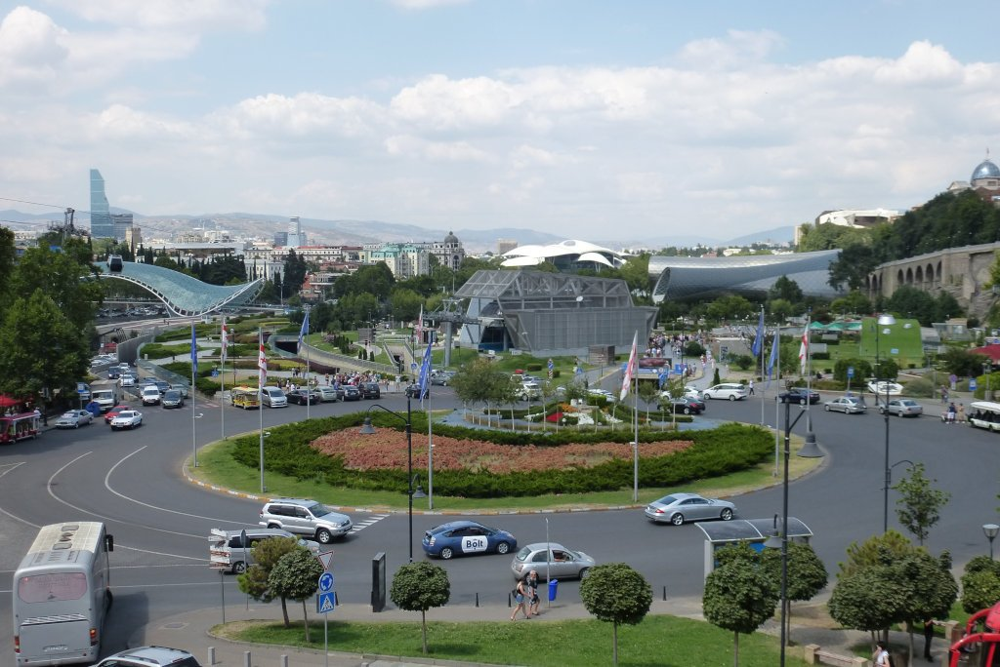

Mi primera etapa comienza con poca confianza. Primero, de forma global, no me siento confiado con el viaje. Mi estado mental no es el mejor, y no por nada en concreto. Simplemente me cuesta pensar en todos estos días en solitario. ¡Ni que fuese la primera vez! Y segundo, el caos circulatorio de <em>Tblisi</em> me asusta un poco, escapar de la ciudad puede ser peligroso y me va a llevar un buen rato. Aunque, tal vez, este segundo miedo sea consecuencia de mi estado mental.

Pero aquí estoy, y toca empezar lo que tanto costó planear. Salgo del hotel y voy siguiendo la ruta que me he descargado de la web de <a href="https://bikepacking.com" target="_blank" rel="noopener noreferrer">bikepacking</a>. Se nota que está muy trabajada. En casi ningún momento salgo a vías principales, y siempre me muevo por pequeñas calles donde el tráfico es menos denso. Aunque también es cierto que me paso el día subiendo y bajando, mientras que la vía principal discurre cómodamente por una zona llana. Pero puedo avanzar tranquilo, y eso es lo importante. Hasta un momento, en el cual me desvía mucho de la vía principal por un camino de tierra que encuentro bloqueado en la bajada, lo que me obliga a dar la vuelta. Revisando la ruta, observo que se vuelve <em>un poco loca</em>, así que decido probar suerte por la vía principal. Sí, el tráfico es muy loco y los conductores ven a las bicicletas como algo que no debería estar ahí... pero voy rápido y salgo de una pieza.

Los edificios desaparecen y llego a otra carretera con mucho tráfico, que abandono rápidamente para adentrarme en la primera emboscada del viaje. La ruta se desvía por el monte, donde apenas se aprecia lo que en algún momento debió ser un camino. Ni la pendiente ni el firme permiten pedalear, así que empujo la bici... durante demasiado tiempo. La vegetación es alta y está muy seca (¡y enfadada!) y se agarra a mis piernas desnudas clavándome toda suerte de pinchos largos, cortos, con forma de garfio... que me dejan las piernas como si un gato se hubiese afilado las uñas en ellas. Aunque ahora mismo, lo que más me preocupa es que el líquido sellante de mis ruedas resista, no me gustaría tener que empezar el viaje quitando los <em>tubeless</em> para montar una cámara. ¿He dicho ya que aprieta un sol de justicia? Ni una sombra, por supuesto.

Una vez finalizada ésta subida, el resto no mejora. La vegetación lo tapa todo, y hasta las bajadas las tengo que hacer andando. Después, un sube-baja criminal siguiendo el <em>trazado</em> de de una tubería de gas, con un firme horrible y unas cuestas imposibles. Desde luego esto no es lo que estaba buscando. No me apetece ni sacar una foto, aunque pensándolo bien tampoco hay mucho que fotografiar. Finalmente, en el GPS diviso la carretera principal y huyo hacia allá. Esta carretera tiene un firme aceptable y muy poco tráfico. No entiendo el sinsentido de atravesar el monte empujando la bici. De aquí a destino, seguiré la carretera.

Ya en la carretera, aprovecho para hacer una parada técnica, comprar algo de comida y cargar agua. De aquí a destino, nada digno de mención.

El hotel de <em>Aranisi</em> me sorprende. Modesto por fuera pero con un interior muy cuidado y una <em>WiFi</em> excelente. Una doy una ducha, me lamo mis heridas y me preparo para la etapa de mañana, donde espero ver zonas más bonitas.
