El día no empieza nada bien. Me he despertado en mitad de la noche con migraña. Por la mañana la migraña continúa con la misma intensidad, con sus síntomas habituales de dolor de cabeza y nauseas. Desayuno un café y poco más, y arranco con bastante miedo... y el estómago casi vacío.

Mi plan para hoy es llegar a Atabe, lo que parece ser un pequeño pueblo en lo alto de las montañas del Cáucaso, en la parte norte de Georgia. Para ello, saliendo desde Zhinvali, seguiré la senda que discurre al lado de uno de los ríos que suministra agua al embalse de Zhinvali.

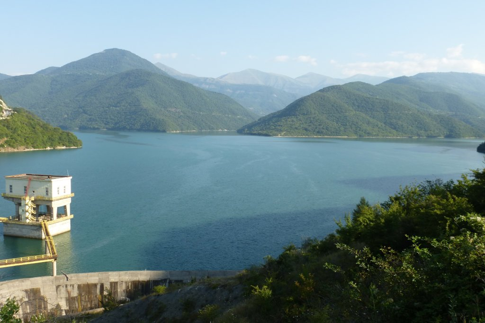

Es un lugar muy curioso. Al parecer, el auténtico Zhinvali está en el fondo del embalse, que fue construido en época soviética. Para reubicar a todos sus habitantes se decidió construir un <em>nuevo Zhinvali</em>, que está unos cinco kilómetros más al sur del original. Adentrarse en este <em>nuevo Zhinvali</em> es todo un viaje a la época soviética: grandes edificios cuadrados en medio de zonas verdes y grandes avenidas. Desgraciadamente, la situación económica del país se ve reflejada en el estado general del pueblo, muy descuidado (que no sucio) y viejo.

Empiezo por una carretera bien asfaltada que me lleva a lo alto del embalse... primeros quince minutos, primer calentón. A partir de ahí, sin mucha sorpresa. La carretera discurre al lado de un río, con lo que asciende contínuamente. La cabeza aún me molesta, así que aprovecho cualquier oportunidad para hacer un alto en el camino. Aquí, descansando con un nuevo amigo.

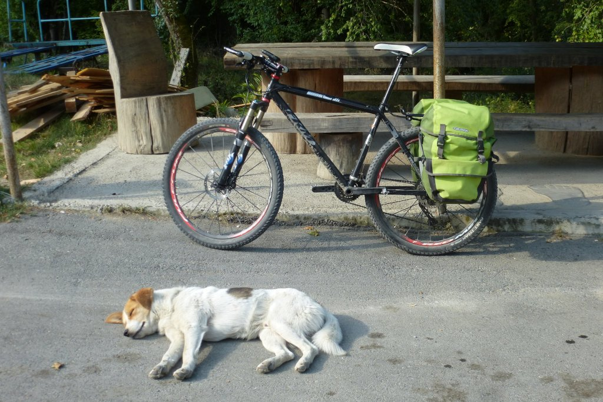

Por desgracia, este viaje lo estoy haciendo sin mi bolsa de manillar, la cual me es muy útil para tener a mano los objetos de uso común, como la cámara de fotos. La bolsa ha venido conmigo, pero se ha tenido que quedar en el hotel de Tblisi porque su soporte para el manillar se rompió durante el viaje. Lección aprendida, en el próximo viaje lo llevaré desmontado.

Rápidamente la carretera se convierte en una pista. Hay muy poco tráfico, la temperatura es agradable y la subida es suave. Además, el paisaje ha cambiado y es mucho más verde. Disfrute total.

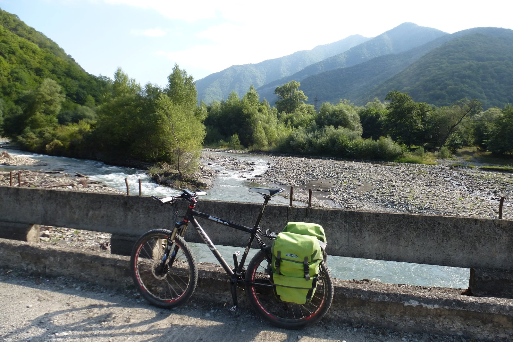

La pista va cruzando, cada poco, de un margen al otro del río. Cuanto más voy ascendiendo, en peor estado se encuentra la pista. Los camiones que me adelanta, todos con muchos años, me lanzan una mezcla de polvo blanco del camino y humo negro del motor que hacen que mi aspecto sea de lo más cómico. Por fortuna para mis pulmones, el tráfico es muy escaso.

Poco más adelante llego a Kohmi, donde hay un albergue con restaurante. Sabía que me lo iba a encontrar porque, durante la preparación del viaje, fue uno de los posibles lugares que había elegido para dormir. Aunque es demasiado temprano para comer, sí que hago un pequeño alto para reponer fuerzas, hidratarme y comer algo de fruta. La migraña casi ha desaparecido y mi estómago se ha estabilizado, así que la comida sienta muy, pero que muy bien.

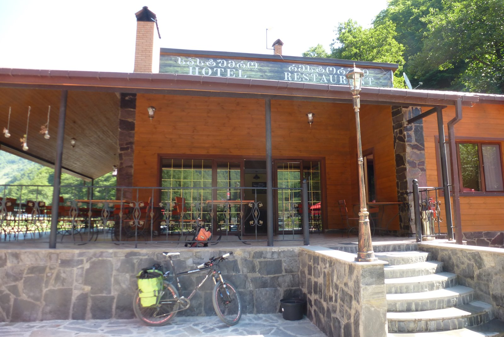

Pero aún quedan un buen puñado de kilómetros de pista, y lo más duro está por llegar. Durante más de una hora, éste será mi paisaje:

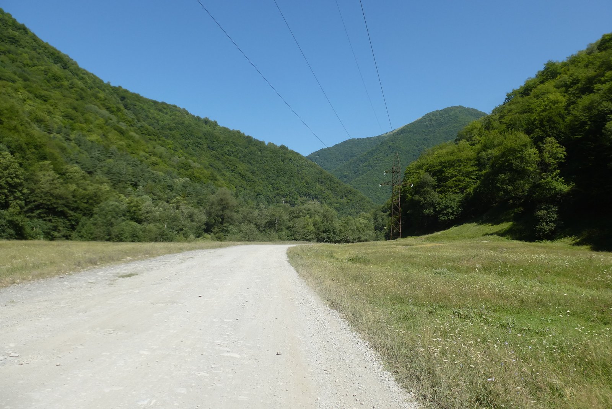

La pista está más rota a cada paso, y tanto mis manos como mis posaderas van pidiendo un respiro. Desde hace muchos kilómetros hasta destino, sólo encontraré un único kilómetro de asfalto, justo al atravesar el pueblo de Korsha. Aprovecho para hacer una parada técnica, ya que éste es el último pueblo que voy a encontrar hasta llegar al final de trayecto en Atabe. Y calculo que no me faltarán menos de dos horas.

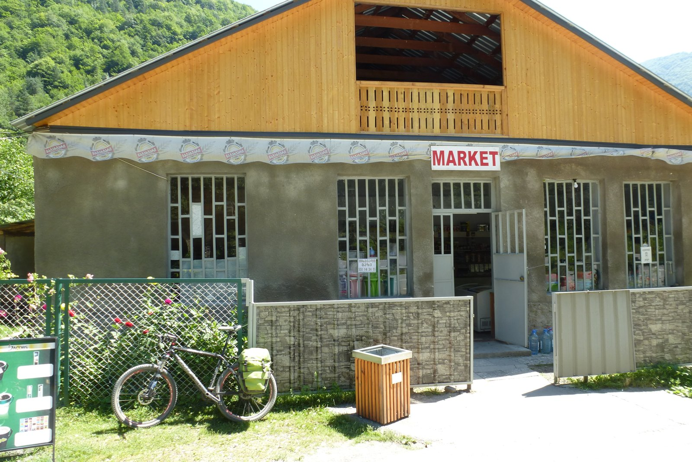

No se puede decir que el pueblo esté muy surtido... tan sólo encuentro ésta pequeña tienda donde esperaba encontrar algo más contundente que fruta o helados. Bueno, no nos engañemos, los helados siempre sientan bien, no hay queja. Pero no deja de llamarme la atención que, siendo la primera tienda que veo en varias horas, no estén un poco más surtidos. Refrescos y helados están bien para satisfacer las necesidades de los pasajeros de la <em>matryoshka</em>, nombre con el que se conoce a los minibuses en Georgia, pero no para los habitantes de la zona.

No obstante, tengo un buen pálpito con el guesthouse que me espera en Atabe. Estoy seguro de que me podré dar un buen homenaje para cenar.

Sigo la pista cada vez más ascendente y me voy encontrando, a cada poco, una fuente. En Georgia están muy orgullosos de su agua, y no es para menos. Hay fuentes de agua fresca y cristalina a cada paso. Pero no es la cantidad de fuentes lo que me llama la atención, sino su decoración. Suele haber, en cada fuente, una placa de piedra con una especie de fotografía incrustada. No es un relieve, es totalmente lisa. Parece una especie de lápida... desconozco el porqué, pero me gustaría saberlo. Como creo que no lo he explicado muy bien, os dejo un par de fotografías.

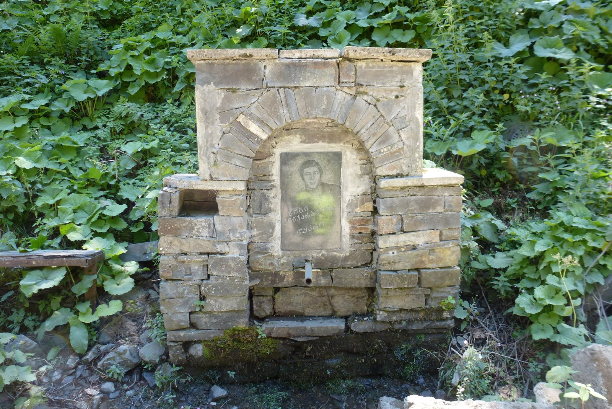

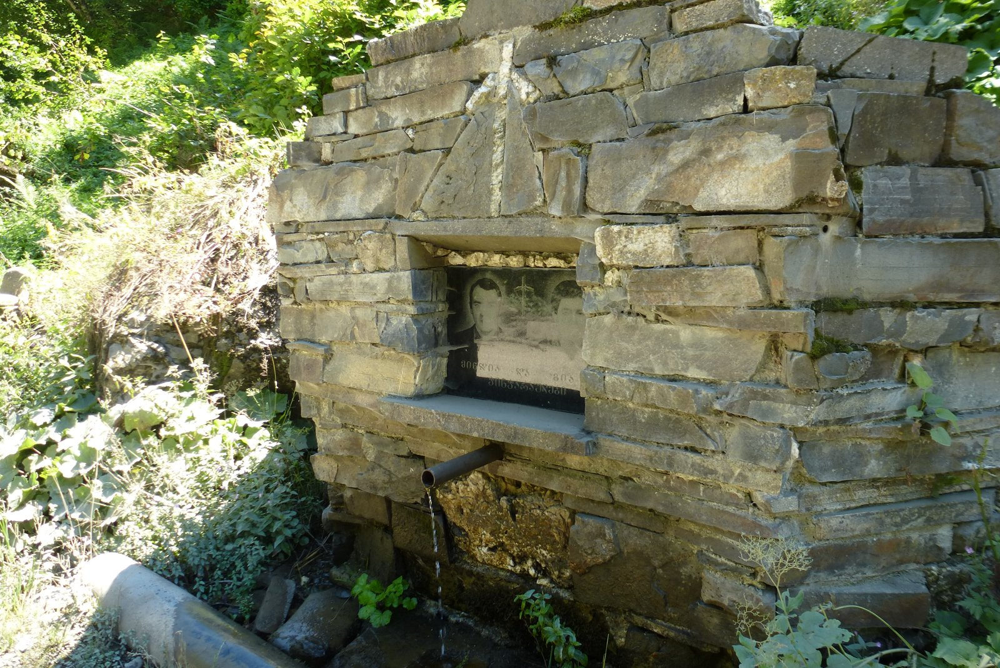

Finalmente llego al desvío que me llevará hasta Atabe. No tengo altimetrías ni mapa de la zona, así que voy un poco a ciegas. Cuando llego al desvío, me doy cuenta de llegar a Atabe va a ser más duro de que lo esperaba. La pista tiene buen firme y buen agarre, pero es tan empinada que tengo que echar pié a tierra y empujar la bici. Y será así a cada poco, aunque hay que reconocer que las vistas merecen la pena. A casi 2.000 metros de altura, Georgia luce estupenda.

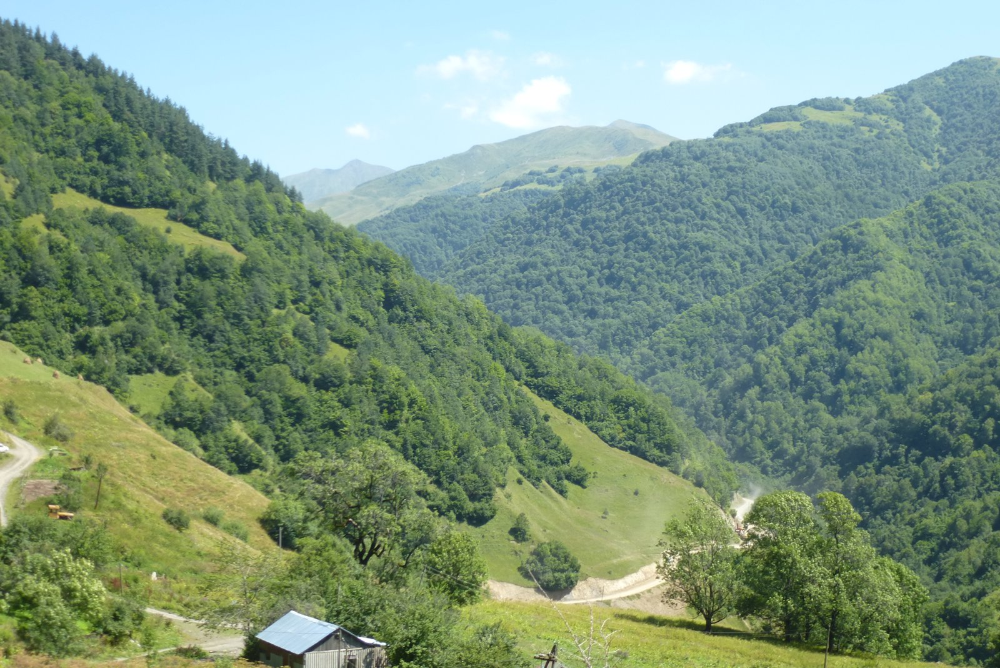

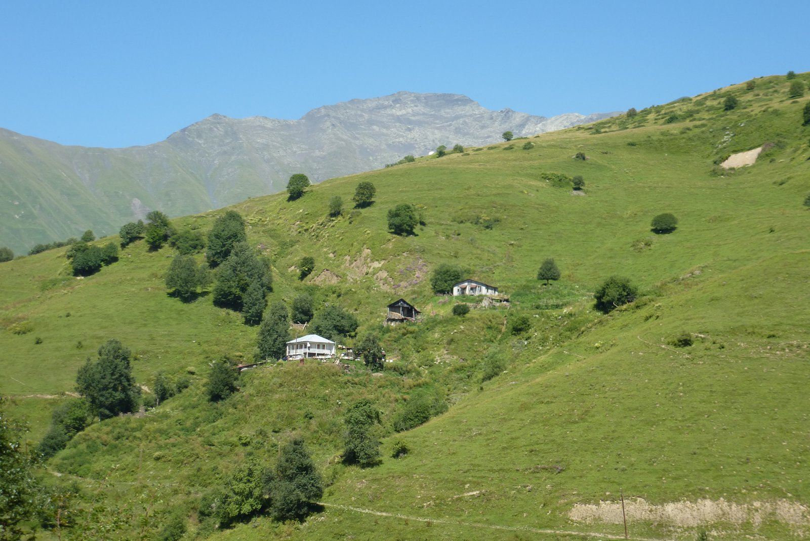

No tengo muy claro a dónde voy, ya que no dispongo de cartografía de la zona y tampoco hay indicaciones. No obstante, me dijeron que el guesthouse sí que estaba señalizado, así que supongo que, tarde o temprano, veré una indicación. Y a juzgar por el paisaje, ya no puede quedar mucho... porque se me está acabando el monte!

Y así es. Poco más adelante, tras una hora de durísima subida en la que me ha tocado empujar la bici más de lo que me habría gustado, llego al guesthouse. Es una pequeña cabaña en la zona transitable más alta. De aquí para arriba, monte y rocas.

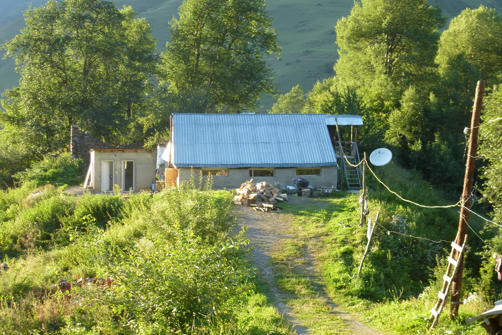

Una señora que no habla una palabra de inglés me recibe. Es muy difícil comunicarse verbalmente cuando no tienes ninguna palabra en común, ni tan siquiera parecida... pero por señas todos nos entendemos. Lo primero, poner la bici en lugar seguro.

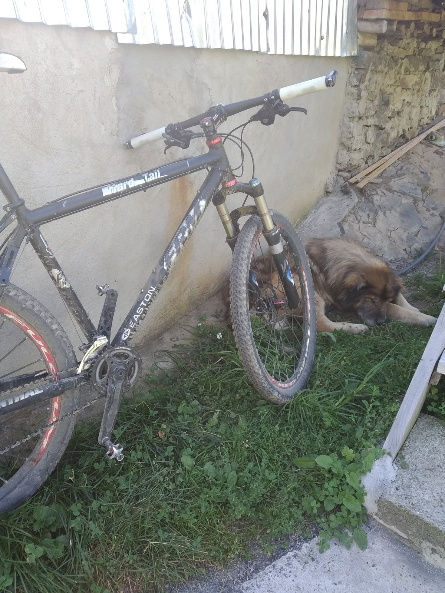

A continuación me muestra la que va a ser mi habitación. Éstas son las vistas.

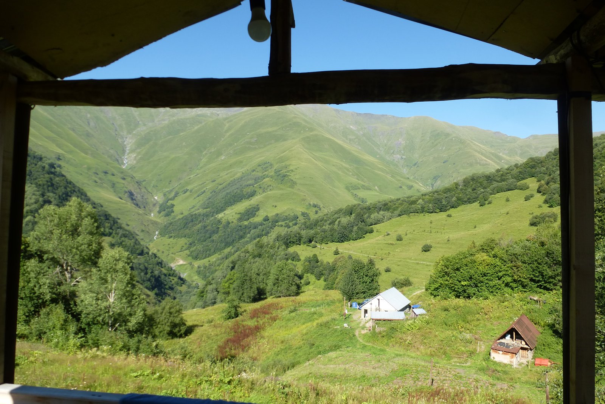

Y como no, toca asearse y hacer la colada.

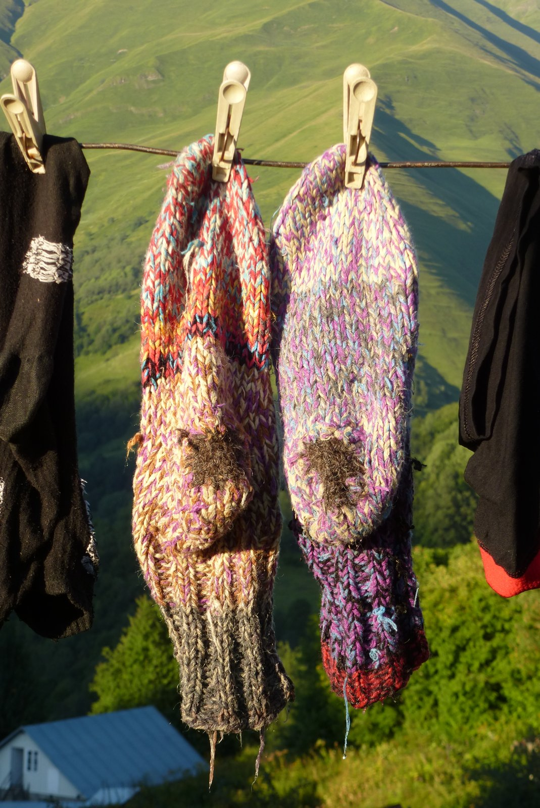

Si algo llama la atención de éste lugar es la cantidad de lagartijas que te puedes encontrar en las zonas donde da el sol. Tanto es así, que tienes que tener cuidado para no pisarlas. En el interior del guesthouse me encuentro con algún dibujo de visitantes anteriores, y en todos ellos sale dibujada alguna lagartija.

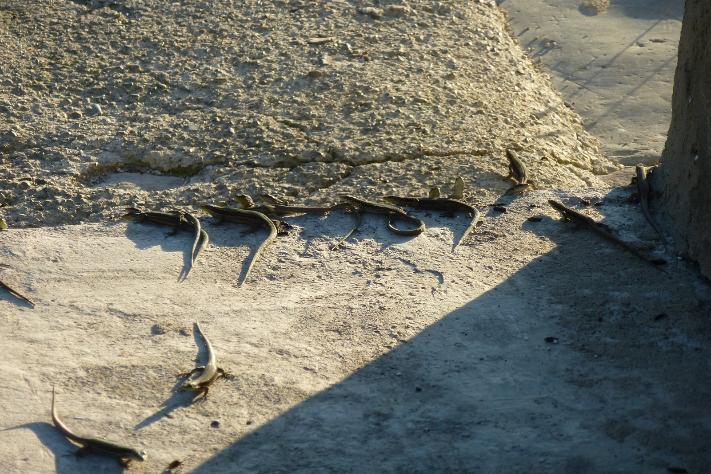

No obstante, lo cierto es que tengo bastante hambre. Dije que tenía un buen pálpito con este lugar y no me va a defraudar. Y para muestra, la merienda.

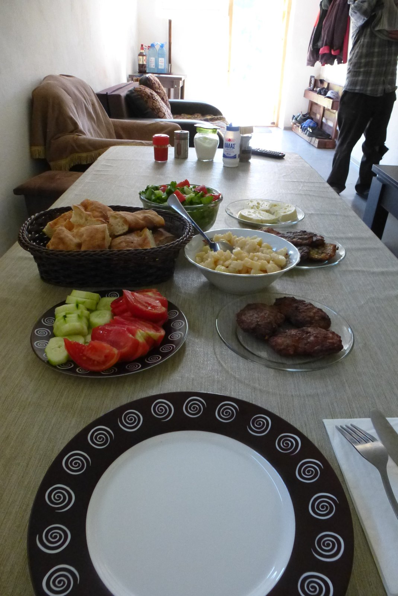

La merienda casi se solapa con la cena, así que me paso un buen rato comiendo y charlando con el hijo del matrimonio que regenta el guesthouse. Es el único que habla inglés. Resulta que vive y estudia en Zhinvali, la ciudad de la que he salido esta mañana. Ésta es su <em>casa del pueblo</em>, a donde vienen en verano, cuando el tiempo lo permite, a hacer queso, recoger la miel y, si hay suerte, alojar a algún turista.

Sobra decir que pocas veces he dormido en un lugar tan tranquilo y confortable. El esfuerzo ha merecido la pena, y hay que mirar la parte positiva: Mañana, ¡los diez primeros kilómetros serán en bajada!

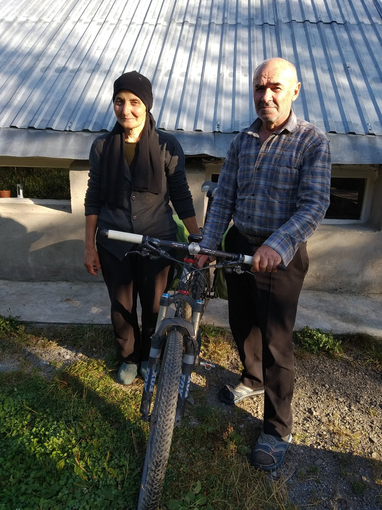
