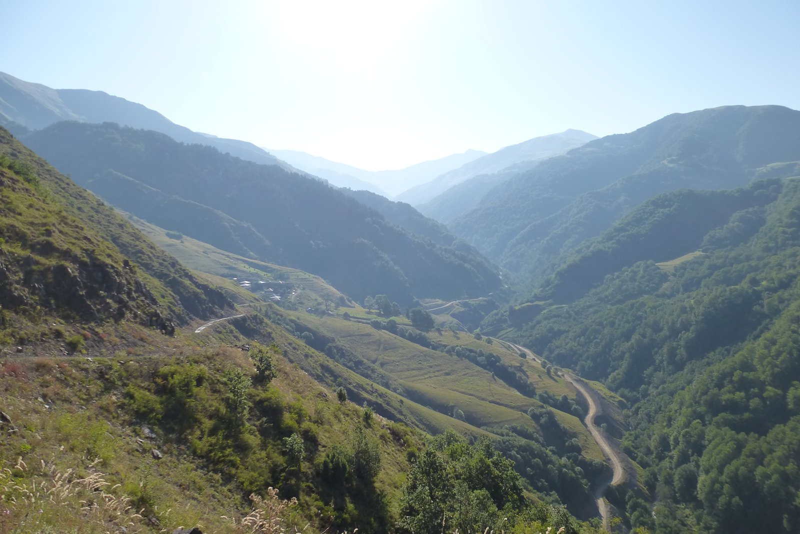
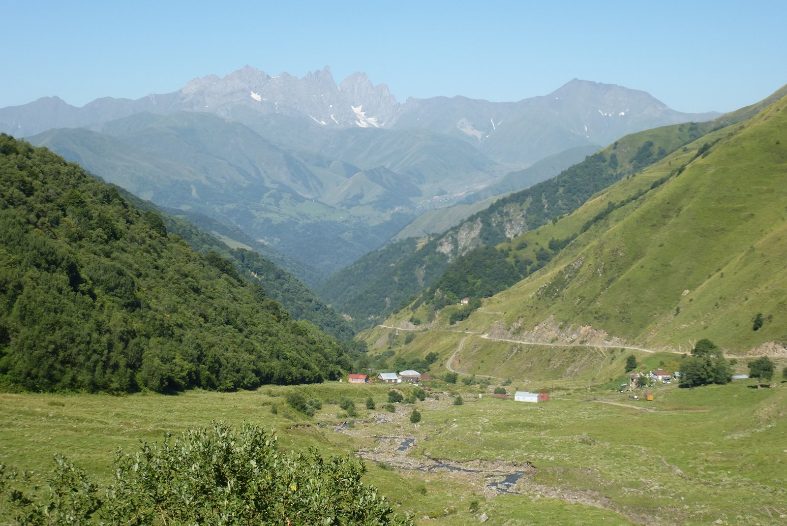
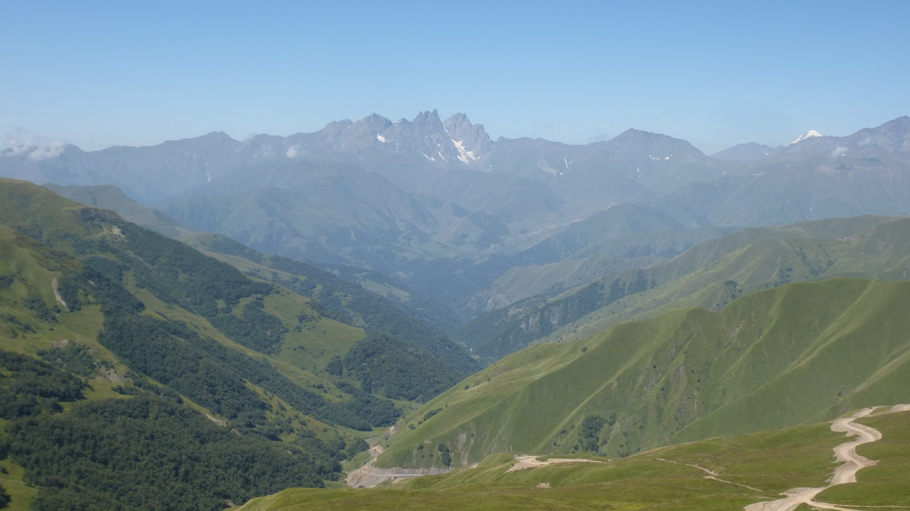
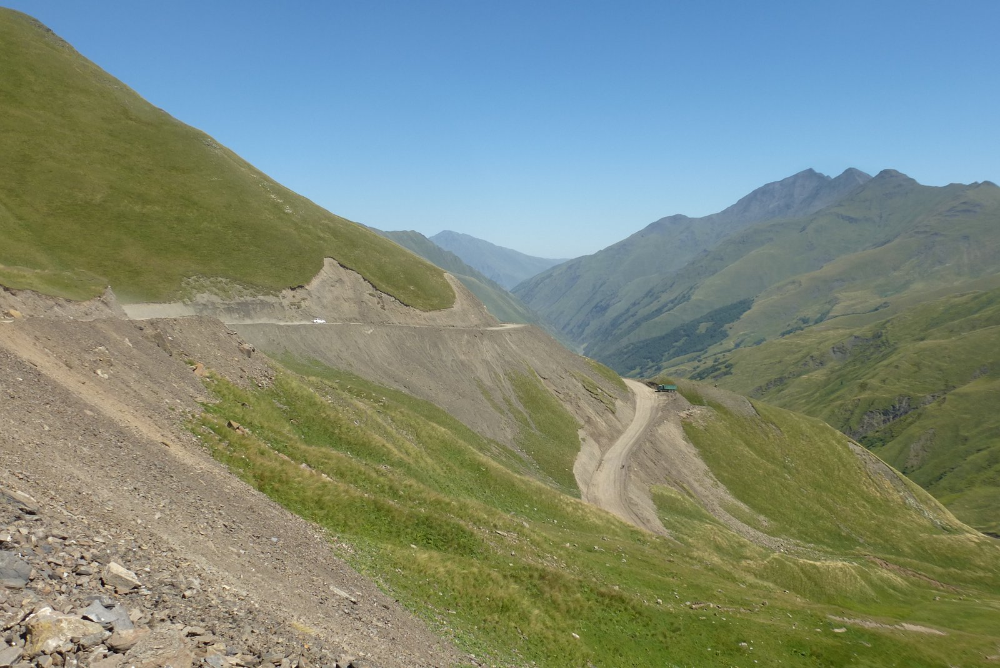
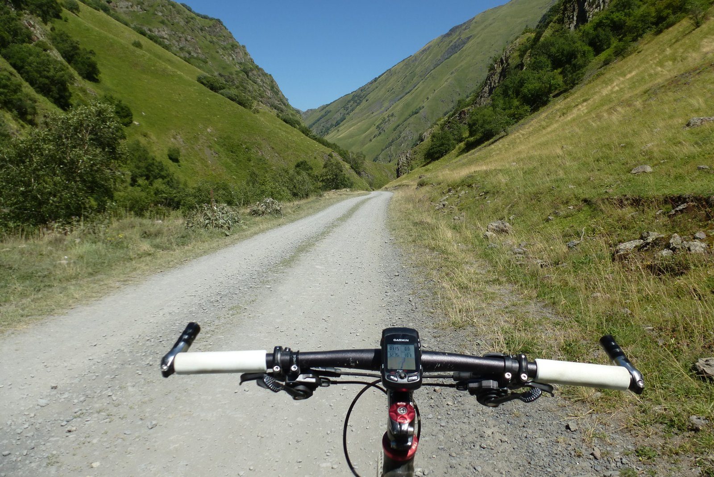
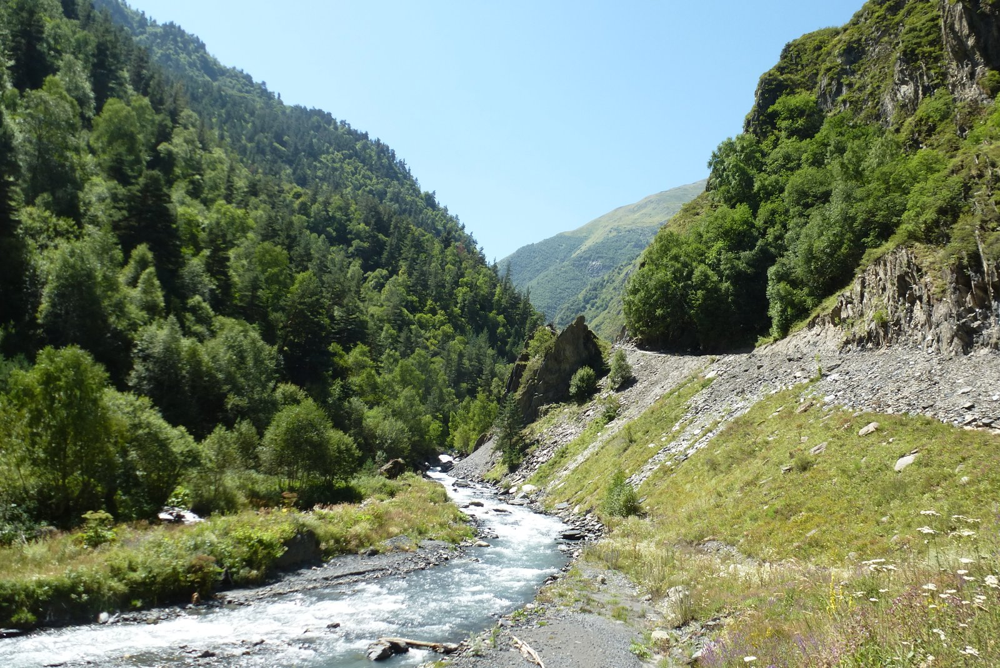
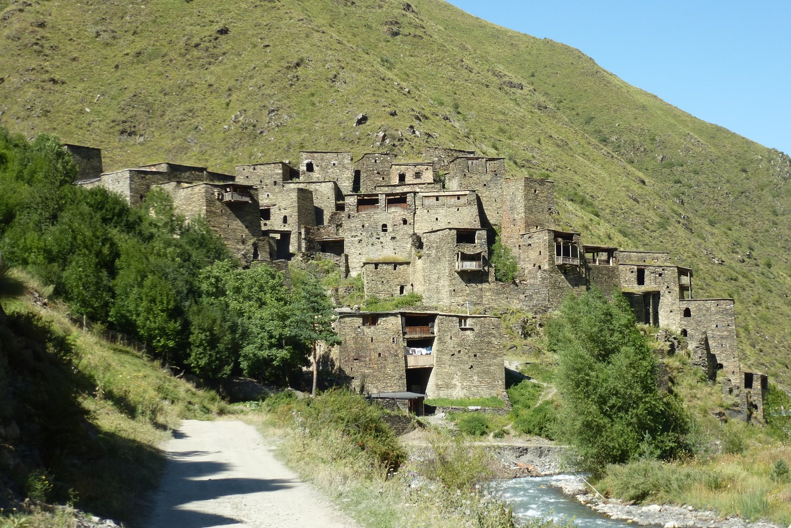

¡Qué bien se duerme cuando se está cansado! La noche ha sido fría, así que me he acurrucado y he dormido como pocas veces. Me levanto temprano y me encuentro con otro desayuno contundente, compuesto de prácticamente lo mismo que la cena del día anterior: queso casero, miel de sus abejas, verduras de su huerto... pero desgraciadamente, el único café que se consume por la zona es café soluble. Vaya, tampoco me voy a quejar por eso... pero mejor me tomo un té.

La mañana está fría, y la niebla mantiene un punto de humedad bastante alto. Además los primeros kilómetros son en bajada, así que hoy será el primer y único día que pondré algo de ropa de abrigo. Voy perdiendo altura rápidamente y voy saliendo de la niebla que está posada en lo alto de las montañas. La mañana me regala unas vistas maravillosas.

En poco tiempo pierdo 500 metros de altura que ayer tanto me había costado llegar en este tramo que va desde la pista principal hasta Atabe. Nuevamente en dicha pista, esta vez giro a la izquierda para continuar hacia Shatili. Tan sólo un puerto de 2.800 metros se interpone en mi camino. El día va a ser intenso, pero estoy seguro que las vistas merecerán la pena.

De momento veo que el sol aprieta y el calor se empieza a sentir, así que me quito toda la ropa de abrigo que me puse al salir de Atabe, que me ha protegido muy bien de la niebla durante un rato, y vuelvo a mi atuendo veraniego que a buen seguro me acompañará el resto del viaje.

La pista es ascendente en todo momento. La pendiente no es muy pronunciada y el firme es de tierra compacta, no excesivamente malo. Eso sí, es muy polvoriento, y cada vez que me adelanta un camión me veo envuelto en una nube de polvo blanquecino que no me deja ver nada. Y me pregunto, ¿a dónde se dirigen tantos camiones? La pista muere poco más allá de Shatili, y no me consta que haya ningún destino evidente para tanto camión. La mayoría son volquetes, me adelantan vacíos y vuelven llenos de piedras y tierra. ¿Una obra tal vez?

La pista es tendida en algunas zonas y empinada en otras, y siempre muy polvorienta. La ruta me está deleitando con estupendas vistas, gracias a la altitud y a un día tan despejado. Eso sí, tengo ganas de llegar a Shatili.

Shatili es un pequeño pueblo histórico de Georgia, propuesto como <a href="https://whc.unesco.org/fr/listesindicatives/5232/" target="_blank" rel="noopener noreferrer">patrimonio mundial por la Unesco</a>. Se encuentra situado en la vertiente norte del Cáucaso, en la región de Khevsureti, muy cerca de la frontera con Chechenia. Intentaré alojarme en un guesthouse en el centro de la fortaleza. Será, sin duda, uno de los puntos más interesantes del viaje, y también el más remoto (que no inaccesible). Llegar hasta allí, bien sea en bici o en coche, es un pequeño desafío.

Durante la subida me voy encontrando con varias máquinas que están trabajando en diferentes puntos de la ruta, arreglando derrumbes y mejorando algunas zonas con mal firme o mucho desnivel.

Después de unas horas llego a la cima. Aunque estoy a casi 3.000 metros y se nota la diferencia de temperatura, la brisa es tan agradable que ni me planteo abrigarme. Toca perder altura hasta el valle para encarar la última parte de la ruta hasta Shatili.

Parecía que llegaba un descenso vertiginoso hasta el valle, pero nada más lejos de la realidad. Había multitud de obras en la carretera para ensanchar el trazado, para alargar la pista quitando algún desnivel, para apartar algún derrumbe... pero no eran obras como a las que estamos acostumbrados. Lo más normal era encontrarte las máquinas cortando la carretera, y una caravana de vehículos y personas esperando a que acabasen lo que estaban haciendo para volver a abrir la carretera. Aunque el tráfico era más bien escaso, sí que te encontrabas a un buen puñado de coches esperando durante 15 o 20 minutos. Y nadie parecía impacientarse, ¡es lo que hay! Así pues, el <em>vertiginoso</em> descenso se convirtió en un pequeño descenso seguido de una parada, una y otra vez.

Después de un buen rato llegué al valle, donde ya no me encontré con ninguna otra obra y pude disfrutar de varios kilómetros de una cómoda pista en un entorno muy bonito.

La pista discurre río abajo, cambiando de margen cada poco. Prácticamente no hay tráfico, tan sólo se oye el murmullo del agua y el canto de los pájaros.

Y casi sin darme cuenta, tras una curva, me encuentro con la maravillosa estampa de Shatili. Una ciudad de otra época  en lo más profundo del Cáucaso que se conserva como en la antigüedad. No me puedo creer que hoy vaya a dormir ahí, dentro de una de esas casas.

Y es que hay mucho que ver y que contar de Shatili. Pero eso lo dejo para mañana.
