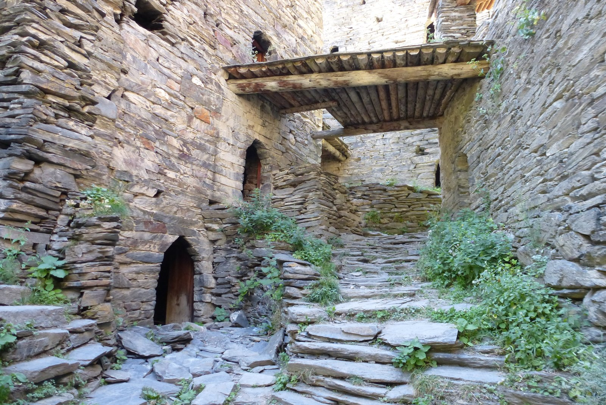
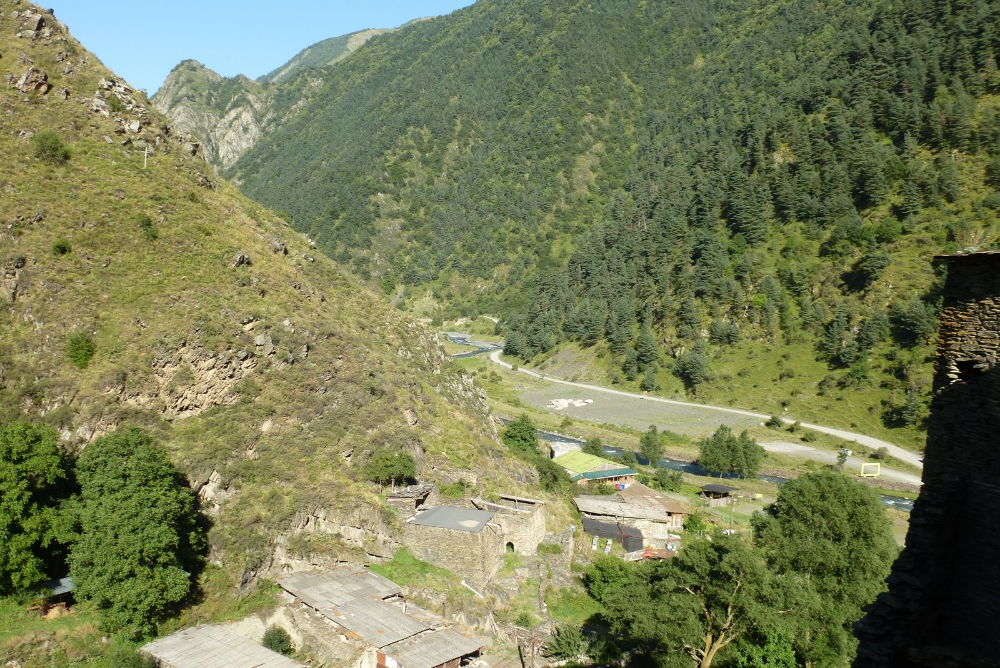
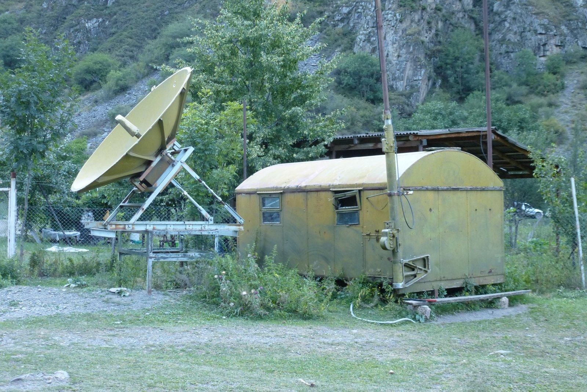
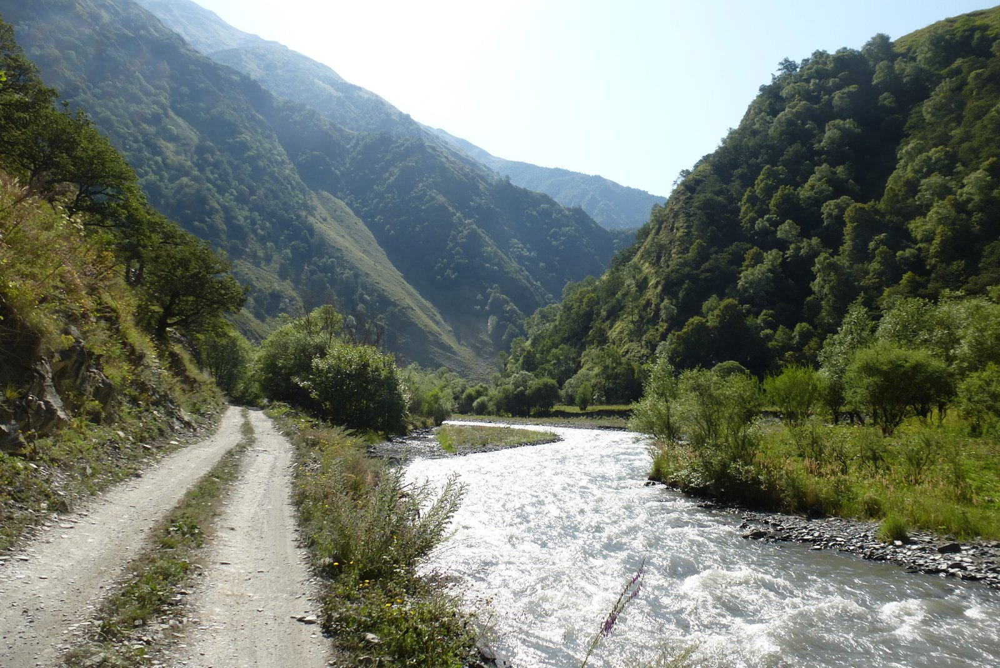
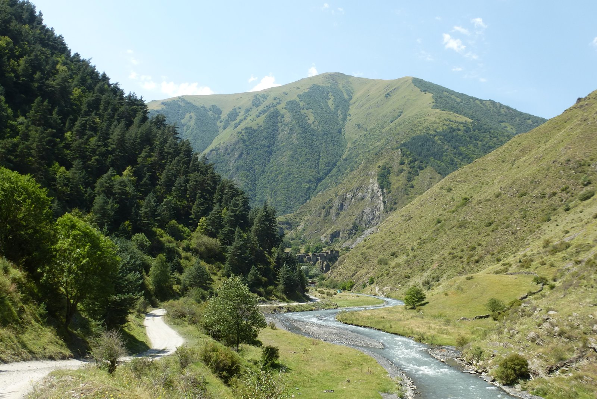

Nada más llegar a Shatili me di cuenta de que estaba en un sitio mágico. Acercarse por la pista para contemplar cómo se abre el valle que da paso a esta histórica villa es una de esas imágenes que quedarán grabadas en mi retina para siempre. No me podría conformar con pasar un único día aquí, tenía que disfrutarlo un poco más. Y más aún cuando había conseguido alojarme en un guesthouse que habían habilitado en una de las casas de la villa. Era, sin duda, el menos glamuroso,  pero el más auténtico.

Dicen que quien algo quiere algo le cuesta, y en este caso el dicho se cumplió a la perfección. Voy a intentar explicar mi periplo desde la llegada a Shatili hasta que conseguí entrar en el guesthouse. Shatili se encuentra situada en la ladera de una montaña y se extiende de arriba a abajo (o de abajo a arriba, según se mire) con lo que, vayas donde vayas, tienes que subir o bajar. Yo me acerqué por la parte alta, ya que había leído que el mejor acceso al guesthouse era por ahí. Cuando llegué (después de bajar un tramo de escaleras), la puerta estaba cerrada a cal y canto y nadie respondía. No se si por culpa de mi tarjeta telefónica o por mi escasa habilidad fui incapaz de llamar al número de teléfono que figuraba en el cartel, así que decidí acercarme a la parte baja de Shatili (arriba no había nadie con quien hablar). Y claro, no iba a dejar mi bici y mis alforjas en la calle... así que bajé por las callejuelas de Shatili hasta la parte baja. Inisito, callejuelas muy empinadas e irregulares.

Una vez en la parte baja de Shatili me acerqué a otro guesthouse a preguntar. Allí me hicieron el favor de llamar por teléfono a los dueños de mi guesthouse. Un chico llegó en poco tiempo y me dijo<em> ¡Vamos para arriba! </em>Pues nada, vuelta a subir. Eso sí, ésta vez que pedí que me ayudase con las alforjas, subir siempre es más duro que bajar.

Las habitaciones se manenían totalmente tradicionales, nada más que una cama y una bombilla llenaban su espacio. Afortunadamente sí que se había construido un baño con una ducha de agua caliente, así que no faltaba ninguna comodidad básica. Y qué decir de las vistas, ¡impresionantes!

Una vez duchado me fui a dar una vuelta por la parte baja del pueblo, y a buscar algo de comer. Shatili, aunque pequeño y alejado, sí que tiene cierto turismo, así que no me fue muy difícil encontrar algo de comida y una cerveza. Eso sí, mejor beber con cuidado, no parece buena idea pasarse con el alcohol bajo éste sol de justicia.

Shatili tiene un enclave estratégico. Dado que es el pueblo georgiano más cercano a la frontera chechena, ha tenido (y sigue teniendo) control militar. Aquí, algunos ¿restos? de lo que parece una central de comunicaciones.

Al atardecer aproveché que bajó un poco la temperatura para dar un paseo por los alrededores. La pista continúa durante varios kilómetros hasta adentrarse en las montañas, cruzando a la parte <em>este</em> de Georgia por el paso de <em>Atsunta. </em>No tengo intención de cruzarlo, en este viaje no me he traido la tienda de campaña y este paso hay que afrontarlo en dos días. Además, no me atrae la idea de empujar la bici durante horas y horas, he leído que este paso es complicado hasta caminando.

No obstante, merece la pena pasar un día más aquí para explorar el entorno.

De vuelta al guesthouse, conozco a mis compañeros de habitación. Nathalie, una chica de Bruselas que viaja a dedo. Viajó desde su casa hasta Armenia en avión, y desde ahí llegó a Shatili haciendo autostop. Y Juanma, un canario muy majete que también viaja en solitario.

Me confirman que hay disponibilidad para una noche más (sólo una), así que busco algo para cenar y me preparo para un nuevo día por los alrededores de Shatili.
