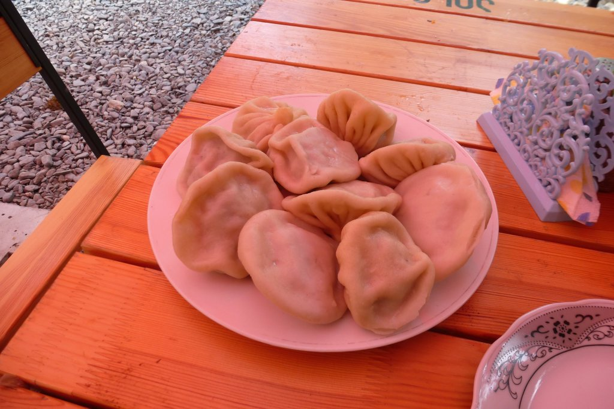

En Shatili tenía dos opciones: seguir hacia el sureste y atravesar el Atsunta, o bien volver sobre mis pasos. El paso del Atsunta parece espectacular, y sin duda merece la pena. Pero no voy equipado para la ocasión; hacer el paso en un solo día no parece factible, y no me he traido la tienda de campaña ni hornillo, así que habrá que dejarlo para otra ocasión.

Así pues, doy la vuelta rumbo a Zhinvali. Esta vez no haré parada intermedia, sino que haré el recorrido completo. Son muchos kilómetros, pero una vez se corone el puerto, el terreno es muy favorable. Siempre en ligero descenso. Pero claro, primero hay que coronar el larguísimo puerto que descendí hace ya dos días.

Al poco de empezar el puerto me encuentro la carretera cortada. Un coche, sin nadie dentro, se encontraba atravesado en la carretera y, poco más adelante, en la parte inferior de una subida en "zetas", encuentro un montón de piedras desperdigadas. Y lo que es peor, una lluvia de piedras que vienen de la parte superior, donde se encuentra una pala excavadora arreglando la carretera. ¿Y ahora?

Desde una zona más o menos segura, intento hacer señas y grito para que me oigan. Pensándolo bien, teniendo en cuenta la distancia a la que me encuentro, va a ser imposible que oigan. Afortunadamente, no pasa mucho tiempo hasta que la persona que maneja la excavadora me ve, deja de trabajar y me hace señas para que suba. Así que, poco a poco (muy poco a poco) voy subiendo. Las piedras que me encuentro en el camino me entorpecen muchísimo la marcha, y es que algunas son enormes y me cuesta pasar incluso caminando. Tardo unos diez minutos en llegar a la excavadora. Agradezco el gesto al conductor, que me pregunta: "England?" Tras intercambiar "Spain" y "Madrid" con él, continúo la subida.

El tiempo es fresco,  se agradece para una subida tan dura. Ésta cara es más corta y dura que la otra, y algunas rampas tienen tanta inclinación que tengo que echar pie a tierra y empujar la bici. Además, curiosamente, no siempre el terreno está bien pisado lo que hace que me hunda de tanto en tanto. En definitiva, es un terreno bastante pegajoso. Y así, entre piedras y empujones a la bici, llego a la cima.

Noto la subida de temperatura al cambiar de vertiente. De ahora en adelante, me limito a soltar frenos y dejarme caer. La bajada es muy larga y me obliga a pedalear durante un buen rato. Me cruzo con un buen número de camiones que levantan muchísimo polvo y acabo como si me hubiese revolcado por el suelo..

Antes de llegar a destino, paro en un pequeño bar para comer algo. Lo lleva una familia muy simpática. La mujer habla italiano, y así poco a poco nos vamos entendiendo. Me cuenta que trabaja varios meses al año en Italia, en la vendimia (o eso quiero entender) . Total, que pPensaba en pedir algo para llenar el estómago, sin más, pero acabo comiendo los mejores <a href="https://es.wikipedia.org/wiki/Khinkali">khinkalis</a> de todo el viaje. Eso sí, he de reconocer que me dejé llevar por la gula y comí más de la cuenta. Afortunadamente, ¡el camino sigue siendo favorable!

El último tramo es un sube y baja de asfalto que se me hace bastante pesado. Después de más de 100 kilómetros llego al mismo hotel de Zhinvali donde he estado hace ya tres días.
