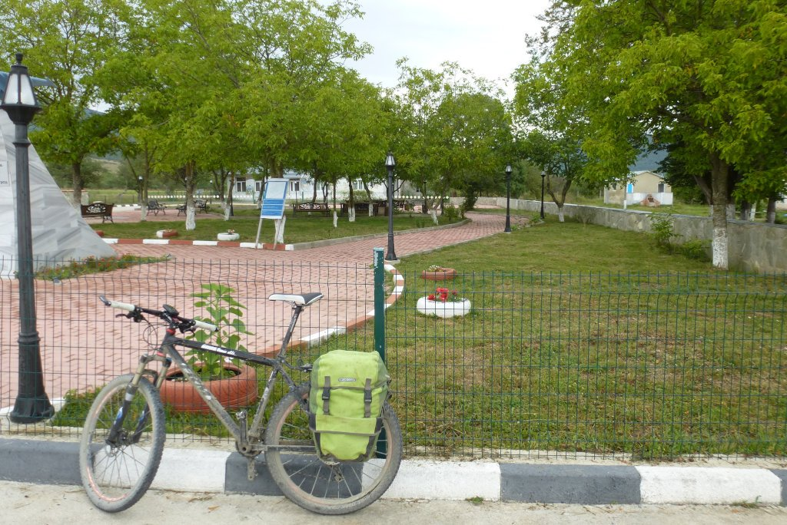
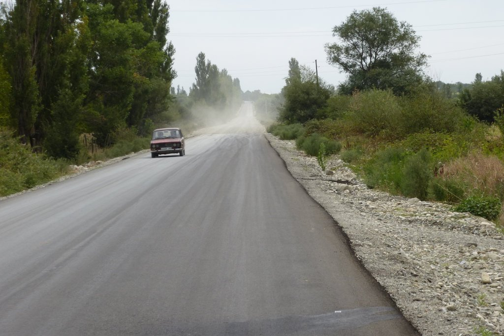
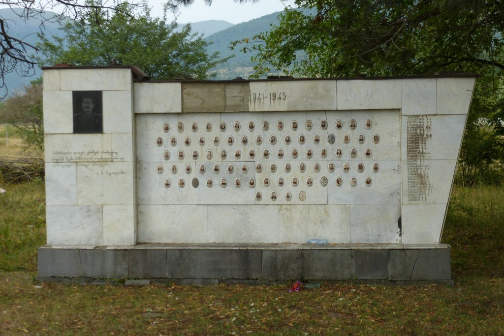
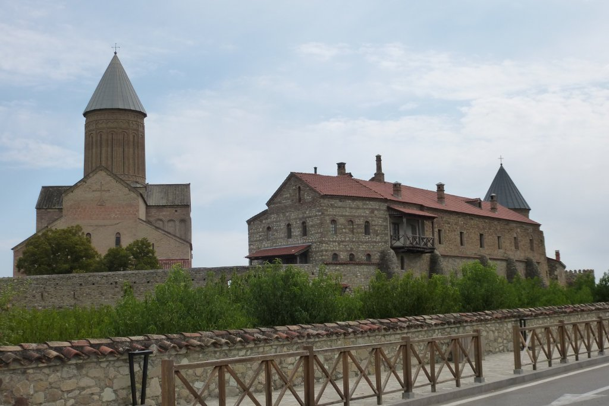

Hoy tocaba ruta sencilla, al menos sobre el papel. Aunque me quedaban bastantes kilómetros hasta Telavi todo el recorrido era asfaltado, lo que facilitaba mucho la marcha. Eso sí, los 100 kilómetros los había que rodar.

Qué mejor manera de empezar que con un puerto, no muy largo, pero con rampas duras. Tras coronar el puerto fui atravesando diferentes pueblos sin demasiado interés.

Afortunadamente, en uno de los pueblos encontré una gasolinera con manguera a presión donde le pude dar un buen lavado a mi bici. El polvo del día anterior había sido tan abundante que había creado una costra dura en todo el cuadro. Además, parecía casi imposible quitarlo de la transmisión. Afortunadamente la manguera tenía presión suficiente para arrancar la pintura. Dejé mi bici totalmente limpia y seguí viaje hacia Telavi.

En la parte final del viaje pasé por el imponente <a href="https://goo.gl/maps/S5QBY9pWBtEPT3CL7">Monasterio de Alaverdi</a>.

Y de ahí hasta el final, poco más que contar. Finalmente llegué a Telavi, donde pude relajarme en la ciudad más tranuila de todas las que he visto a mi paso por Georgia. He de reconocer que el viaje no funcionó como esperaba pero, con todo, me queda un gran sabor de boca de mi paso por Georgia. Unos paisajes maravillosos, una gente encantadora y una gastronomía que, si no la habéis probado, os la recomiendo.
