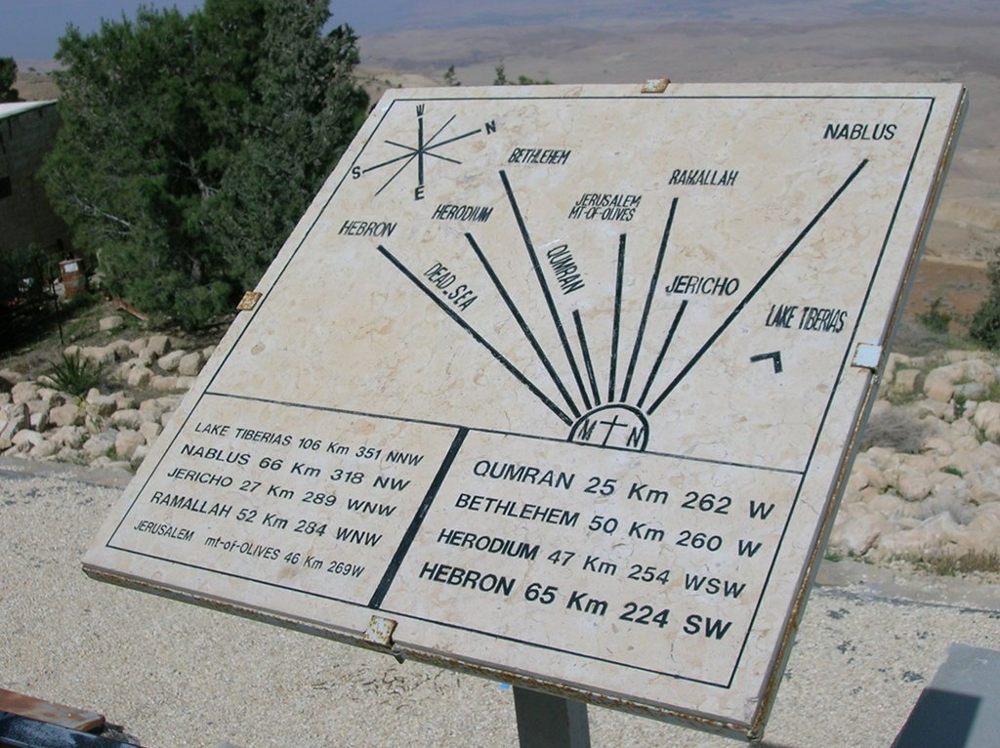
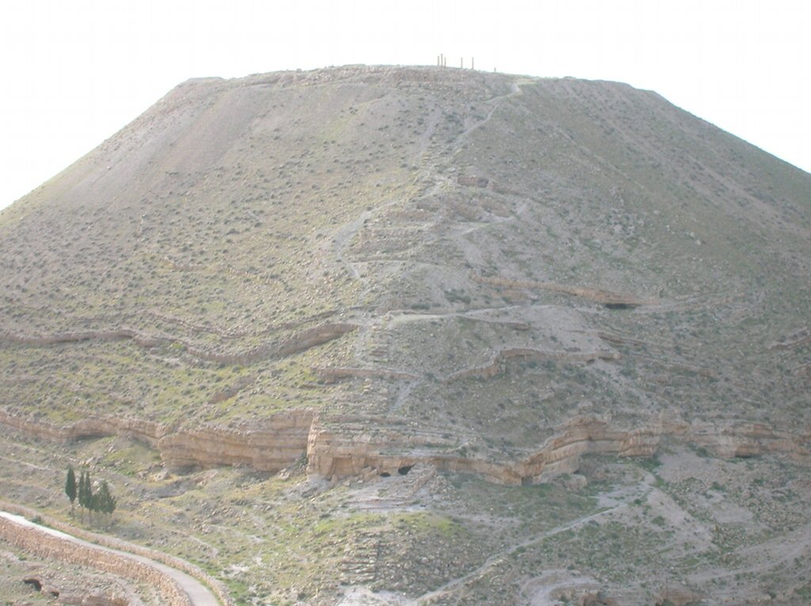

Tenía muchas ganas de volver a un país árabe y, aunque mi primera idea era Egipto, finalmente me decidí por Jordania. No iba a ver las pirámides, pero por contra iba a visitar la magnífica ciudad de Petra.

Me junté con el grupo en Madaba, muy cerca de Amán, capital de Jordania. Llegamos a Jordania bastante tarde y arrancábamos la primera etapa muy temprano, así que todo pasó muy rápido. Montamos las bicis y nos pusimos a pedalear, saliendo desde la misma puerta del hotel. La primera parte de la etapa fue aburrida, mucha carretera sin nada interesante, hasta que llegamos al monte Nebo. Desde lo alto de este monte, Moisés divisó la tierra prometida. El paisaje era bonito, aunque supongo que para un creyente la imagen tendría un significado especial.

El resto de la etapa no tuvo mucho interés, pero lo mejor estaba por llegar. Al final de la etapa íbamos a visitar las ruinas de la fortaleza de Mukawer. Un pequeño trekking nos llevó hasta lo alto de estas ruinas. La fortaleza de Mukawer fue construida durante la primera centuria antes de Cristo. Herodes el Grande construyó un palacio en su interior, y finalmente fue destruida en el 70 después de Cristo. Y lo mejor, la vista del mar Muerto desde la cima.

La noche iba a ser aún mejor. Una familia beduina nos iba a acoger en su casa, y nos iba a ofrecer lo mejor. Literalmente nos agasajaron con su hospitalidad. Primero, una buena conversación donde aprovechamos para tocar los temas sensibles, como la poligamia. No queríamos ser impertinentes, pero hay que aprovechar estos momentos para tocar temas interesantes. Después de la conversación, nos deleitaron con un magnífico café beduino. Tiene una preparación muy parecida al café turco, pese a su insistencia en subrayar que no tenía nada que ver. Eso sí, con mucho cardamomo. Además, la ceremonia del café es muy interesante. No aceptar un café beduino es casi una ofensa y, por muchos problemas que haya entre dos familias, si se acepta una invitación a un café indica que todos los problemas han sido zanjados. Es como la pipa de la paz de las películas de vaqueros de nuestra infancia.

Tras el café, una fantástica cena al aire libre. Dos enormes bandejas de arroz con pollo con diferentes preparaciones y muchas especias. Y lo mejor de todo, nada de cubiertos, a comer con las manos. Esta bienvenida a Jordania había sido espectacular, todo un lujo que nos prepararía para la fantástica experiencia del viaje por Jordania. Pasar la noche bajo el cielo estrellado puso la guinda al pastel de este primer día.
