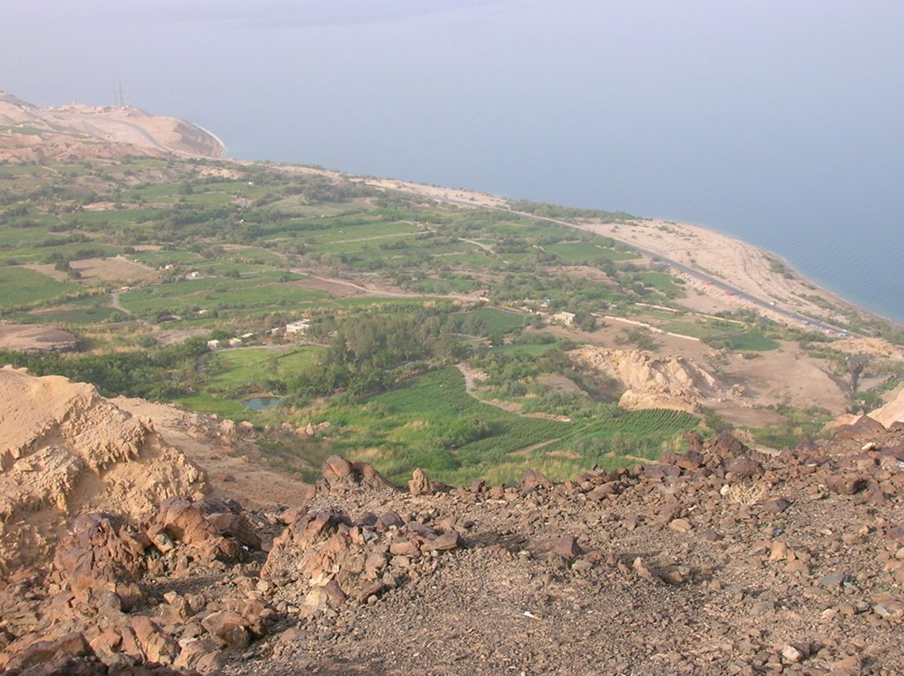
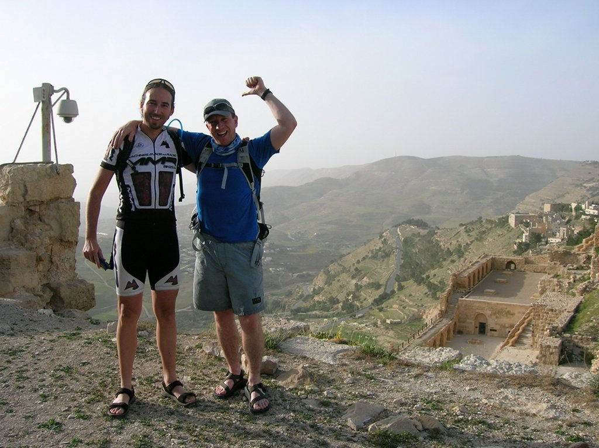
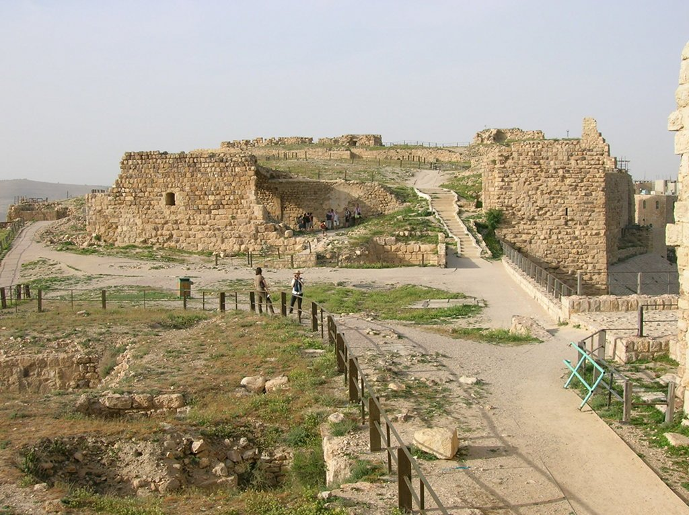

Después de dormir al raso en Mukawer, tras una confortable y bonita noche estrellada, nos sentimos con fuerzas para comenzar la segunda etapa. El principio no parece complicado, tan solo un tan solo un descenso que nos llevará hasta el mar muerto para recuperar altura nuevamente al final de la etapa. Pero como siempre, llegaría un invitado que nos iba a endurecer la etapa.

Como comentaba, el principio de la etapa discurrió por una carretera sin nada más interesante que una bonita vista sobre el mar Muerto, incluso entre la tenue neblina podíamos vislumbrar la costa israelita de este peculiar mar, situada a 18 kilómetros de la costa jordana. Peculiar por su alta salinidad, en el cual nadar se convierte en una tarea sencilla, y por su ubicación, a 417 metros bajo el nivel del mar. Nunca había pedaleado a tan poco altura, y nunca mejoraré esta cifra dado que me encontraba en el punto más bajo de la Tierra en tierra firme.

Evidentemente había que darse un baño, y aproveché para descubrir dos cosas. Uno, mi inglés no es tan bueno como pensaba y me perdí la parte en la que el guía nos decía <em>no metáis la cara en el agua si no queréis que os pique a rabiar</em> (o algo así) y que el grado de flotabilidad del mar Muerto es mayor del que pensaba. Nadar en sus aguas es como intentar nadar en mermelada. Muy complicado, dado que prácticamente estas <em>posado</em> sobre el agua, y sobre todo muy divertido. Nunca me había sentado en el agua, es una experiencia muy extraña.

Después de un buen baño y una buena comida iba a comenzar la subida a Al Karak, situado a 1.000 metros sobre el nivel del mar. Es decir, nos quedaban 1.400 metros de ascensión. La subida no parecía demasiado complicada, dado que era una carretera larga y tendida, pero no contábamos con la temperatura. 45º al comenzar la subida, que llegarían a 50º en momentos puntuales. Por fortuna los guías nos iban a cuidar bien y no íbamos tener falta de agua. Bebí todo lo que me aceptó el cuerpo, y poco a poco fui alcanzando la cima en Al Karak, comandada por las majestuosas ruinas de su castillo. Tan solo Duncan, mi compañero de habitación, y yo alcanzamos la cima. El resto del grupo se tuvo que subir al coche de apoyo, que por fortuna estaba presente en esta etapa de carretera.

Después de la subida visitamos el castillo. Me gustaría explicaros lo bonito que es, pero por desgracia apenas disfruté de la visita y no me enteré de muchas cosas. Duncan se volvió para el hotel, mientras que yo aguanté con un terrible dolor de cabeza a causa del intenso calor y la evidente deshidratación. Tuve la cabeza dolorida hasta el día siguiente.

Después de cenar en un bonito restaurante al lado del castillo fuimos a comprar víveres para la siguiente etapa. Me fui intranquilo, ya que el guía insistió en que podíamos dejar las bicis en la calle, frente al hotel, que estaba en medio de la ciudad. Ante mis continuas preguntas de <em>no sería mejor guardarlas? </em>o <em>no hay peligro de que alguien las robe? </em>siempre me respondía con un simple <em>estás en Jordania.</em> Reconozco que, pese a mi confianza ante la profesionalidad del guía, me fui intranquilo.

Me encantan los mercados locales, intento pararme y tocarlo todo. Era de noche y no íbamos a ir a un mercado tradicional, era más como un Mercadona pequeño. Aun así, me encantó la experiencia. Mientras comprábamos, el dueño del supermercado nos invitó a café, algo que no me pasará en ningún supermercado de España, y aproveché para comprar unos maravilloso (y baratos) dátiles jordanos.

Y ya de vuelta en el hotel, descubrí a un chico que estaba paseando con mi bici. Me bajé nervioso del coche y le dije, intentando parecer tranquilo: <em>oye, esa es mi bici.</em> El chico sonrió y se acercó a mi para explicarme lo mucho que le gustaba, el color, la suspensión... realmente no había ni una pizca de maldad en él, la había cogido porque le gustaba y quería probarla. La colocó delicadamente junto al resto y siguió hablando con sus amigos. Otra lección aprendida: podía dejar mi desconfianza en la cuneta, estaba en Jordania.
