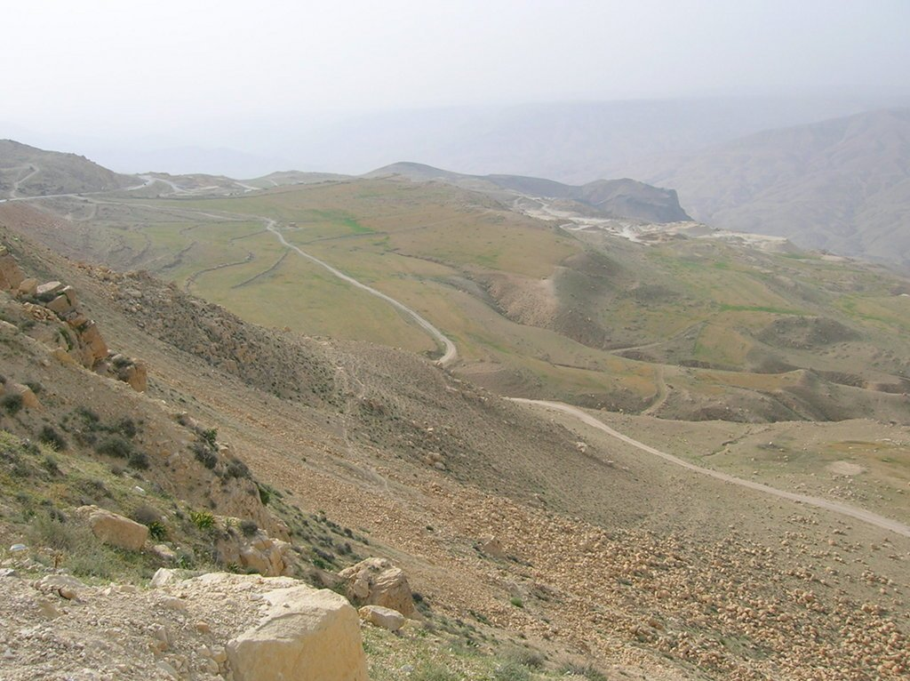

No hay nada como un buen sueño reparador para recuperar la energía perdida el día anterior. El hotel de Al Karak era confortable, y la fatiga acumulada tras la agónica ascensión nos hizo dormir como bebés. A la mañana siguiente nos esperaba un buen desayuno, la mejor forma de empezar una larga etapa de 86 kilómetros.

El paisaje era bonita pero lo cierto es que la etapa se hizo un poco pesada. Carretera y pista se alternaban para llevarnos al inicio del Wadi Musa, el valle donde se encuentra la famosa ciudad de Petra. Pero eso sería al día siguiente.

Hoy íbamos a llegar al Wadi Musa, el valle donde se encuentra situada la bonita ciudad de Petra. Y dando la bienvenida a tan hermoso valle se encuentra Dana. Desconocía la existencia de esta ciudad, y fue una de las mejores sorpresas del viaje. Esta pequeña ciudad, <em>colgada</em> sobre el Wadi Musa, es un antiguo asentamiento de más de 500 años de antigüedad convertido en una villa turística. Pero por fortuna, se ha cuidado la forma en la que el turismo ha llegado a la villa y lo ha hecho de una forma respetuosa y un poco <em>hippie</em>. Hay varios guest-house distribuidos por la villa, todos construidos respetando el estilo clásico del lugar. Desde lo alto de nuestro guest-house pudimos disfrutar de una fascinante puesta de sol en el desierto, una opípara cena y una agradable noche con música tradicional en directo. Eché de menos poder tomar una cerveza, aunque hay que reconocer que el té estaba muy bueno y fue más apropiado para el lugar en el que nos encontrábamos. Tal vez alargamos la noche un poco más de la cuenta, dado que había que madrugar al día siguiente, pero la noche estaba siendo muy animada.
