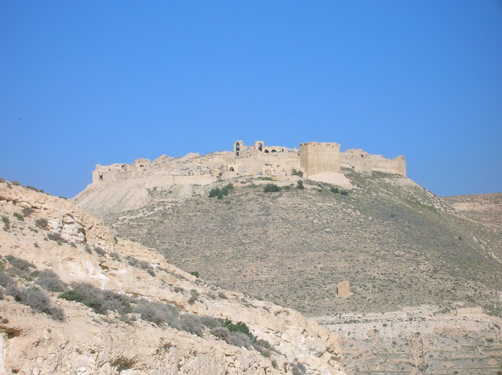
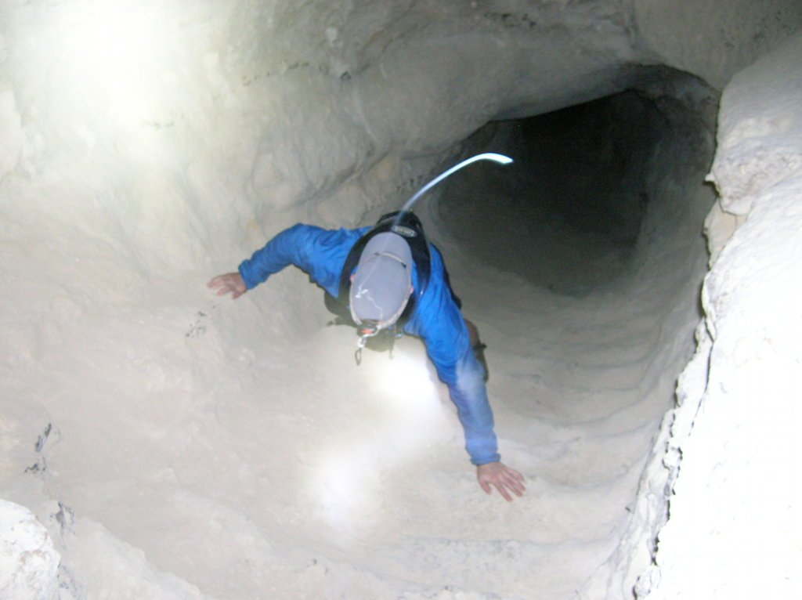
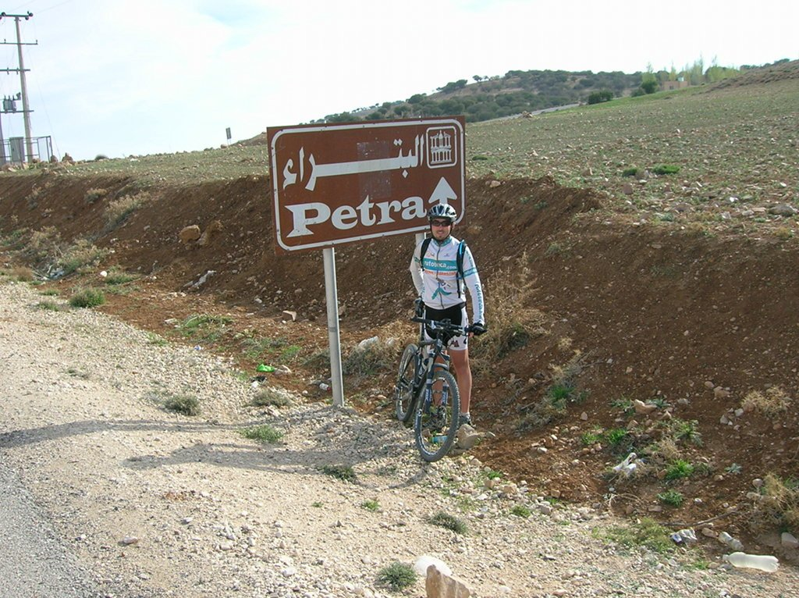

Hoy va a ser un gran día. Por fin vamos a llegar a Petra, y no hay duda que todos estábamos ansiosos por llegar y poder visitar esa maravillosa ciudad. 75 kilómetros separan de Dana, inicio de la etapa, de Petra.

Tras las altas temperaturas de días atrás, de hasta 50º, resulta que hoy no hacía nada de calor. El cielo azul y despejado parecía indicar que las temperaturas iban a ser altas, pero el aire era frío y había que abrigarse. Al parecer, esta zona es fría y son habituales estas temperaturas. Comenzamos la etapa por la King Highway, por un sube y baja muy bonito. Al poco nos salimos de la carretera para coger una pista pedregosa y polvorienta que nos llevaría hasta el castillo de Shobak.

Este castillo se encuentra en lo alto de una montaña que en esta ocasión no íbamos a escalar en bicicleta, sino que íbamos a encontrar una forma más original. Algo nos imaginábamos cuando nos habían pedido llevar con nosotros calzado cómodo y un frontal, y es que existe un camino por dentro de la montaña que nos lleva desde la base hasta lo alto del castillo. En apenas media hora alcanzamos nuestro destino de una forma muy divertida. Estoy seguro de que si hubiese algo similar en Europa (que lo habrá) habría que poner casco, cuerdas, botas de seguridad... pero en Jordania no hay problema, cada uno es libre y dueño de sus actos.

Tras la visita al castillo, recogimos nuestras bicis y continuamos camino a Petra. Íbamos a abandonar definitivamente la carretera para coger una zona de pista que no nos abandonaría hasta el final de la etapa, y nos llevaría por una zona montañosa, dura y con unas maravillosas vista al Wadi Musa, el valle donde se encuentra la ciudad de Petra.

El día seguía frío, lo cual se agradecía tras el calor de días pasados, y tras unos kilómetros por pista saldríamos a la carretera para llegar definitivamente a nuestro destino.

Teníamos ganas de llegar, por un lado para visitar la ciudad y, por el otro, para disfrutar de la jornada de descanso que nos esperaba. Nada más llegar nos acercamos al hamman (demasiado turístico para mi gusto, pero muy bonito) y temprano para la cama. Al día siguiente teníamos visita a Petra y había que madrugar para poder disfrutar el mayor tiempo posible de tan maravillosa ciudad.
