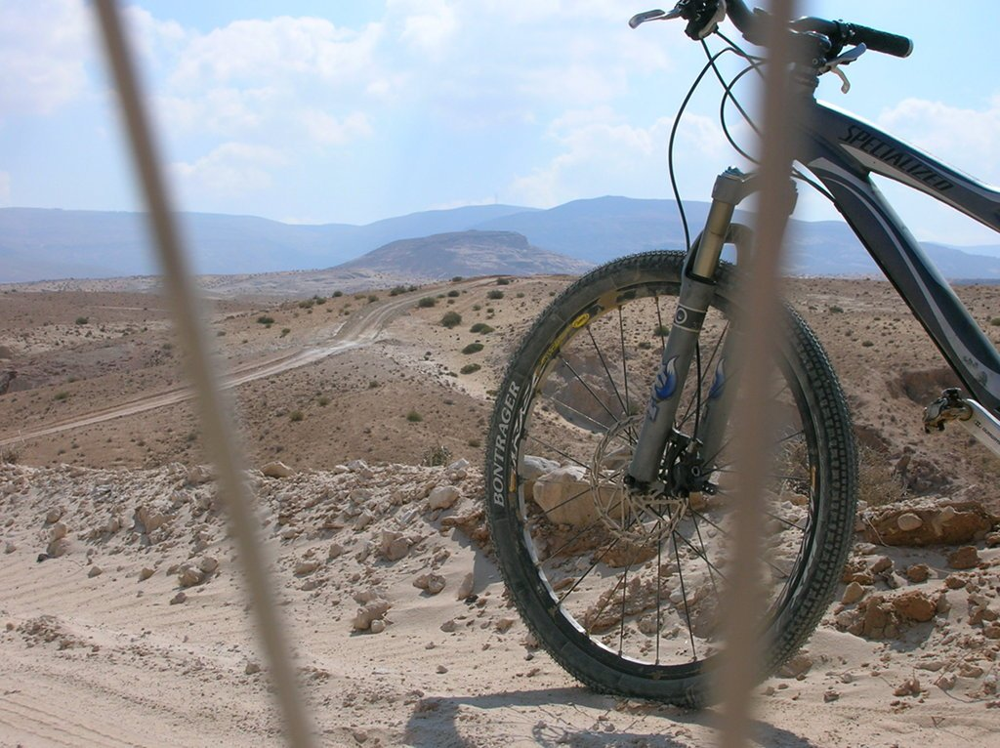
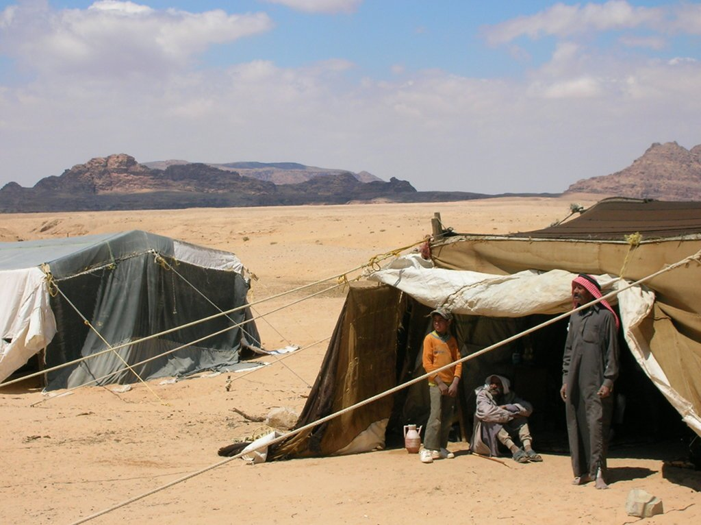
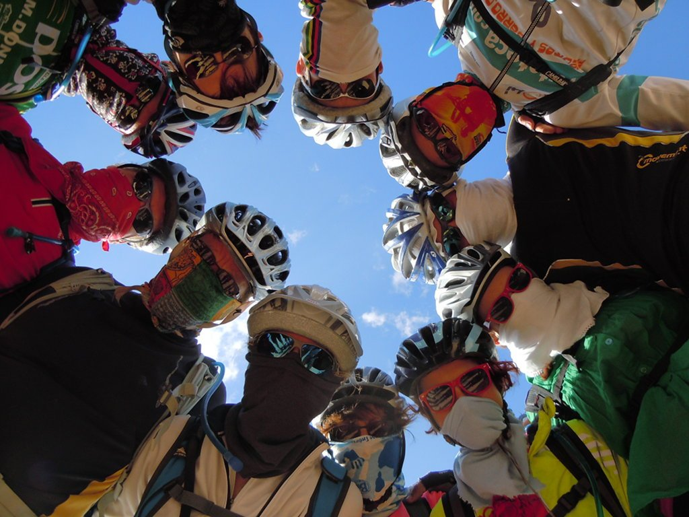
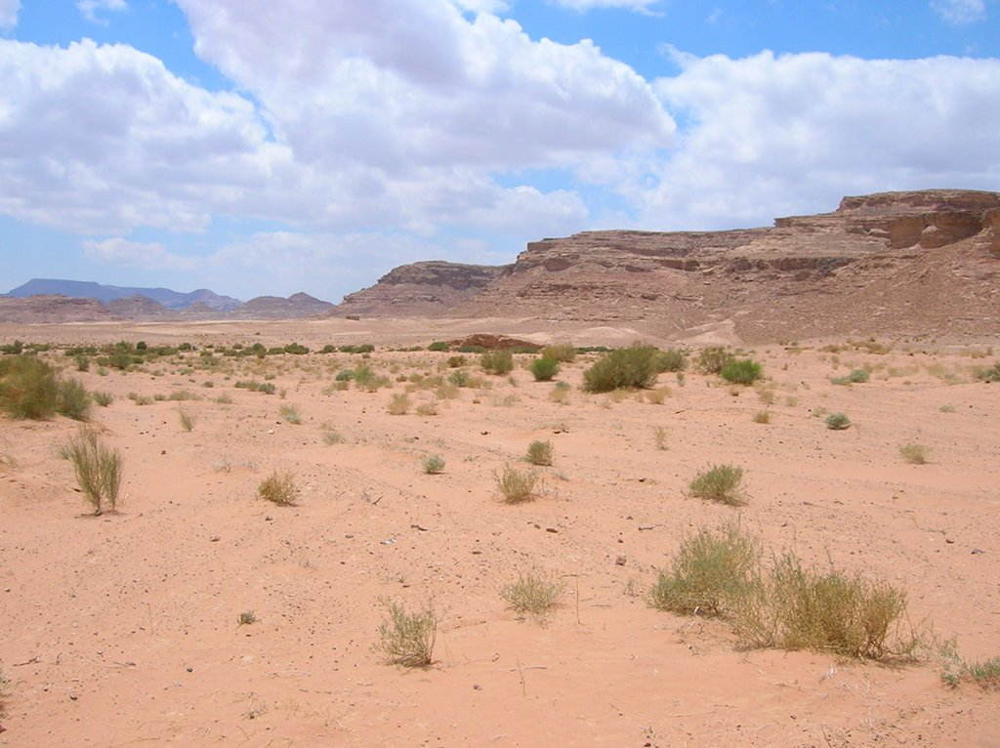
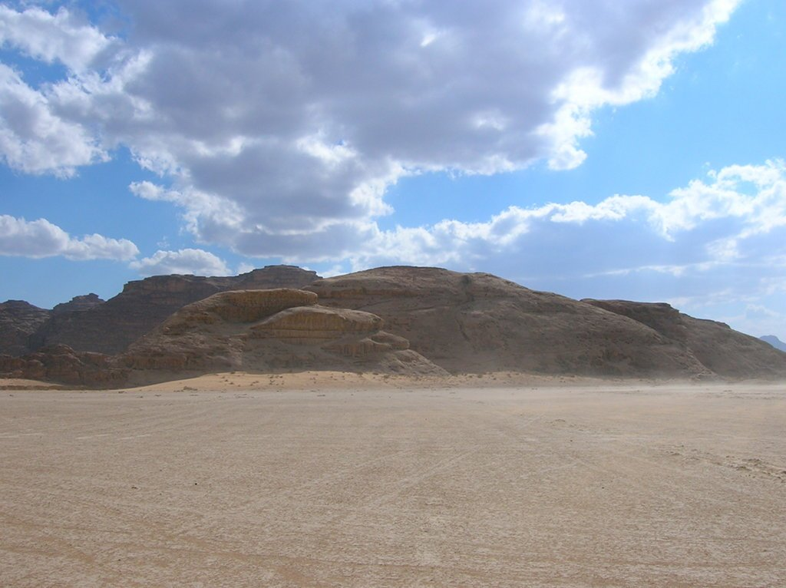

Después del día de descanso (por llamarlo de alguna manera, ya que la visita a Petra no fue lo que se dice un descanso) nos tocaba la etapa reina. 92 kilómetros nos separaban de nuestro destino en el Wadi Rum, un precioso desierto que ha salido en multitud de películas y que íbamos a tener el lujo de disfrutar, incluso íbamos a dormir en sus arenas dentro de unas confortables jaimas.

Por fin íbamos a tener una etapa completa sin asfalto, todo iban a ser piedres y arena. No hay que decir que yo estaba encantado... Salimos por una pista ancha, con mucha piedra, a más de 1.600 metros de altura. Rápidamente entraríamos en el desierto. Largas pistas, cielo azul y, a lo lejos, la arena. Estaba entusiasmado.

Dentro de un rato íbamos a llegar a un pequeño poblado, donde íbamos a tener la oportunidad de pasar un rato con unos nómadas y disfrutar de un té y una buena conversación en una de sus tiendas. Otra vez nos iban a demostrar que siempre hay tiempo para atender a una visita.

Tras el té con los nómadas nos íbamos a adentrar en el desierto. El viento empezó a soplar muy fuerte y empecé a echar de menos, una vez más, disponer de unas gafas de ventisca. Pero no las tenía, así que no quedaba más remedio que echarse un pañuelo a la cara y taparse todo lo posible.

Ahora entiendo lo de los pañuelos en la cabeza, no es un capricho. La arena se colaba por todas partes, y avanzar se hacía complicado.

La etapa reina se estaba haciendo dura. Pero todo ese terreno que tanto nos estaba costando avanzar nos iba a devolver el favor. Poco después entraríamos en el terreno más liso, compacto y, a la postre, rápido por el que había rodado en toda mi vida. El fondo de un lago, seco desde hace años, nos iba a proporcionar este terreno. Y además, el fuerte viento soplaba ahora a favor. No hacía falta pedalear para avanzar, de hecho se hacía necesario frenar.

Y para que veáis de qué hablo, echadle un vistazo al vídeo que grabó uno de mis compañeros.

<iframe src="https://www.youtube-nocookie.com/embed/tzNQVS-t4pw" title="YouTube" loading="lazy" allowfullscreen></iframe>

Finalmente llegamos al Wadi Rum. El paisaje era espectacular, estaba deseando que llegase la siguiente etapa para pedalear entre les piedres y la arena. Pero antes íbamos a disfrutar de una magnífica cena, preparada al estilo más tradicional. Un recipiente metálico, con ascuas en su base y una serie de bandejas en vertical servían de parrilla. Este recipiente, bien cerrado y enterrado en la arena, le daban el toque exótico. Ya entrada la noche fuimos a <em>desenterrar</em> nuestra cena, compuesta de carne y verduras. Y la verdad es que estaba sensacional, aunque reconozco que el toque exótico le da un punto a su favor.

Y mañana, Wadi Rum y fin de ruta.
