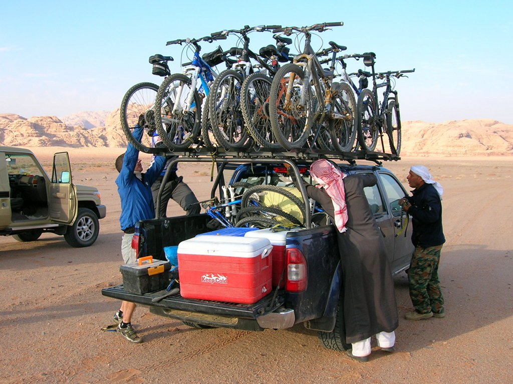
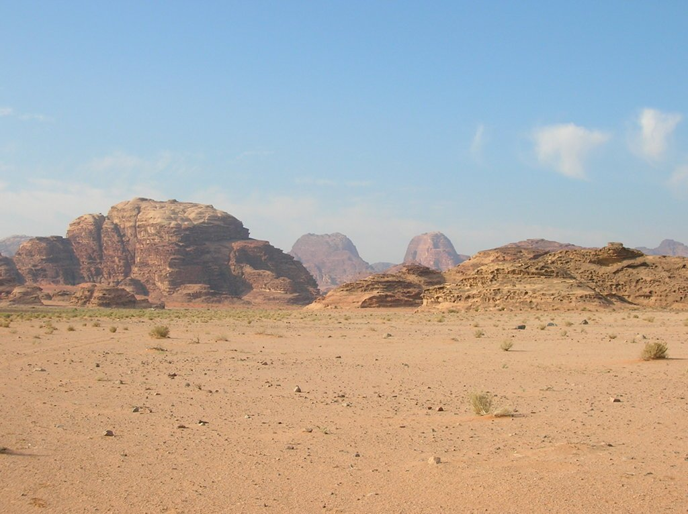
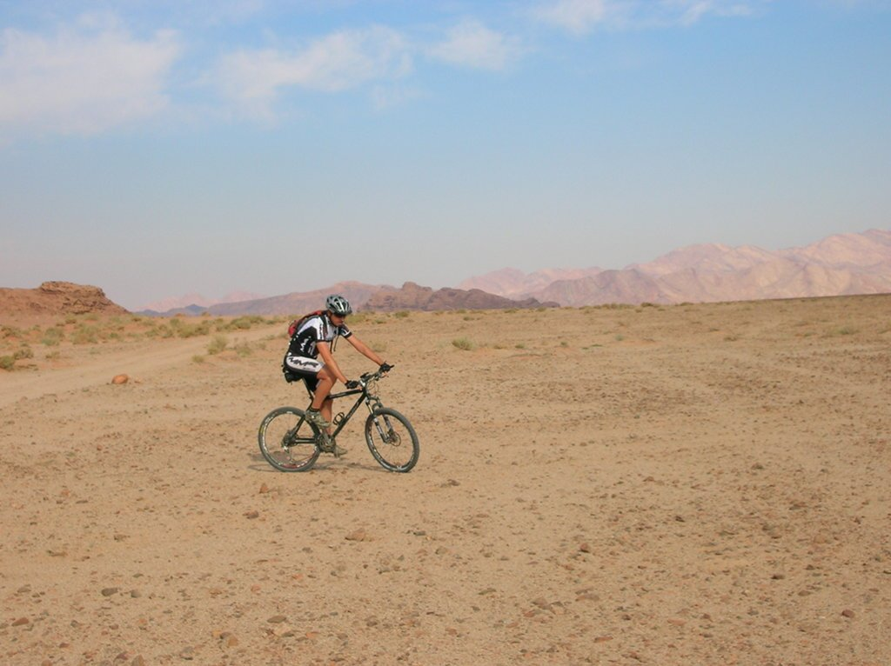
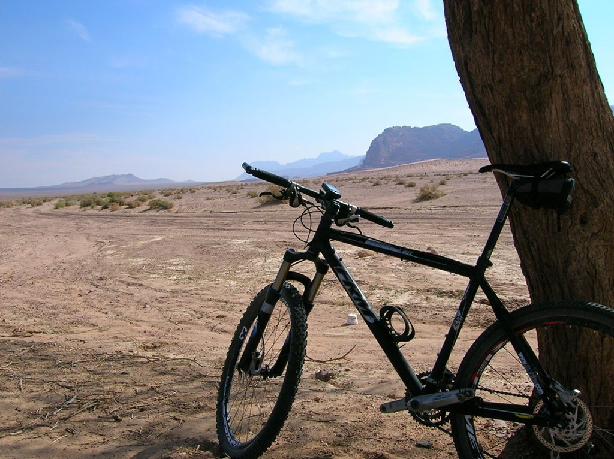

Última etapa, solo nos quedaba avanzar desde lo más profundo del desierto del <strong>Wadi Rum</strong> hasta la turística ciudad de <strong>Áqaba</strong>. Nos despertamos temprano, ya que teníamos que avanzar por una zona con mucha arena y lo íbamos a hacer en todo terreno.

Una vez pasada esta zona de arena llegaríamos a una pista utilizada por los todo terreno, con firme más duro y <em>ciclable</em>. El terreno era muy, muy bonito, con arena y hierba de camello. A los lados, las montañas, y al frente arena. Siempre me llamaron la atención este tipo de terrenos cuando los veía en el París-Dakar, cuando se disputaba en África, y ahora estaba pedaleando por uno muy similar.

Tras avanzar varios kilómetros por estas pistas, y tras mis insistencias de que me dejase pedalear un rato a mi aire, me dice: tú tira y nos esperas en el árbol. Qué curioso, con estas indicaciones, en Asturias nos perdemos fijo. Pero curiosamente, según avanzas por el Wadi Rum, puedes ver a lo lejos <strong>el árbol</strong>. Es el único árbol que hay, tan especial que incluso es sencillo localizarlo con el Google Earth o cualquier otro programa con ortofotos. Un lugar especial en medio del desierto.

De ahí hasta el final, nada especial. Se acabó el Wadi Rum y pasamos a una carretera, para poco más adelante entrar en la autopista (sí, en Jordania se puede circular por las autopistas en bicicleta, aunque sigue siendo una mala idea). De uno de los lugares más bonitos para pedalear, a uno de los más feos (y peligrosos). Avanzaríamos unos cuantos kilómetros por esta odiosa autopista hasta la ciudad de Áqaba. Es una de las pocas ciudades costeras de Jordania, con salida al golfo de Áqaba, en el Mar Rojo. No sé qué decir de esta ciudad, creo que un ciclista que conocí hace poco, llamado Oriol, la llamaría <em>guirilandia</em>. Ciudad turística, playas privadas, cerveza a un metro del agua... muy bonito, sí, pero no es mi estilo.

Y este fue el final del viaje, corto pero intenso y muy bonito. Me gustan los países árabes. Mucho.
