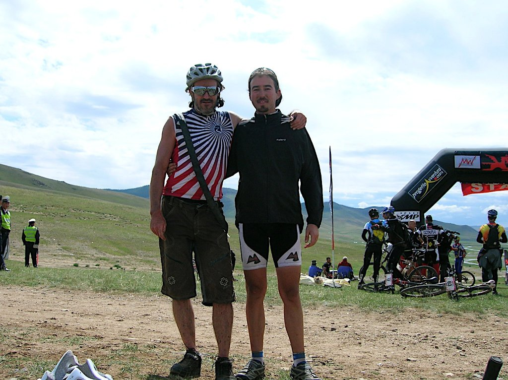

Décima y última etapa. Esto se acaba, solo 100 kilómetros nos separan de la última línea de meta del Mongolia Bike Challenge 2010. La verdad es que siento, además de la lógica alegría, un cierto alivio al saber que se acaban las etapas. Lo cierto es que ya estamos castigaditos...

La décima etapa arranca con un frío idéntico al de la etapa novena, ha caído una pelona de escándalo. Me armo de valor y salgo de corto, total, seguro que calienta dentro de poco... caray, las que no calientan ni a tiros son mis piernas, me he pasado de listo. Hasta el kilómetro 10 lo paso bastante mal. Cruzamos un puente que no estaba en el itinerario inicial y nos lanzamos valle abajo, justo a la orilla del río. La bajada es muy, muy rápida, con piedras pero ancha y recta. Alcanzo una velocidad máxima de 76km/h, lo cual no está nada mal para una pista pedregosa.

Hemos tenido que cambiar el itinerario sobre la marcha, el río lleva más agua de lo previsto y tenemos que evitar el vadeo programado. Lo cierto es que esta parte inicial del recorrido es impresionante.

Aunque siempre he dicho que mi único objetivo era terminar la carrera, la noche anterior he revisado las clasificaciones y estoy a menos de 30 segundos de un italiano. Y he salido por detrás de él, mecaguen...

Hacia el kilómetro 20 me junto con Stephan, un alemán muy majete que había roto su bici el día anterior. Le había partido una de las vainas, pero el nuevo MacGiver germano se hizo un invento con los radios de repuesto y unas bridas y consiguió llegar a la meta. Un fenómeno el tío. Por suerte para él, para afrontar la última etapa la organización le cedió la Nevi que había utilizado Heras, totalmente rígida y con ruedas de 29'. El tío iba como un tiro...

Más adelante cogemos al italiano que me sacaba 30 segundos en la general. Aguantó poco a nuestro ritmo (jeje). Vamos cogiendo a más gente, un austriaco y un mongol (gentilicio, no adjetivo). La etapa tiene poca chicha, seguimos a fuerte ritmo hasta el primer avituallamiento. Me quito algo de ropa, meto algo pal cuerpo y tiro con mis compañeros de ruta. El mongol se nos queda...

A pocos kilómetros del final pincha Stephan. El austriaco no mira y sigue viaje, un gesto un poco feo después de tantos kilómetros. Paro con Stephan y, a duras penas, me voy entendiendo con él. Creo que no os había dicho que es gangoso...

Total, que me dice que no tiene cámara, ni bomba, ni desmontables... vamos, un desastre. Y claro, yo llevo cámara de 26' y él lleva 29'. En fin, le dejo todos los trastos y sigo viaje mientras pienso que el bueno de Stephan va a tener que acabar la última etapa en el coche escoba.

Kilómetro 98, quedan 2 para el final. A lo lejos, en un alto, veo la última línea de meta del Mongolia Bike Challenge 2010. No me puedo creer que, lo que en noviembre de 2009 era una locura y en marzo de 2010 se convirtió en sueño, en este mismo instante se esté convirtiendo en realidad. Ya no me duelen las piernas, todo lo contrario. Avanzo con soltura, me siento enérgico. La mano de Gengis Kan me empuja hacia la línea de meta. En el repecho previo al final, el simpático periodista de Sky, cámara en mano, me pregunta qué siento. No recuerdo qué le dije, pero sí que recuerdo que le contesté en español, no me acordé de hablarle en inglés. Todo el staff de Proguetto Aventura, con el gran Willy Moulonia a la cabeza, nos esperan tras el arco de meta, grande, brillante, que anuncia el fin de tan largo viaje. No puedo describir la sensación de cruzar bajo el arco de meta tras tantos días de carrera.

Siento alegría y tristeza. Alegría, había cumplido mi sueño. Tristeza, la felicidad la había encontrado en la búsqueda de mi sueño. El final no era más que eso, un final. Feliz, si, pero final al fin y al cabo.

Después de abrazarme con un montón de gente veo a lo lejos a Stephan. Llega a meta y me da un gran abrazo mientras me agradece, una y otra vez, que le dejase herramienta. Me cuenta como, a base de tirar como un bestia, consiguió meter la cámara de 26' en la rueda de 29'.

Y eso es todo. Tan solo nos queda dejarnos bajar hasta Karkorum para hacer una entrada protocolaria y fuera de carrera, y visitar el monasterio de Erdene Zuu, el monasterio budista más antiguo de Mongolia.

Y nada más. Al día siguiente volvemos a Mongolia para la entrega de premios y camisetas de finisher y 25º en la general. Han sido 865km, 2.715 minutos sobre la bicicleta, 195.480 pedaladas, 407.250 latidos, 8.939 metros de ascenso... una aventura y un montón de amigos.

Es el fin de la aventura, me he ganado un descanso.

Os dejo este vídeo que resume esta gran aventura. Podéis verme, brevemente, en el 3:40!!

<iframe src="https://www.youtube-nocookie.com/embed/H5fAcNsIfoQ" title="YouTube" loading="lazy" allowfullscreen></iframe>

