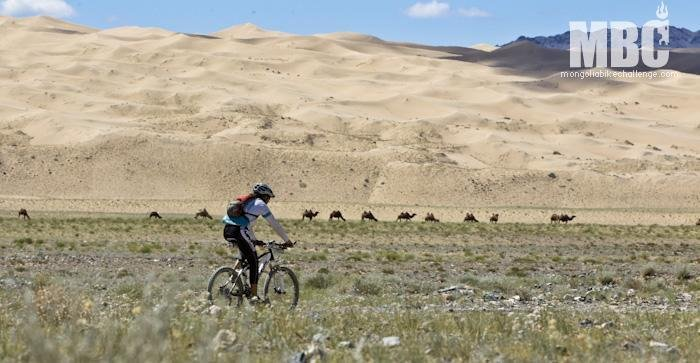

Día 14, quinta etapa. El día amanece frío y lluvioso, estoy como en casa. Afortunadamente no hace viento, así que a pesar de la lluvia me siento animado. Además mañana es día de descanso y esta noche dormimos en un campamento de Ger (no hay que montar tienda, ¡¡yuju!!) y hasta tendremos agua caliente. 125 kilómetros nos separan de las magníficas dunas del Gobi, las siguientes etapas nos llevarán hacia el norte, por zonas más montañosas. A las 7:30 de la mañana nos dan la salida, todo hacia arriba. Salgo muy animado y me junto con un grupito comandado por dos mongoles y un austriaco. Tiramos muy rápido por un terreno compacto de sube-baja, y llegamos al avituallamiento del kilómetro 40. Ahí me doy cuenta de que voy bastante adelante, porque estos tíos paran lo justo. Total, cojo mi bidón de sales, me meto un trago de Coca Cola y para adelante. A los pocos kilómetros nos metemos en el cauce seco de un río, una zona pedregosa muy complicada que rompe totalmente el grupo. Algunos se van para adelante y otros se quedan detrás, mientras yo cojo la rueda de un italiano muy simpático con el que aguantaría varios kilómetros. Al cauce seco sigue una zona de sube-baja en la cual llegamos a ver el inmenso valle que nos lleva hasta las arenas del Gobi. Esta es una de esas imágenes que se me quedarán grabadas en la mente para siempre por la inmensa belleza del paisaje, tanto al italiano como a mí se nos escapa hasta la risa. Después nos volvemos a meter en otro cauce seco, este mucho más ancho que el anterior. Es increíble ver un cauce de 30 metros de ancho, ahora seco, que en época de deshielo debe llevar gran cantidad de agua a juzgar por el estado de las piedras, trituradas hasta convertirse en arena. El italiano se queda, así que tiro solo. Salgo del cauce y paro en el último avituallamiento, quito algo de ropa y me lanzo a por la última parte de la etapa, una pista pedregosa ligeramente descendente. A la izquierda, el cordón de arenas del Gobi. A la derecha, las montañas. Y por todos lados, camellos. De muestra, una foto que me sacaron los periodistas de la organización.

Hoy me encuentro muy bien, y la MMR Koans Carbon de doble suspensión que estreno para la ocasión se comporta a la perfección. Adelanto a un montón de gente con bicis rígidas, se les nota que ya no soportan el trasero sobre el sillín. Yo voy sentado y dando pedales con fuerza. 5 km a meta, veo a un mongol a lo lejos y aprieto un poco, a ver si lo cazo. A 4 de meta le alcanzo, el pobre va hecho un trapo. Finalmente, tras 5 horas y 45 minutos llego a la meta, situada en un campamento de Ger llamado Gobi Discovery Ger Camp. 20º en la etapa y 31º en la general. Aunque contemplando el paisaje y la inmensidad del Gobi, la posición es un poco lo de menos, ¿no?

Por la tarde nos acercan hasta las dunas. El cordón de dunas no parece tener fin, y es altísimo. En su día, las dunas de Marruecos me parecieron inmensas. Ahora no son más que una playa al lado de este espectáculo. Allí sentado, viendo las montañas, los camellos y el precioso cielo azul, soy consciente de que no podía estar en un lugar mejor y que todas las dificultades estaban valiendo la pena.
