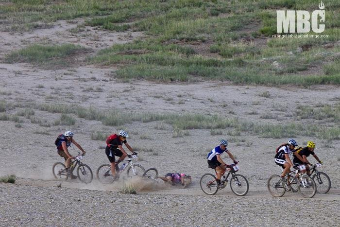

Día 16, etapa 6. Ya hemos pasado el ecuador de la prueba, tras un día de 7 horas de furgoneta que se empeñan en llamar "día de descanso". Tal vez descanso para la familia, ya que pude utilizar mi teléfono móvil después de muchos días de desconexión.

Tras una cálida noche, a las 7:30 nos dirigimos a la línea de salida de una etapa con perfil en continuo ascenso. Un inoportuno pinchazo de nuestra fémina Nines, líder en su categoría, nos pone los nervios de punta. Nos damos prisa para reparar a tiempo el pinchazo, y acabamos de apretar el cierre justo cuando se da la salida. Finalmente salgo el último.

Salgo como puedo, ajustándome el CamelBak hasta que alcanzo a Nines antes del primer avituallamiento, cuando rodaba segunda entre las féminas. Le digo "vamos para adelante" y me pongo a tirar sin miramientos. Poco después vendría una caída que se saldaría con una fisura en una costilla.

No obstante yo sigo tirando con Nines, y vamos adelantando a mucha gente. El recorrido va cambiando de un feo paisaje "monegril" a un bonito valle en la montaña. La última parte es preciosa. La primera manada de Yak nos sorprende, esas vacas hippies con sus melenas al viento nos indican que estamos cada vez más altos. Los niños nos saludan mientras pasamos al lado de sus Ger, algunos nos obsequian con flores y se estiran para darnos la mano. Seguimos subiendo y recogiendo gente, la pendiente es cada vez más pronunciada y nuestro grupo se va haciendo cada vez más grande. Se nota que mañana es la etapa reina de la prueba, nadie quiere gastar más de la cuenta. 5 horas y 116 kilómetros más tarde nos encontramos en la línea de meta. Destacar la primera victoria del que fuera corredor del Liberty, Carlos Abellán, cedida por el líder indiscutible de la prueba, el italiano Marzio Deho.
