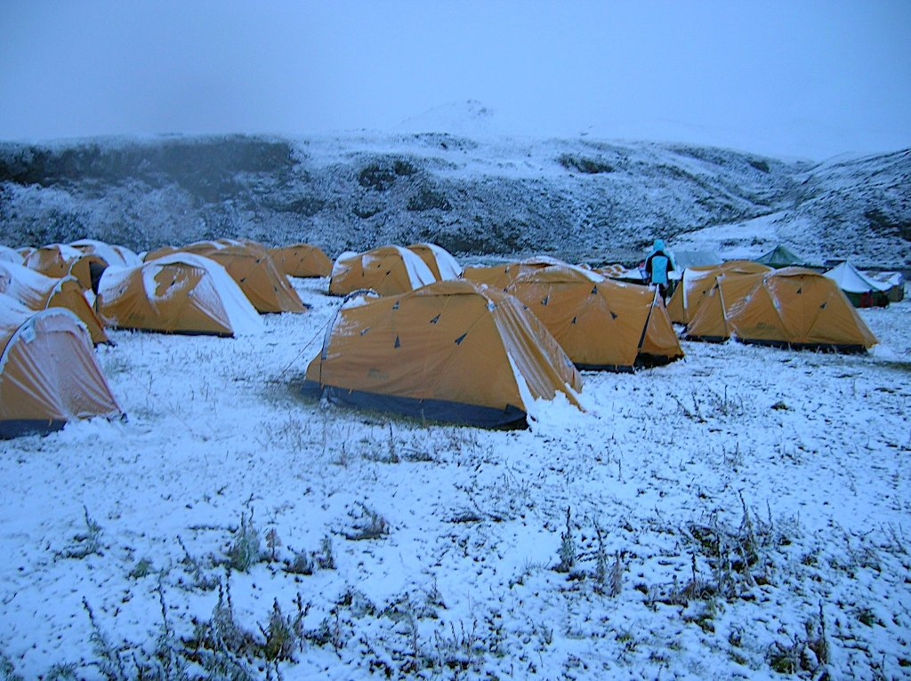
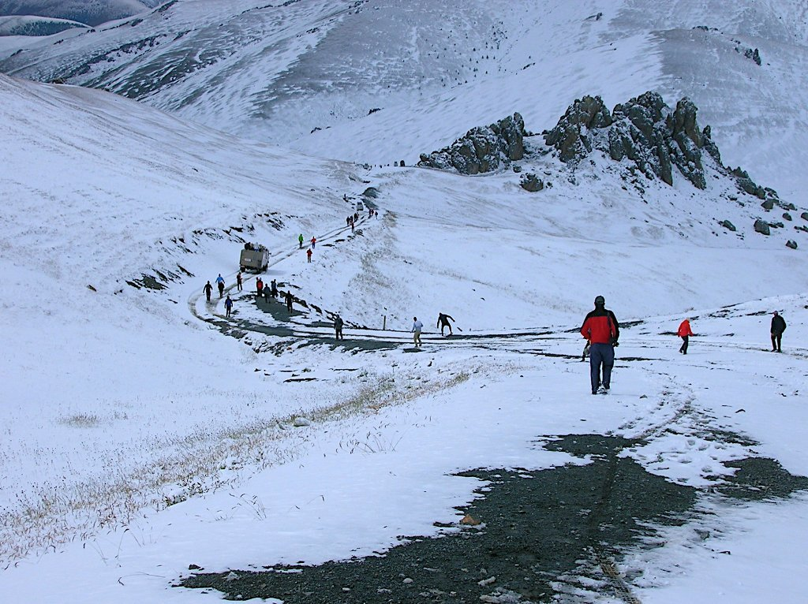
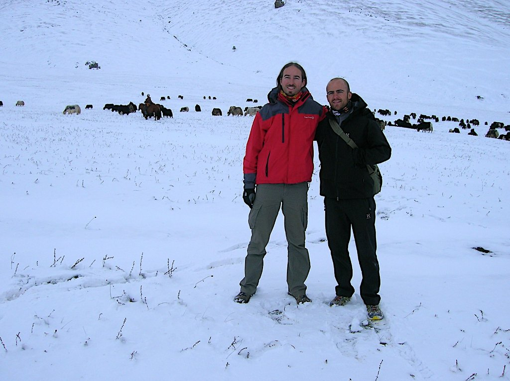

Esta noche dormí como un niño. La etapa anterior había sido durísima y por la tarde la temperatura cayó en picado. Bien temprano, como de costumbre, sonó el despertador. Salgo poco a poco del saco, madre mía que frío!!! En fin, ya calentará. Me voy poniendo los trastos, cinta del pulsómetro, coulotte, etc, abro la puerta de la tienda y esto es lo que veo

Bueno, ¿dónde voy con estas pintas? Briefing, no parece muy sensato que se de la salida en esta etapa, sobre todo teniendo en cuenta que salimos para arriba. Aparte de que el terreno está impracticable, creo que alguien podría perderse (el uso de GPS no es obligatorio). Al final se impone el sentido común y se suspende la etapa. Bien, jornada de descanso!! Si es que se puede llamar jornada de descanso a 8 horas de todo terreno, incluso algo de trekking

No había narices a bajar en el todo terreno, jeje. Bueno, no se puede negar que disfrutamos de unos paisajes maravillosos, aunque en algunos momentos nos preguntásemos qué diablos hacíamos metidos en ese lío. Creo que Carlos Abellán, ex corredor del Liberty, estará de acuerdo conmigo.

Por fin llegamos al campamento. Una buena noticia nos espera... ¡hoy es la última noche en tienda de campaña! Y mañana, novena etapa, la más larga de todas con 144km. ¡A por ella!
