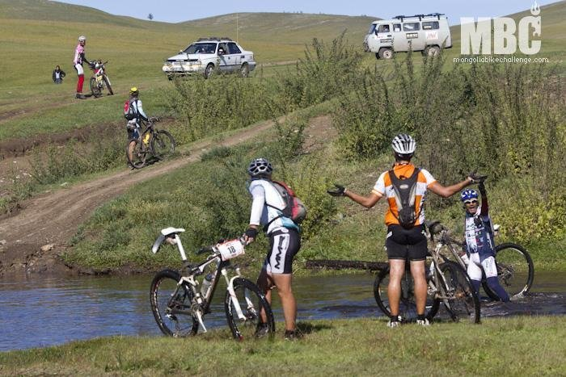

Suena el despertador. Pensaba que ayer hacía frío, pero lo de hoy lo supera con creces. Ha caído una helada como nunca había visto en mi vida, es realmente complicado recoger la tienda de campaña, la tela se encuentra totalmente congelada y parece que se va a partir en pedazos. Tomo el desayuno con los guantes de la bici, aunque están llenos de... roña. Nada, no hay manera de entrar en calor. Bien temprano nos acercamos a la salida de la novena etapa, la más larga de todas, con 144 kilómetros y 2100 metros de desnivel.

Salida rápida por un precioso valle. Nos dedicamos a vadear ríos de agua helada, alguno hasta aprovecha para darse un baño.

Afortunadamente empieza la subida. Digo afortunadamente porque no hay manera de entrar en calor, aunque brilla el sol y no hay ni una nube en el cielo. Las primeras subidas nos llevan a una zona de sube-baja muy, muy bonita, con terreno rápido que permite rodar con facilidad. ¡Por fin podemos dar pedales!

Me junto con Daniel Becerril, los kilómetros pasan con rapidez. Estoy disfrutando realmente de esta etapa, es preciosa. Poco más adelante alcanzamos a Luis y a Paolo Angaroni, un italiano muy simpático. Poco a poco vamos haciendo kilómetros y vadeando ríos, hasta que en uno de estos ríos vemos... ¡a la maglia rosa! ¿Qué pasa aquí, cómo podemos haber cogido al líder en el kilómetro 80 de la etapa?

Cruzamos el río, parece que Marzio, el líder, interpretó mal la señal de "río profundo" y se dio una vuelta de varios kilómetros. Dani, al otro lado del río, intenta convencerle para cruzar. Mientras tanto, Paolo, desde el río, nos dice que el agua está muy fría (o algo así), yo (18) le digo que le mande al cuerno mientras que Luis no entiende nada.

Al final le convencemos, nos da las gracias, arranca la moto y desaparece en el horizonte. Cómo anda este tío...

En la siguiente subida perdemos a Paolo, que se queda descolgado. Más adelante nos arrimamos a unos Ger, cabañas típicas mongolas, para recortar un trozo del camino. Un par de perros salen tras nosotros con las peores intenciones. Nos damos un calentón de escándalo y conseguimos salir vivos, creo que los perros son perros en cualquier parte del mundo...

El ritmo de Dani y Luis es demasiado para mí, me descuelgo a 30 kilómetros de la meta, me están empezando a doler demasiado las piernas y aún queda otra etapa. Atravesamos una pequeña ciudad, con sus calles asfaltadas. Parece que volamos sobre el asfalto, ¡cuánto tiempo sin rodar sobre suelo uniforme! La fantástica sensación desaparece tras un escaso kilómetro, volvemos a la pista. En fin, ya volveré a rodar sobre asfalto en España.

En el último tramo lo paso un poco mal, me empieza a molestar el estómago y cualquier cosa que intento comer me provoca malestar. Pues nada, tampoco queda tanto para la meta, a muerte.

Finalmente llego a la meta tras 6 horas 33 minutos, 26 en la etapa y 26 en la general... a medio minuto del italiano majete, parece que va a haber guerra hasta el final. ¡¡Mañana, última etapa!!
