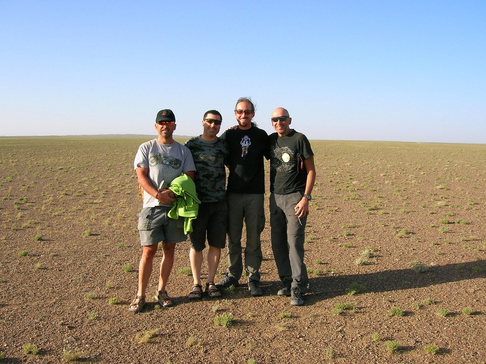

Día 12, tercera etapa.

La noche ha sido muy movida, al parecer. Yo dormí como un lirón, gracias a los sabios consejos de Javi nunca viajo sin tapones para los oídos. Cuando me despierto por la mañana compruebo que la tienda se mueve muchísimo y está llena de arena, tengo arena en la ropa, en el saco… salgo de la tienda tapado hasta los ojos y compruebo cómo los efectivos de la organización se afanan en sujetar las carpas. Estamos viviendo una tormenta de arena impresionante, nunca había visto nada igual. Parece claro que la etapa no se va a poder realizar, al menos en su totalidad, y comprobamos cómo, con buen criterio, la organización decide suspender la etapa. Jornada de descanso.

Día 13, cuarta etapa.

La tormenta sigue igual, el viento no da un respiro. La organización decide acortar la etapa de hoy, quitando la primera parte llana y disputando nada más que la parte final, ya en las montañas. Hacemos un traslado en furgoneta y arrancamos para hacer los últimos 55 kilómetros de la etapa.

El perfil es completamente ascendente, aumentando la pendiente según nos acercamos a la meta. La etapa es odiosa, una fea pista ascendente con un fortísimo viento en contra. Ruedo con Nines, un austriaco, un alemán y dos italianos y, salvo Nines, los demás no dan ni un relevo. La verdad es que estoy hasta las narices de pedalear contra el viento, el paisaje es feísimo y acabo echando una bronca a mis compañeros de viaje, pegamos un arreón y nos vamos para adelante. Seguimos tirando con fuerza pero me estoy rayando, veo una rueda buena y paso de tirar, me pongo a chupar rueda para variar.

Después de un rato de preguntarme qué coño hago aquí y por qué no me subo a una furgoneta, el paisaje empieza a cambiar radicalmente. Comenzamos a ver montaña, una preciosa subida nos eleva sobre el desierto y el viento parece amainar un poco. Me vengo arriba y empiezo a tirar con ganas, llego a la altura de Nines y nos vamos los dos para arriba. Tras 3 horas y 44 minutos llegamos a la meta, ya en las montañas. 39ª posición en la etapa, 37º en la general. El paisaje es precioso y la etapa de mañana promete, aunque se empieza a dejar sentir el frío.
Aún no somos conscientes, pero esto está empezando a cambiar radicalmente.
