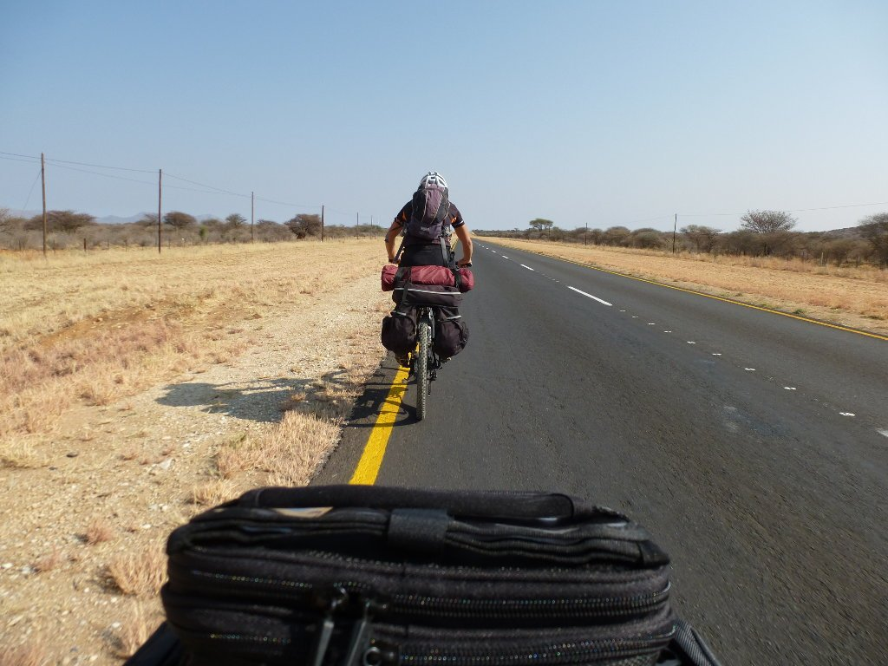
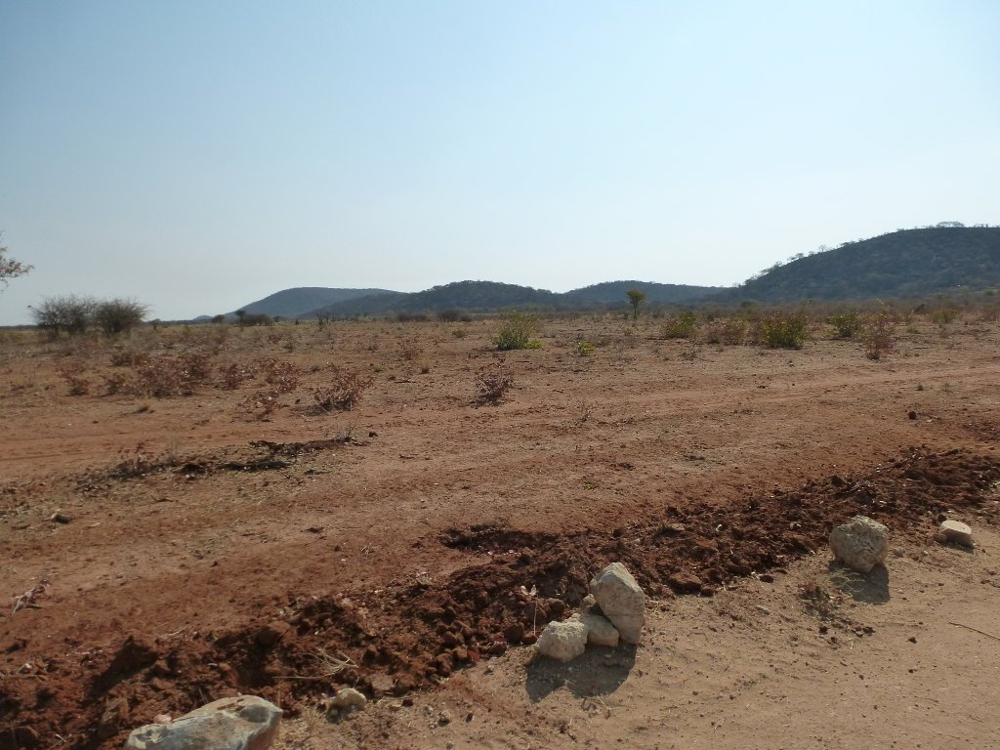
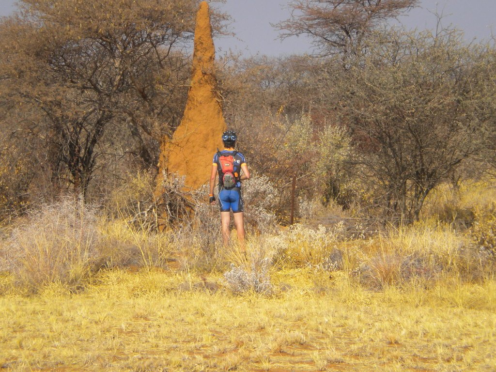
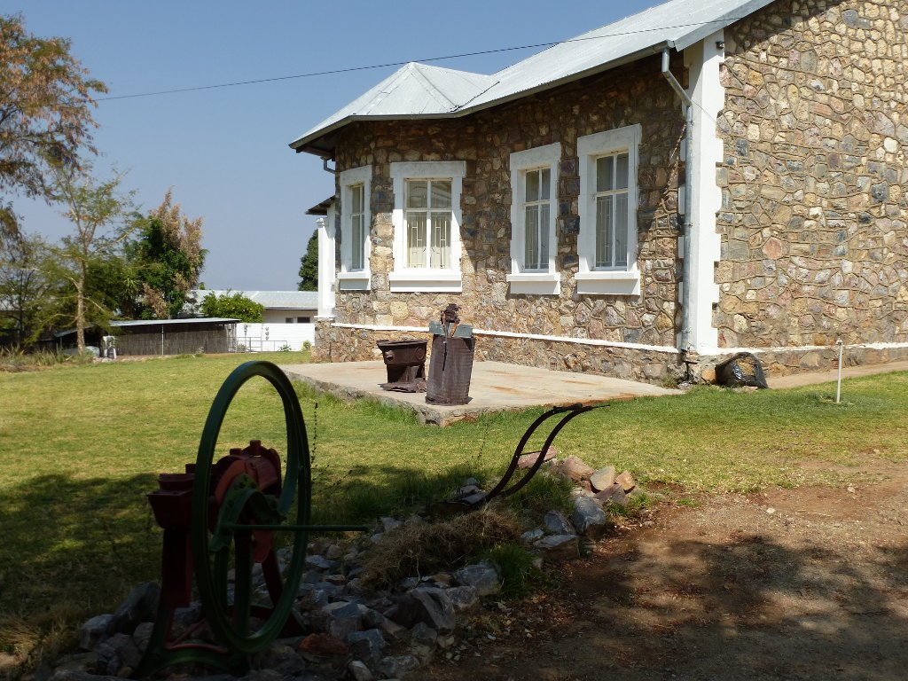
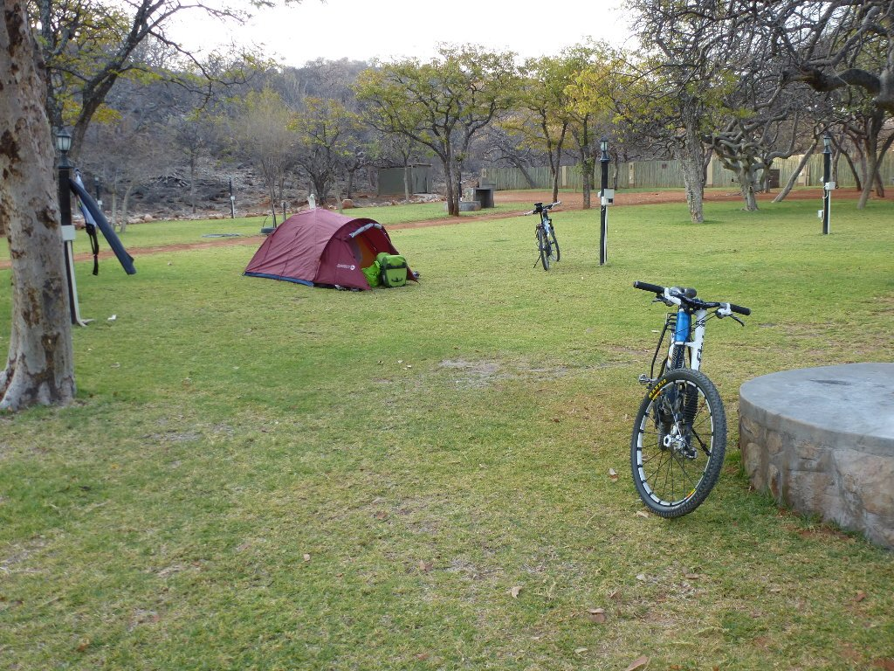
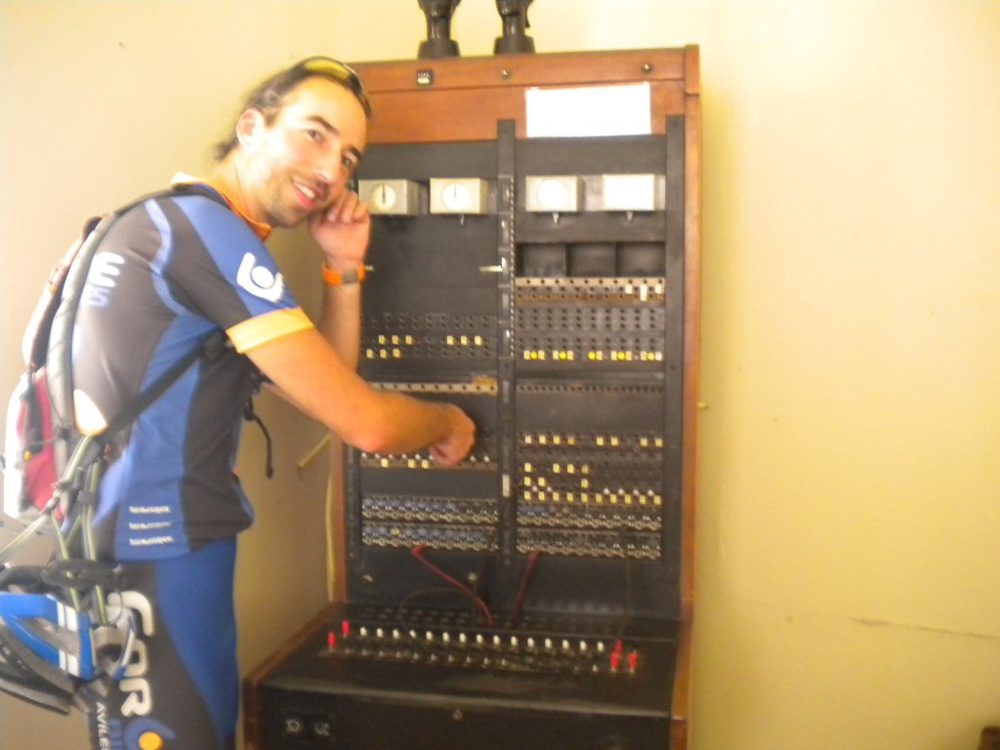

Seis de la mañana, suena el despertador. Si vas con tienda de campaña hay que ir con el sol, y no nos podemos despistar porque en el invierno austral anochece temprano. El día amaneció frío. Tras el proceso de desmontaje de la tienda, más lento de lo habitual debido a la inexperiencia del primer día, nos preparamos un desayuno para quitar el hambre. Hemos buscado alcohol de quemar desde que llegamos, pero hasta ahora nos ha sido imposible localizarlo, lo que nos obliga a conformarnos con un desayuno frío. Afortunadamente, mientras desayunábamos se acercó una persona que se interesó por nuestras bicis y nos indicó la ubicación de una tienda con artículos de camping. Nuestros ánimos suben y estamos convencidos de que la búsqueda de alcohol de quemar se va a terminar. Nos montamos en las bicis, vamos a la tienda y... por abreviar, el alcohol de quemar no existe en Namibia. Con nuestro gozo en un pozo y nuestro estómago frío, nos lanzamos a la carretera rumbo a Outjo. 70km fáciles, donde lo únicamente complicado es sobrevivir al tráfico.

Viajamos por una carretera sencilla y, una vez en Outjo, visitamos su museo. Se trata de una casa colonial, habitada hasta 1980 por un general alemán. En ella podemos ver cómo se vivía a mediados del siglo XX... o más bien cómo vivía el hombre blanco de mediados del siglo XX en Namibia.

Tras comer algo en Outjo ponemos rumbo al lodge. Éste es el nombre que le dan a los alojamientos rurales y no, no son baratos. De hecho la mayoría son prohibitivos. Nosotros, que no tenemos ninguna intención de pagar un dineral para pasar una noche, sólo nos acercamos a los que tienen zona de camping, la cual es muy económica. Una verde hierba nos da la bienvenida y desde el primer momento somos conscientes de que éstas comodidades no se van a repetir.

Una buena cerveza, unos cuantos <a title="Dik-Dik" href="https://es.wikipedia.org/wiki/Madoqua_kirkii" target="_blank">dik-dik</a> y una gran cena despiden el día, no sin antes darnos una última última sorpresa. ¡¡En el lodge utilizan quemadores de alcohol!! Pero en lugar de alcohol, utilizan una especie de gel (<em>heating gel</em>) que tiene el mismo efecto que el alcohol. A la mañana siguiente pedimos un poco en el lodge y nos lanzamos a la carretera más felices, sabiendo que no estamos cargando con comida y cocina en balde. Esta misma noche lo probaremos.

125km nos separan de Khorixas, nuestro siguiente destino antes de adentrarnos en la solitaria zona de Damaraland. Pero primero, una llamada a casa ;)

