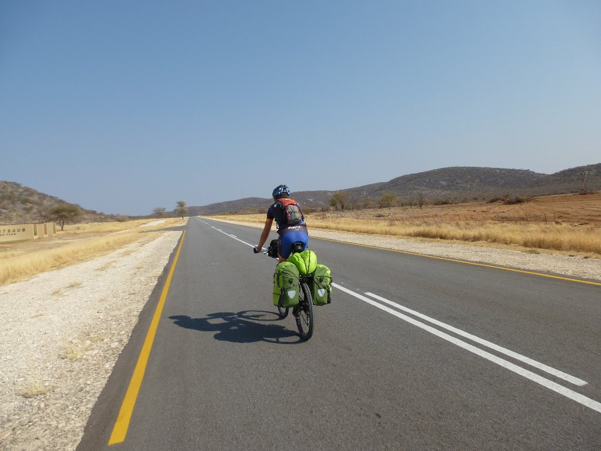
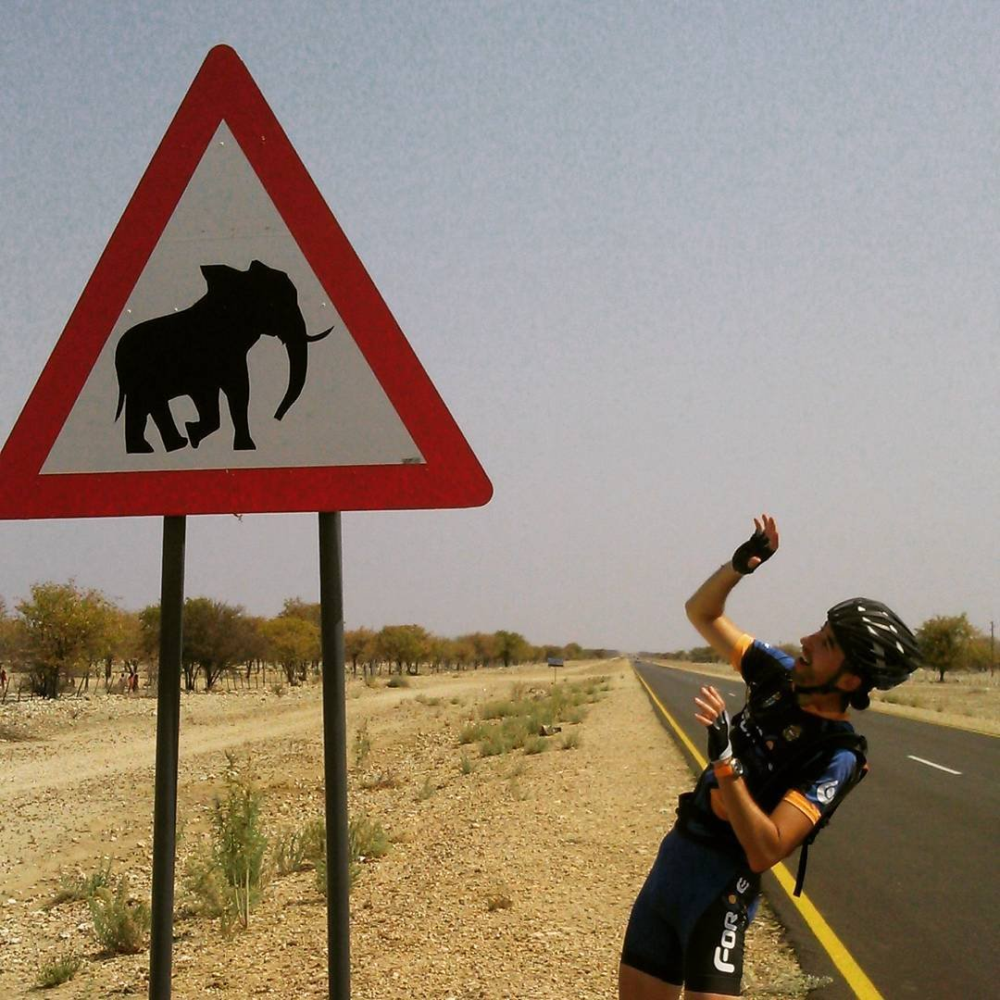
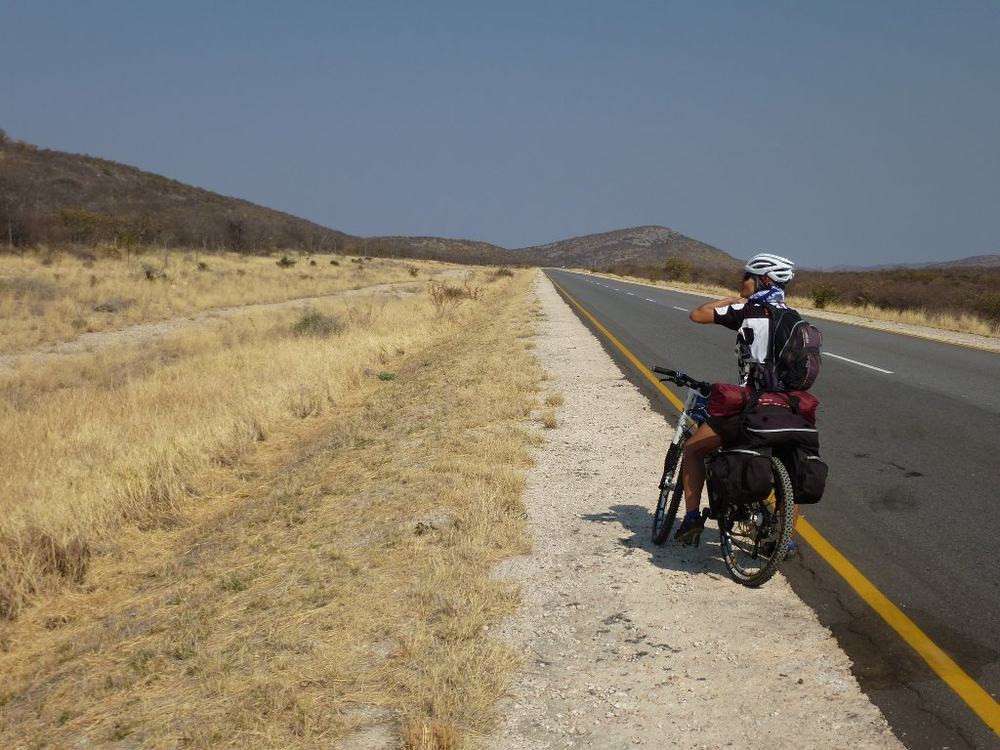
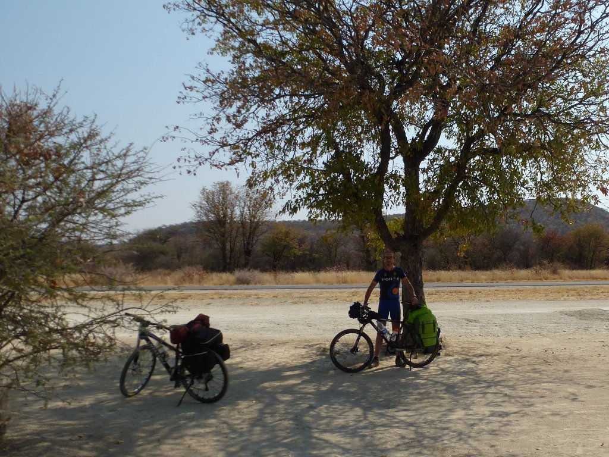
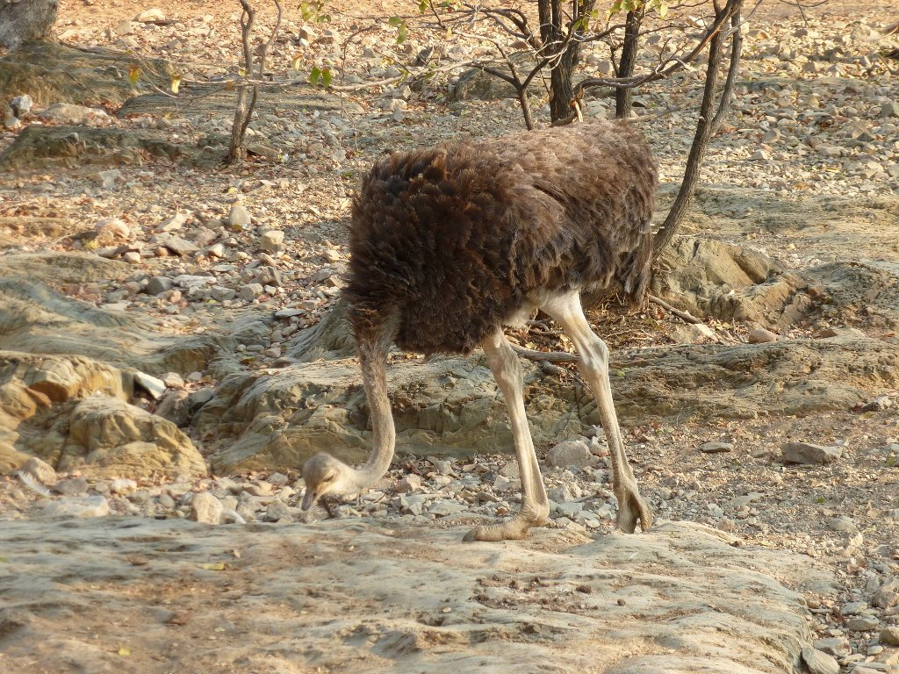
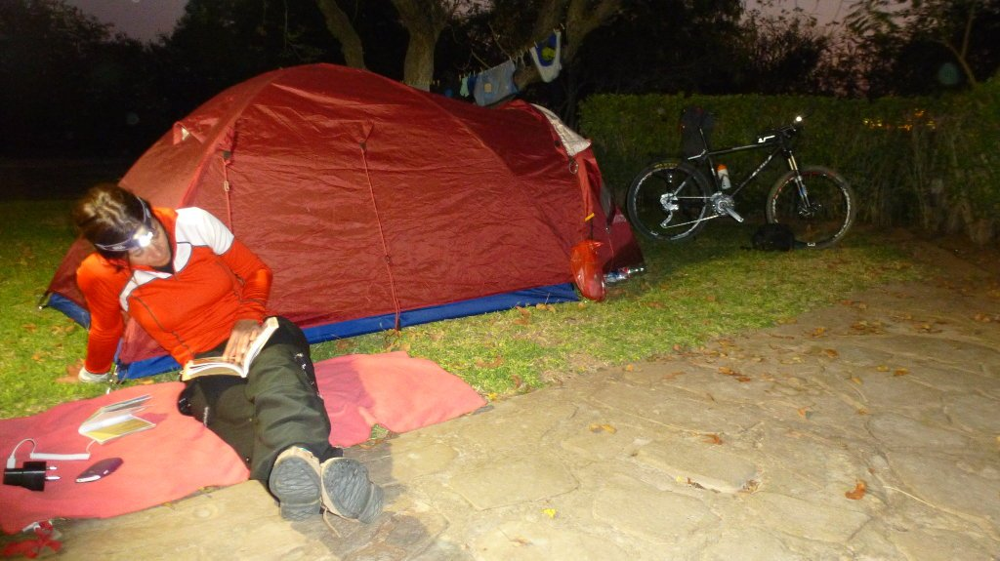

Un desayuno de campeonato para empezar el día nos despide del lodge <a title="Sophienhof Lodge" href="http://www.sophienhof-lodge.com/en/" target="_blank">Sophienhof</a>, un apacible lugar al que nos gustaría volver algún día. Cómodo y tranquilo... pero no es lo que toca en este viaje, hemos venido a montar en bicicleta y justamente eso es lo que vamos a hacer. 123 kilómetros de carretera nos separan de nuestro destino en Khorixas.

Nos lanzamos a la carretera con muchas ganas y mucha fuerza, avanzamos deprisa rodando en paralelo y charlando, disfrutando del viaje y de la carretera. Por fortuna, esta carretera está mucho menos transitada que la de ayer y eso nos permite disfrutar de la bicicleta. Los kilómetros pasan deprisa y el paisaje va cambiando, se va desertificando y poco a poco va desapareciendo la vegetación.

La etapa de hoy nos adentrará en el batustán de Damaraland. Situado en el noroeste del país, con una extensión de casi 48.000 km2, es la patria actual de la etnia damara. Hemos leído que el idioma más hablado de la zona, además del inglés, es el nama. He intentado aprender las palabras básicas que vienen en mi guía, pero creo que la fonética es algo más que complicada. Tengo ganas de oír a alguien hablando nama para ver si es tan complicado como parece.

Pero, además de los damara, también es el territorio habitual del elefante africano. ¿Tendremos la "suerte" de encontrarnos con alguno?

Aunque avanzamos deprisa, los kilómetros se notan, la temperatura y sequedad del ambiente nos deja sin saliva y los litros de agua desaparecen. Las distancias entre pueblos son enormes y entre un pueblo y otro no hay nada más que desierto. Creo que hemos sido demasiado confiados, tendremos que dosificar.

Aunque rodamos rápido, muy rápido, con una media por encima de los 27 km/h, tanto tiempo sentados, sin cambiar de postura, nos va pasando factura ahí donde la espalda pierde su nombre. Por desgracia no hay ningún lugar interesante en el que hacer una parada y tenemos que conformarnos con unas sencillas áreas de descanso que, al menos, tienen una sombra en la que descansar del sol de todo el día. Eso sí, nada de comprar agua o cualquier cosa para comer.

La etapa termina por hacérsenos larga, llegamos tocados y temiendo por la etapa de mañana. 98 kilómetros hasta el White Lady lodge, en el monte Brandberg, 80 de ellos por pista en vete a saber tú qué condiciones. Pero hoy, de momento, buen asfalto.

<iframe src="https://www.youtube.com/embed/oDP1870gNnY" title="YouTube" loading="lazy" allowfullscreen></iframe>

Por fin llegamos a Khorixas, capital administrativa de Damaraland. Con solamente 11.000 habitantes, es un lugar sin ningún tipo de interés turístico pero con un interés diferente: podemos ver cómo es la vida real en Namibia, lejos de las comodidades del hombre blanco (generalmente de ascendencia alemana) que vive a todo tren en una África, digamos, diferente. Pero Khorixas no, esto sí es África.

No obstante, el camping en el que nos vamos a alojar es bonito y cómodo, y nuevamente tenemos césped donde plantar la tienda. Un lujo en esta zona del planeta. Nos vamos a la ducha y el agua nos purifica, se lleva el polvo y las inseguridades surgidas en la etapa de hoy de cara a nuestra siguiente etapa ya por terreno mucho más salvaje. Nos damos un pequeño lujo, una <a title="sidra Savanna" href="https://www.savanna.co.za/" target="_blank">Savanna Dry Premium Cider</a>, una sidra tipo inglesa hecha en Sudáfrica que está realmente buena, mientras vemos algún que otro animalito.

Preparamos la etapa tras una visita al supermercado (¡agua, mucha agua!), ya nos sentimos confiados. Va a ser una gran etapa, lo sabemos. Eso sí, necesitamos dormir... y la fiesta no cesa a nuestro alrededor. Hasta aquí ha llegado el reguetón, ¡noooooo!

