Finalmente el susto que nos dieron con el reguetón se quedó en una anécdota y tuvimos una noche tranquila lo que, unido a la paliza de bici que nos habíamos dado, nos hizo dormir de lo lindo. Aún así nos levantamos temprano, hoy nos esperaba un día duro y había que salir lo antes posible. A las siete de la mañana salimos hacia el monte Brandberg. En este monte (más bien un macizo) se encuentra el punto más alto de Namibia, el Königstein, de 2573 metros. También se pueden encontrar multitud de pinturas rupestres. Vamos a tener la suerte de visitar una de ellas, tal vez la más famosa, la llamada White Lady.

La de hoy será nuestra primera etapa fuera del asfalto, con casi 100 kilómetros de pista de grava y arena para llegar a uno de los lugares más bonitos del viaje, tanto por el espectacular paisaje como por su fauna, encabezada por el gran elefante africano. La primera parte de la etapa nos alberga esperanzas, la pista es buena y avanzamos a buen ritmo. Poco a poco los kilómetros van saliendo y parece que llegaremos a destino a una hora prudencial. Tal vez nos hayamos cargado de agua en exceso.

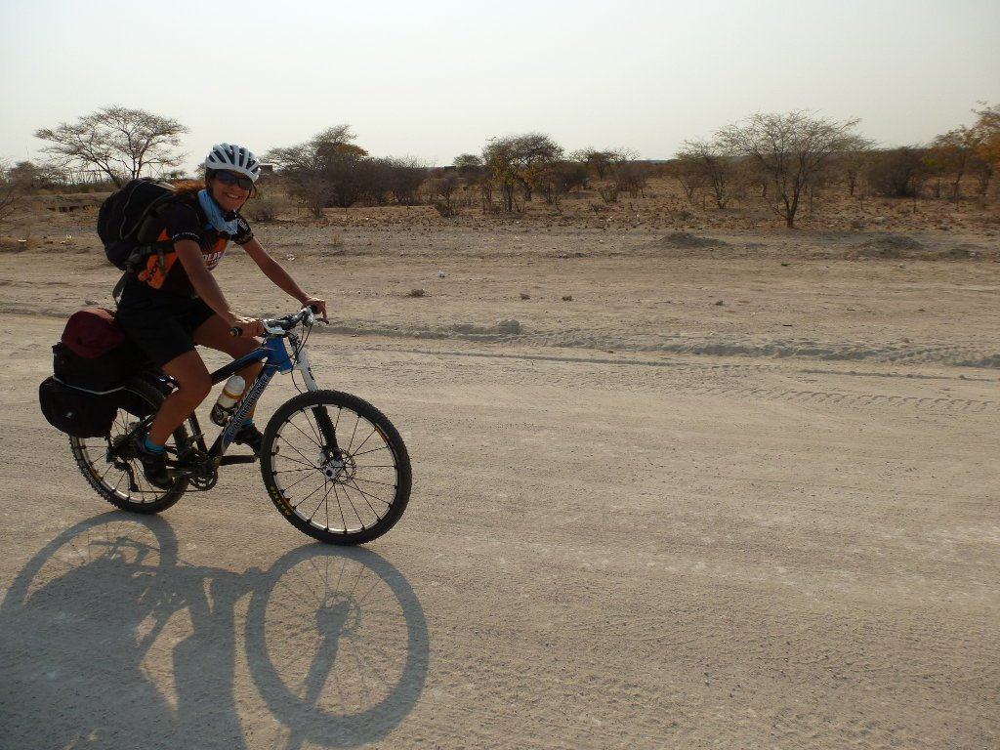

El paisaje se va haciendo cada vez más árido, la arena se come la vegetación y cada vez que damos una curva nos parece ver un animal... pero nada, no hay rastros de vida. La soledad nos acompaña a lo largo de ésta pista en la que, de vez en cuando, algún coche rompe el suave ruido de nuestras ruedas sobre el terreno recordándonos que no estamos solos en éste país .

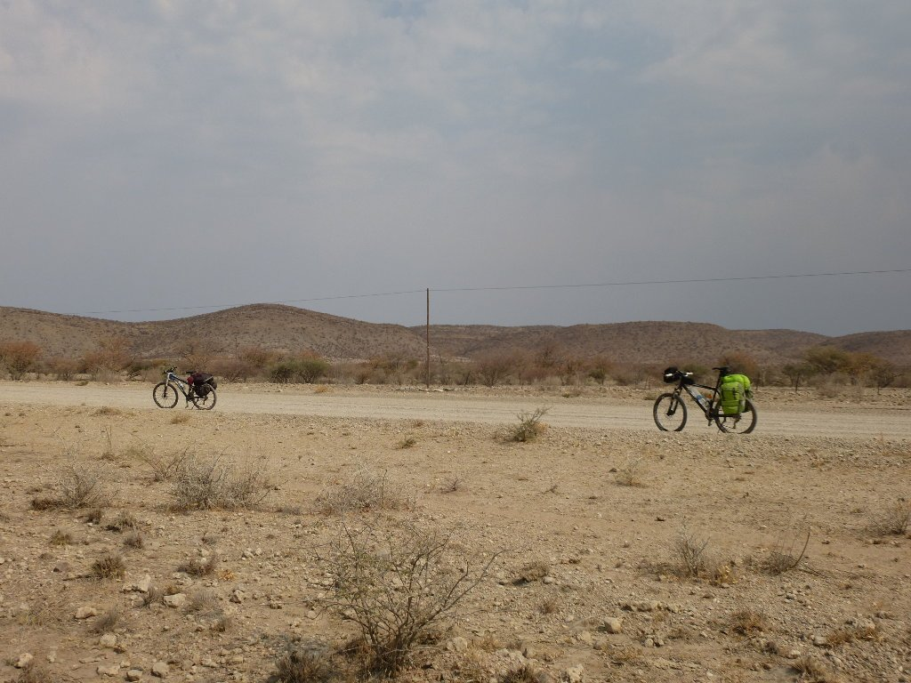

Aunque, a decir verdad, algún rastro de vida sí que hay. aunque su visión nos desconcierta bastante. ¿Quién ha puesto ésto aquí? ¿Y con qué fin?

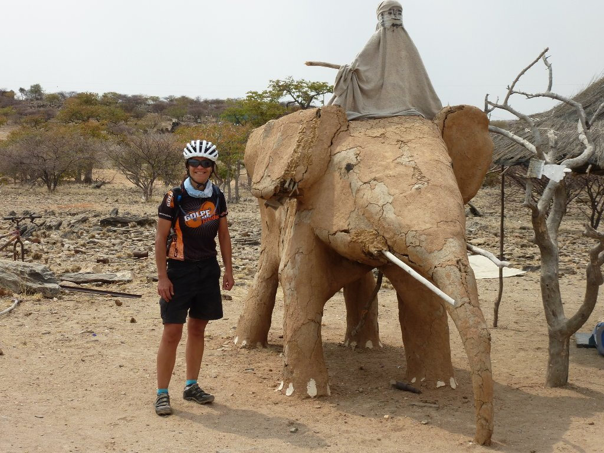

Casi sin darnos cuenta van pasando las horas y empezamos a ver algo en el horizonte. El monte Brandberg se empieza a insinuar y nos hace mucha ilusión, vemos el destino a lo lejos y nos vamos acercando a él. Lo se, parece una tontería, pero tras varios días de horizonte despejado, ésta visión se nos antoja majestuosa.

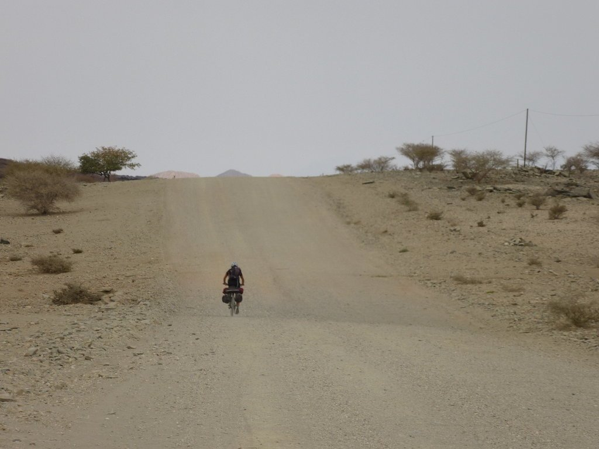

Avanzamos con alegría hasta el kilómetro 60, a 40 del final. Ahí abandonamos la pista principal, con destino Uis, para tomar la pista que nos llevará a nuestro destino en el monte Brandberg. Nada más desviarnos vemos que la cosa cambia, y mucho. La pista se convierte en un auténtico camino, aunque de momento parece que está en buen estado. Eso sí, nada de tráfico y nada de vida. Soledad total y absoluta. ¡¡Empieza la aventura!!

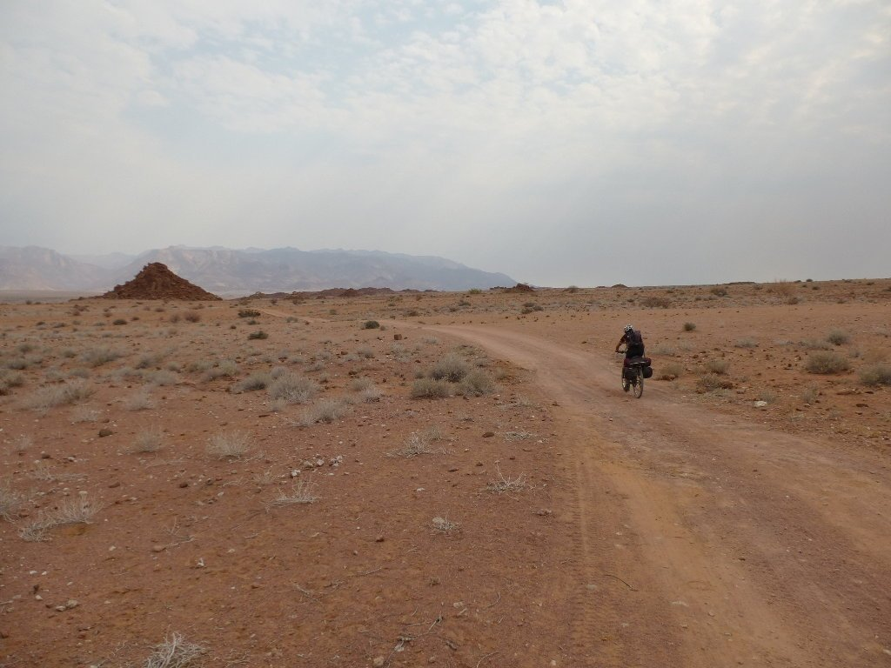

Rodamos solos, completamente solos, durante horas. Esa soledad horada y ablanda la pista (y nuestros ánimos), convirtiéndola en un toulè ondulè o en una playa, alternativamente. El toulè ondulè es lo peor. La sensación es la misma (me imagino) que rodar sobre una uralita. A veces las estrías están más juntas, otras veces más separadas, pero siempre consiguen el mismo efecto de botes continuos. Y sí, con alforjas es mucho peor.

Por fortuna la gravedad juega a nuestro favor, la pista es ligeramente descendente y podemos avanzar. Aún así, todo se va haciendo cada vez más pesado y nosotros nos vamos cansando más y más... y lo peor está por llegar. A 20 kilómetros del destino cogemos un el desvío que nos ha de llevar a directos al lodge, pero resulta ser una pista de arena que se va ablandando poco a poco hasta que nos obliga a echar pie a tierra.

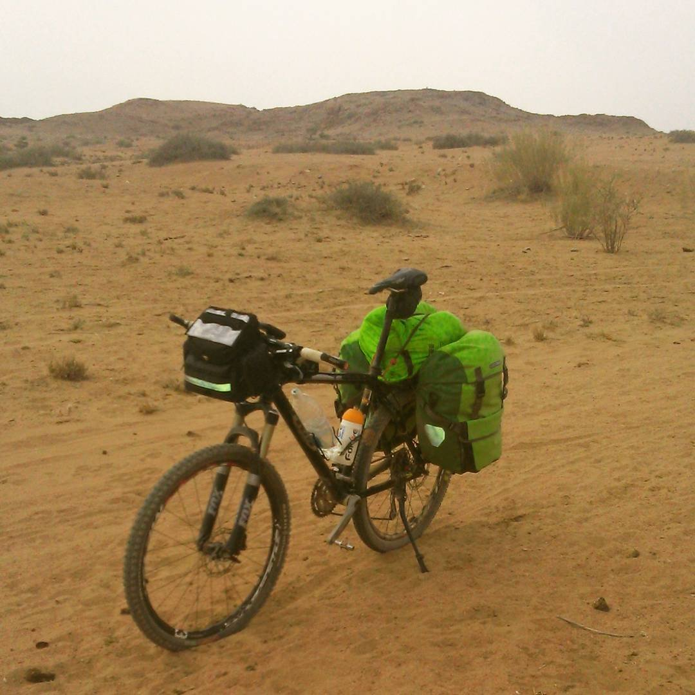

Con las alforjas cargadas no podemos hacer más que empujar la bici mientras que la pista, lejos de mejorar, sigue empeorando, y no sabemos cuándo mejorará ni si lo va a hacer en algún momento. Decidimos que es imposible seguir y tiramos de mapa para buscar una alternativa a esta pista de arena. Aquí es donde más hemos de agradecer lo bien que han funcionado tanto el GPS como los mapas digitales de <a title="Tracks4Africa" href="https://tracks4africa.co.za/" target="_blank">Tracks4Africa</a> que compramos para la ocasión. Por fortuna, encontramos dicha alternativa y, aunque dista mucho de ser una autopista, es ciclable. Esta nueva alternativa tiene tan solo un par de kilómetros más.

<iframe src="https://www.youtube.com/embed/Ju_qE8b3mJ0" title="YouTube" loading="lazy" allowfullscreen></iframe>

Poco a poco vamos avanzando. Arena, toulè ondulè, más arena... ¿y qué es ese olor? A 5 kilómetros de destino pasamos por el cauce del río Ugab, total y absolutamente seco. Y nuevamente ese olor...

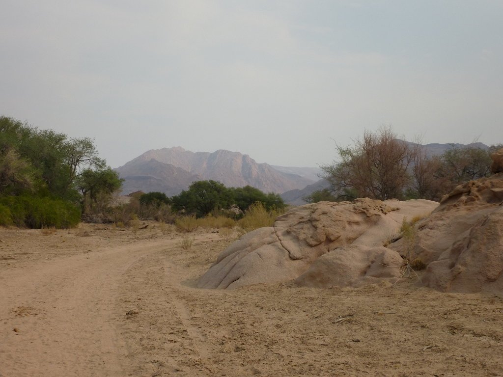

Cansados, absolutamente destrozados, llegamos al lodge. Nos registramos, bebemos algo y vamos a montar la tienda cuanto antes para poder descansar. Nada más salir de recepción nos encontramos de bruces con un gran elefante. Tal vez no era tan grande, no lo se, pero desde luego nos pareció enorme. Y solo hay algo mejor que ver un animal como este, y es verlo en libertad. Grande, enorme, impasible. Majestuoso. Delante de nosotros, comiendo las plantas que dan la bienvenida al lodge como si fuesen suyas. Aunque, pensándolo bien, suyas son. Nosotros somos los visitantes, los extranjeros que hemos llegado a molestarles. Intentaremos molestarles lo menos posible, no se vayan a cabrear... Bien, hemos descubierto qué era ese olor. Y ya lo siento, pero al elefante no le gustamos y nos fuimos de allí sin sacar fotos.

Sinceramente, es una de esas cosas que hace que un viaje merezca la pena. El camping es precioso, tal vez el mejor lugar al que he llegado en bicicleta en toda mi vida. Nuevamente un lujo en medio de la nada. ¿Quién nos iba a decir que íbamos a acampar en tierra de elefantes?

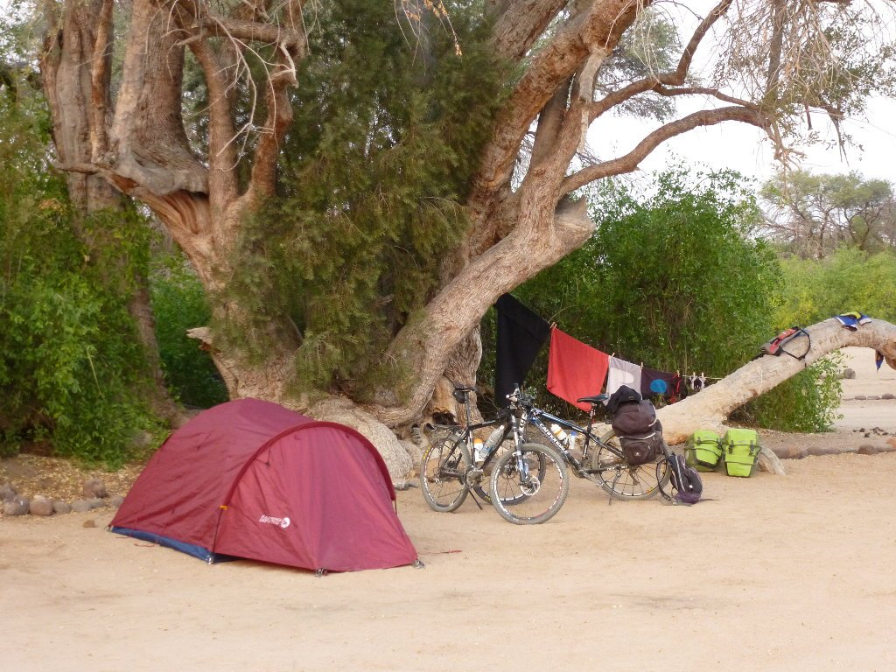

Nada más montar la tienda, una mujer que venía acompañando a un grupo de turistas alemanes se acercó hasta nosotros al grito de <em>No way!</em> preguntándonos si habíamos llegado hasta aquí en bicicleta y explicándonos posteriormente que era la primera vez en su vida que veía unos ciclistas en esta zona. No podemos ocultar cierto orgullo y empezamos a pensar que hemos logrado una pequeña hazaña.

Por otro lado, ¿qué me decís de este sencillo y efectivo método para calentar el agua?

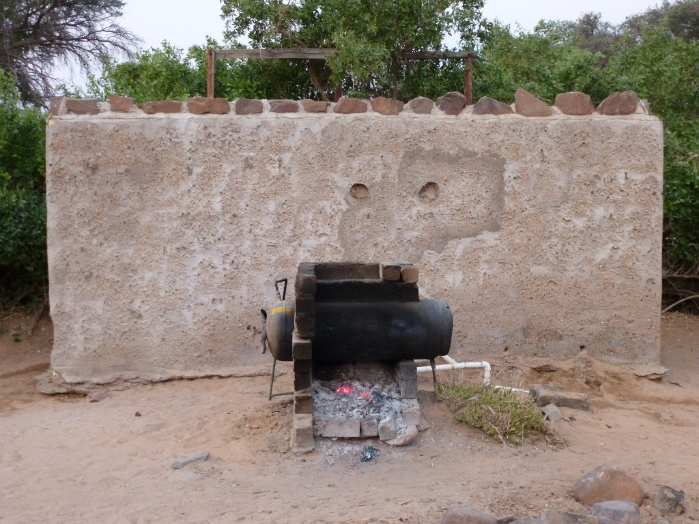

Por cierto, los baños no tenían techo. Otro punto exótico a añadir a tan magnífico lugar. Aprovechamos el anochecer para sacar unas cuantas fotos del camping antes de pegarnos la gran cena para recuperar la energía gastada.

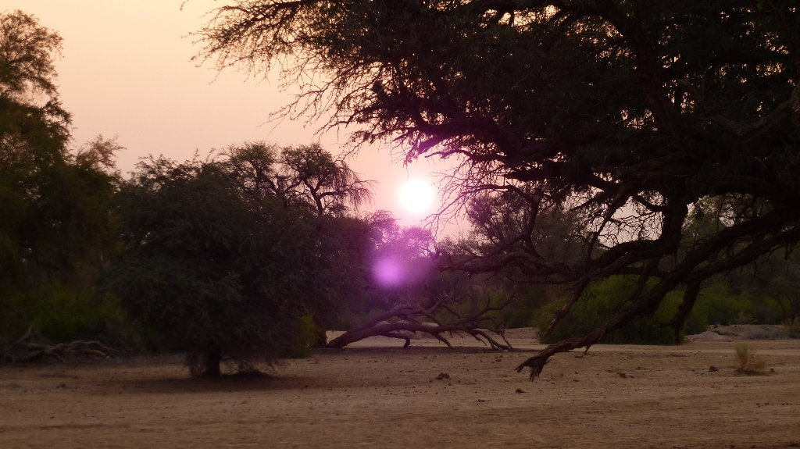

Quiero uno de estos...

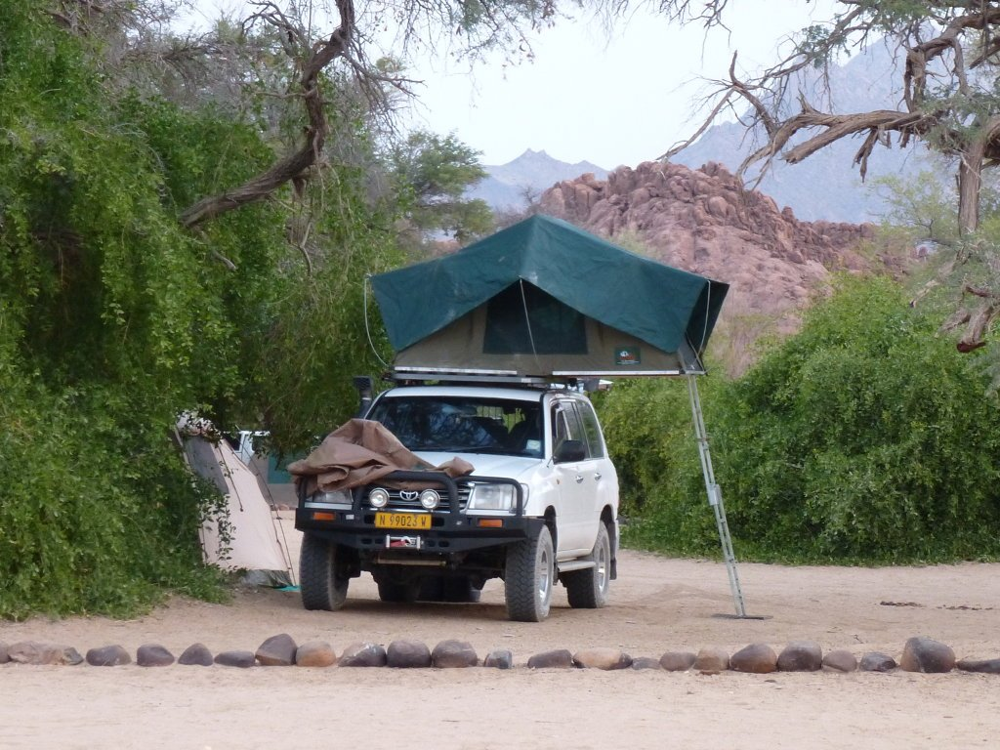

Justo antes de la cena, desde dentro del restaurante, pudimos observar nuevamente a los elefantes pasearse por el bonito jardín del lodge (perdón, por <strong>su</strong> bonito jardín) picando algo antes de ir a dormir. Nuevamente, no podíamos estar en un lugar mejor. Aunque no puedo evitar pensar en la poca protección que nos proporciona nuestra tienda ante un elefante. Mejor le dejamos comer a gusto.

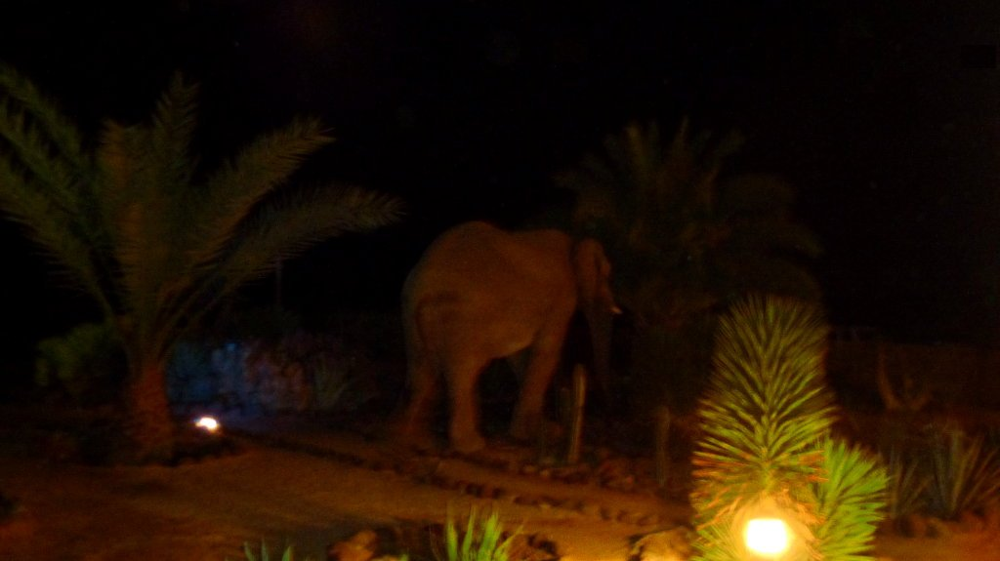

¡Vaya día tan intenso! Toca descansar un poco, han sido muchos kilómetros y emociones para un solo día. Para mañana tenemos un pequeño trekking y tan solo 45 kilómetros de bici, un día tranquilo para descansar un poco antes de acercarnos a la costa.
