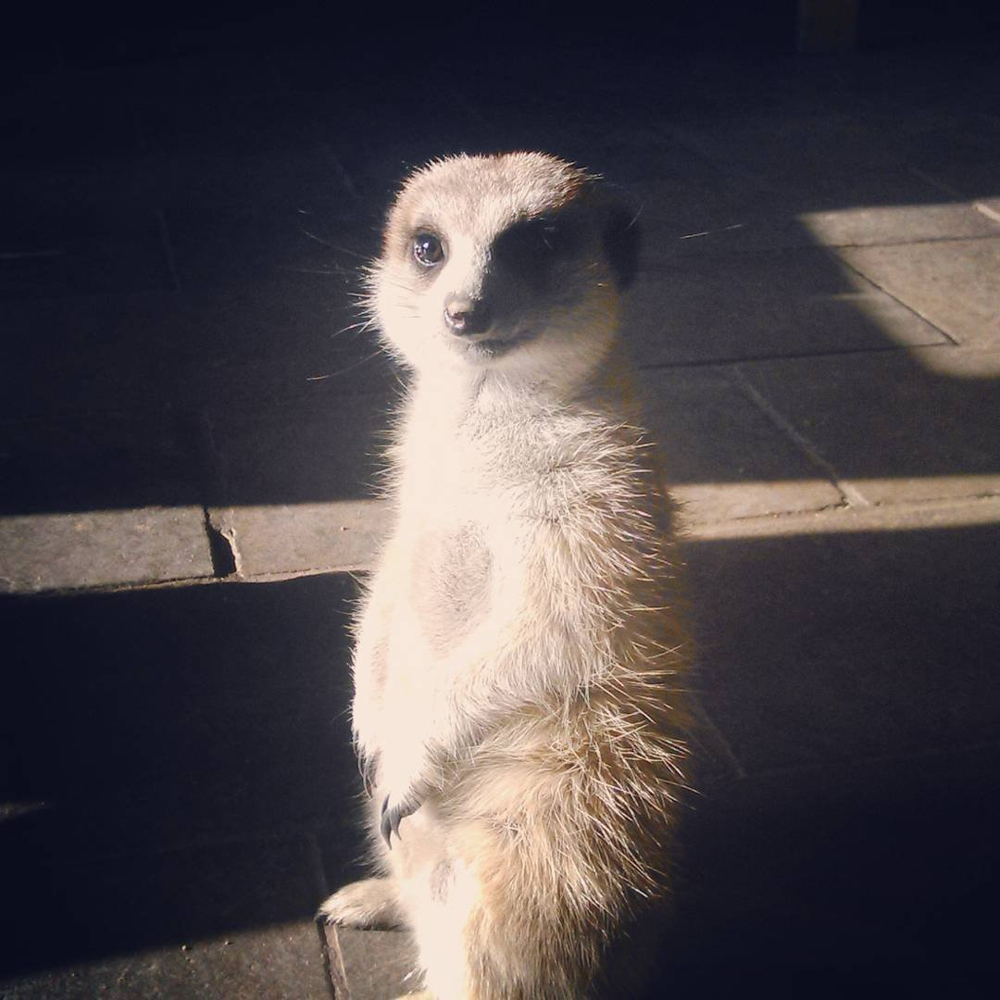
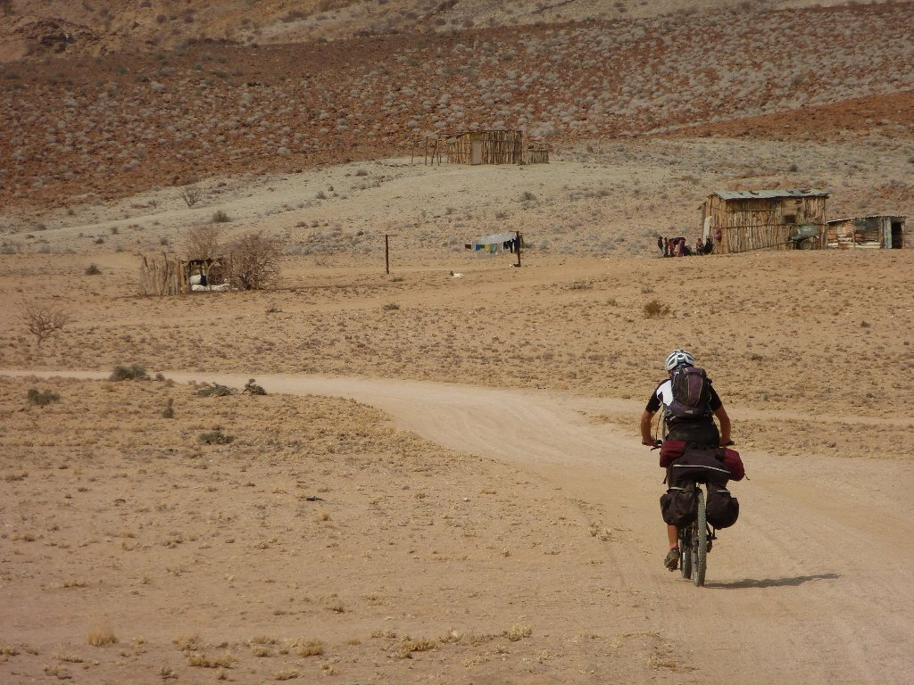
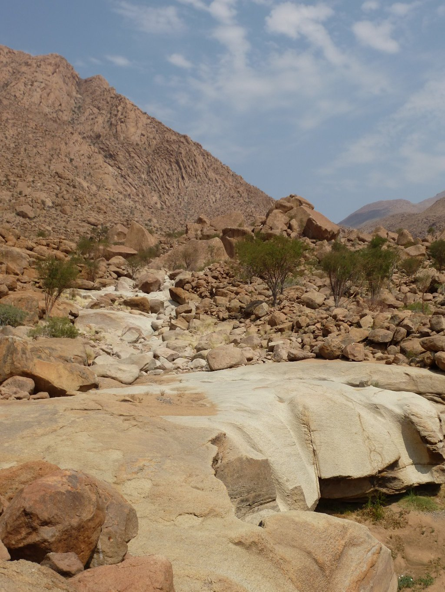
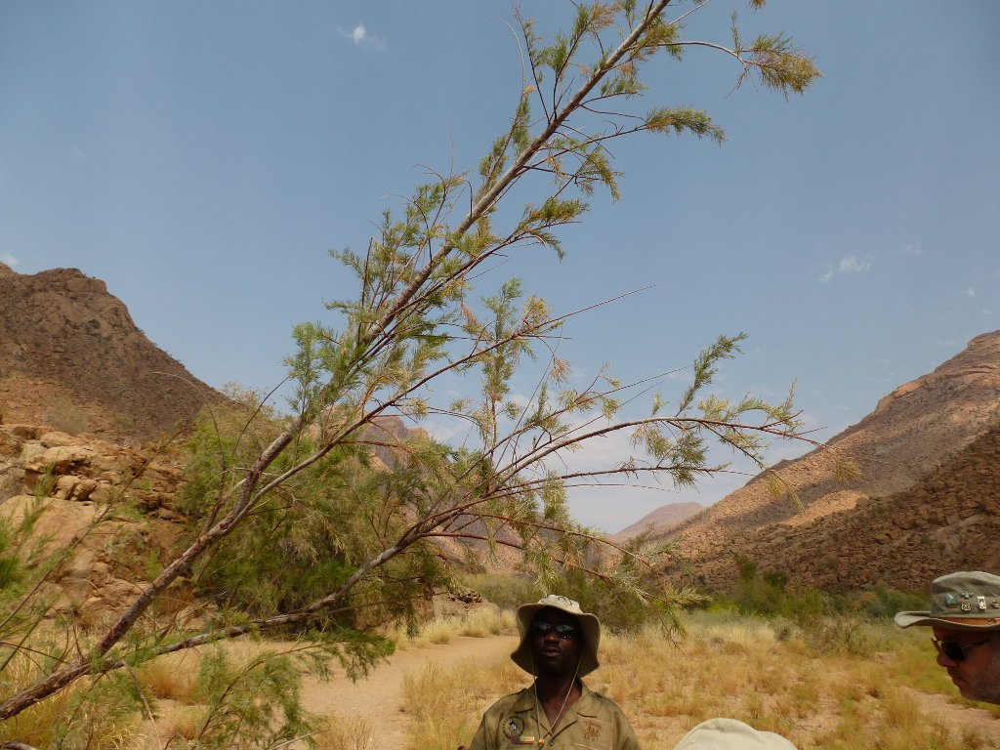
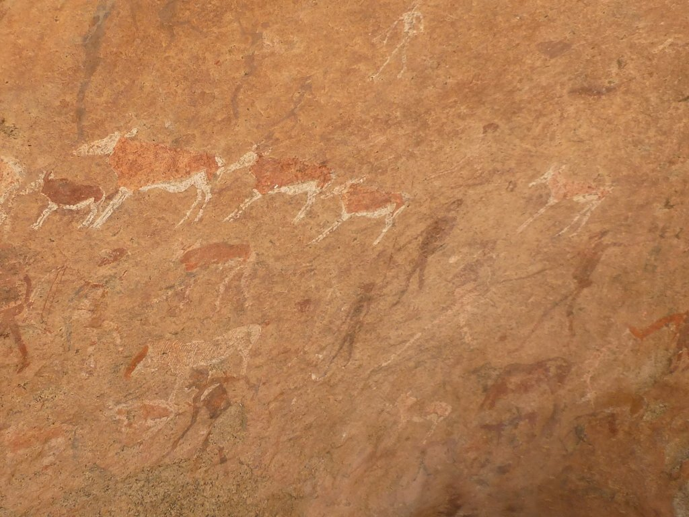
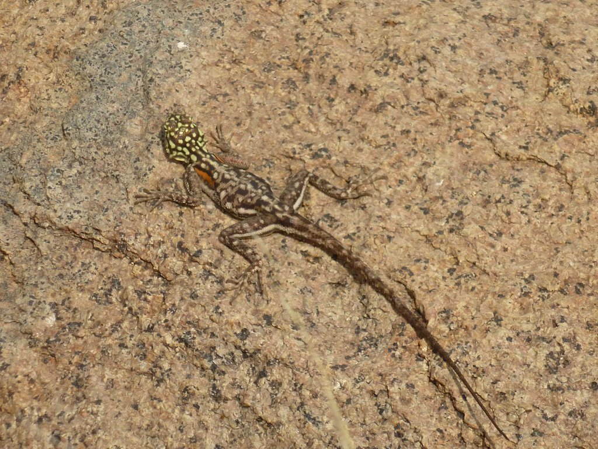
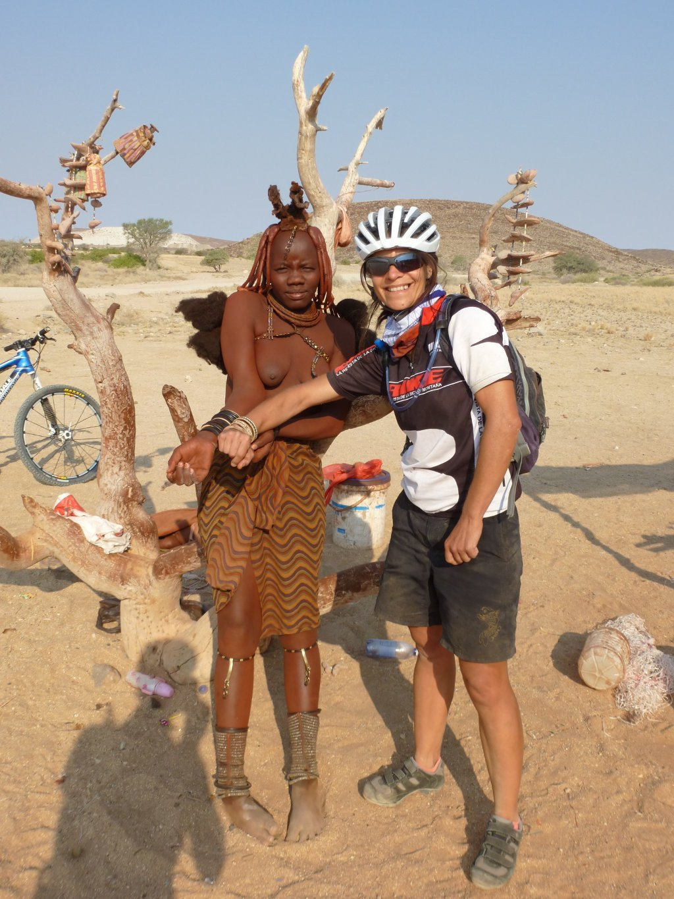
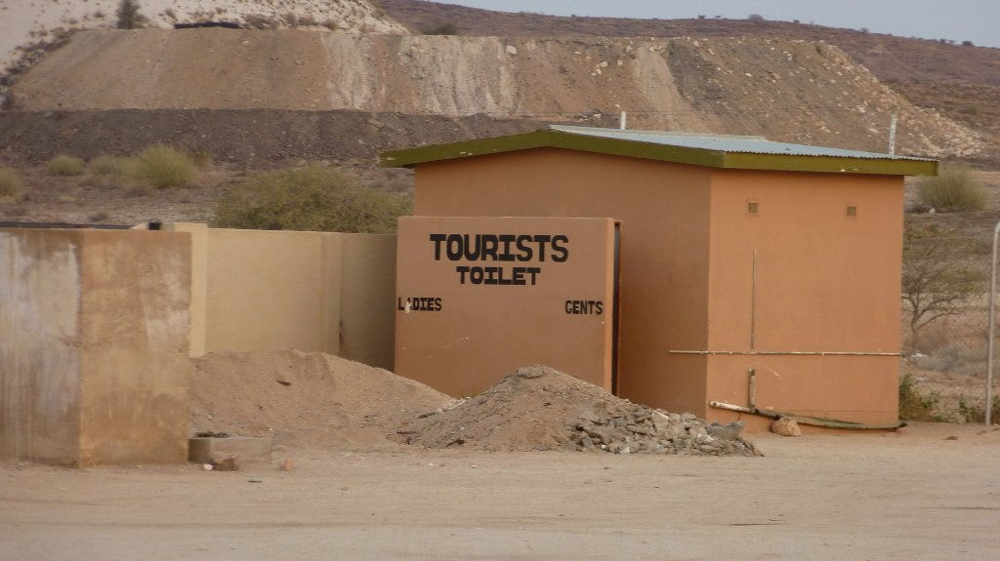
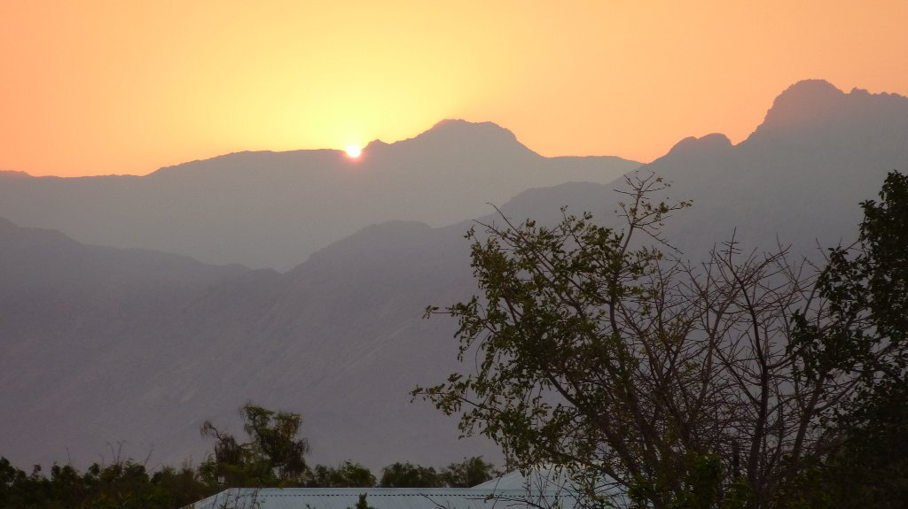

Tras la paliza de ayer, hoy nos levantamos con más bien pocas ganas de juerga. Por fortuna tenemos un día sencillo, al menos sobre el papel, sabemos que las etapas vistas sobre el mapa son una cosa y a los pedales, otra distinta. Los primeros 8 kilómetros son difíciles, sobre una pista parecida a la de ayer, pero tras ellos vendrán otros más sencillos. Pero antes de pedalear toca alimentarse, así que nos vamos al lodge a disfrutar de un buen desayuno. Y ahí nos encontramos a Carlos, una pequeña suricata que se ha convertido la mascota del lodge por méritos propios. Tras intentar robarme (sin éxito) el agua del camelbak, tuvo el amable gesto de posar para una foto.

Hacemos los primeros kilómetros con calma. La ruta es una pista de arena, con lo que nos tenemos que parar a empujar a cada poco, algo a los que nos estamos acostumbrando desde ayer. No obstante, el paisaje es maravilloso y merece la pena empujar la bici con todo el equipaje si eso nos permite descubrir este bonito lugar.

No tardamos mucho en llegar al punto de partida del trekking que nos va a llevar hasta la White Lady, la pintura rupestre más importante de Namibia. Al llegar allí nos encontramos un trekking mucho más organizado de lo que pensábamos. Tras pagar la entrada, un guía nos viene a recoger y nos junta con el resto del grupo, todos alemanes. No se si lo había mencionado, pero el turismo alemán en Namibia destaca sobre cualquier otro. Los años de ocupación alemana se notan, hay muchos viviendo en Namibia y muchos otros de turismo. Ciertamente, no se si hay más alemanes en las costas españolas o en Namibia. Tras juntarnos al resto del grupo, avanzamos sobre lo que parece ser el lecho seco de un río.

Mientras  avanzamos, nuestro guía nos va mostrando los árboles y plantas más habituales de la zona. Las acacias, muy preciadas por los elefantes, el tamarix, un árbol casi mágico del que obtiene prácticamente de todo, como por ejemplo una bebida parecida al café, zumos... vamos, casi cualquier cosa.

Finalmente llegamos al punto en cuestión. Nos explica cómo un aventurero alemán las localizó, estas y otras pinturas sobre la roca, en las inmediaciones del monte Brandberg. Unas 600 pinturas rupestres han sido descubiertas en la zona, lo cual es sorprendente no tanto por su cantidad sino por el hecho de que se conserven en buen estado. La más importante de todas es la White Lady,  con 2.000 años de antigüedad. Descubierta por el explorador y topógrafo alemán Reinhard Maak, representa a una mujer con las piernas y brazos de color blanco en una escena de caza. Yo no tengo tan claro que sea una mujer o un hombre... juzgad vosotros.

Tras contemplar las pinturas, volvemos sobre nuestros pasos de vuelta al punto de partida. Aprovechamos para fijarnos en ciertos detalles que se nos habían escapado anteriormente, e incluso tenemos la suerte de poder fotografiar a este gecko.

Volvemos a por las bicis y nos lanzamos nuevamente a la pista, sabiendo que en unos 30 kilómetros estaremos en el camping. Lo que no esperábamos es que se hiciesen tan duros. Los pocos kilómetros que nos quedan se hacen interminables, primero por el desnivel y el mal estado de la pista y después por el fuerte, fortísimo viento. Avanzamos muy despacio, deteniéndonos únicamente unos minutos para ver a unos himba que venden artesanías. Himba es el nombre de la etnia de los nativos de Kunene, un pueblo semi-nómada originario de Namibia que conserva su estilo de vida pese al paso de los siglos. Pero concretamente estos, en lugar de dedicarse a la agricultura o ganadería, esperan a que algún turista les compre algo y les haga algún obsequio en forma de comida o ropa. Aunque reconozco su dura vida, la artificialidad con la que se presentan y el descaro con el que te piden cosas me resulta violento. No ha sido la experiencia que esperaba, aunque bien es cierto que no puedes esperar colarte en la vida de otras personas como si un de un parque temático se tratase. Compramos, no obstante, unas pulseras para el recuerdo.

Con dos nuevas pulseras seguimos el tortuoso camino que nos lleva al destino, Uis, un pueblo con unas grandes minas a cielo abierto que le aportan prosperidad y ningún interés turístico.

El camping está muy cuidado, y su amable y tranquilo dueño nos regala 5 litros de agua para el viaje, lo cual agradecemos mucho dado que hemos caído en la cuenta de que es domingo y todo está cerrado. Es curiosa esa sensación de no saber en qué día vives. Lo que sí tenemos claro es que debemos descansar.

Para mañana nos sentimos intranquilos, 120 kilómetros de pista nos separan de la costa de Henties Bay. Si la pista es buena, la etapa no será muy complicada. Estamos a 850 metros de altura mientras que Henties Bay es un pueblo pesquero, con lo que toda la ruta tendrá una ligera pendiente descendente. Pero, ¿y si la pista está mal? ¿Y si hay mucho viento? Mañana lo veremos.
