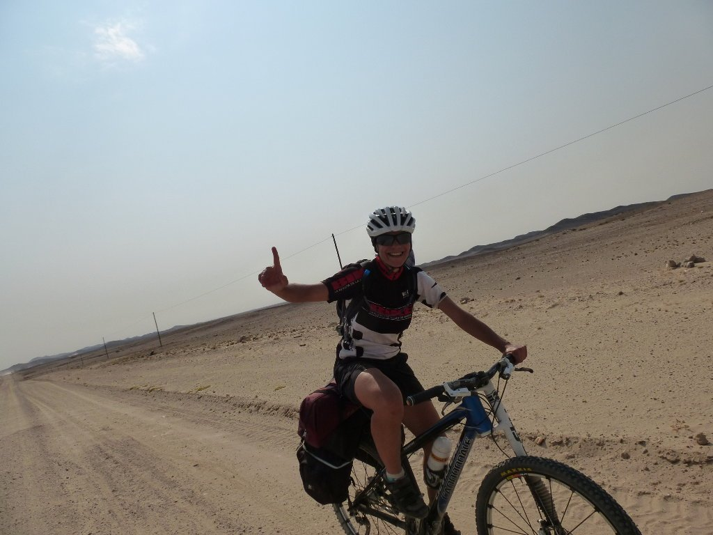
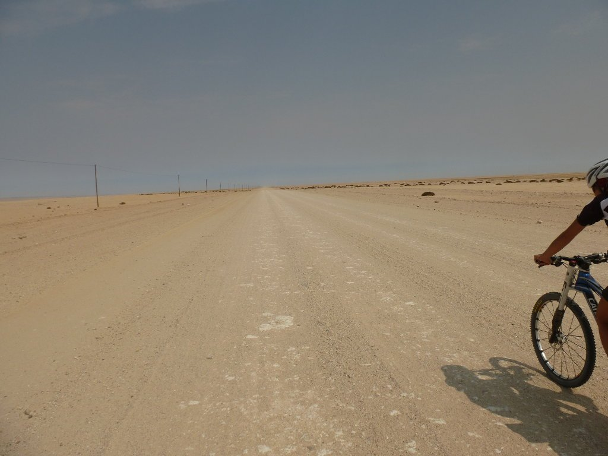
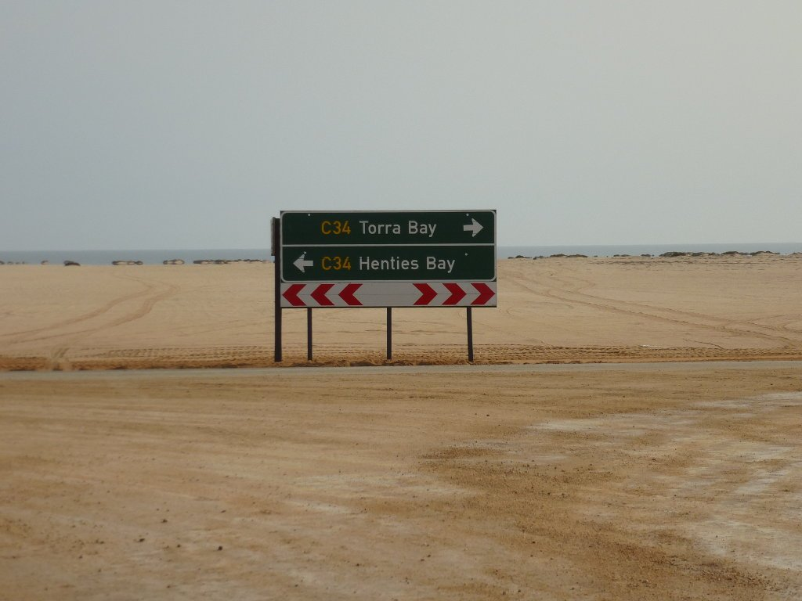
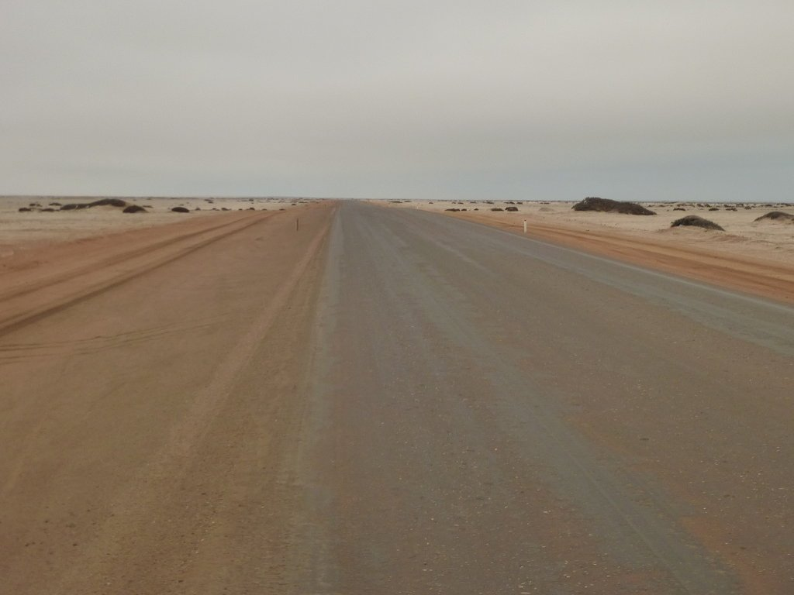

El día amaneció apacible, soleado y sin viento, lo cual nos animó bastante teniendo en cuenta la etapa que nos esperaba, 120 kilómetros rectos y llanos hasta la costa. Sin tiempo que perder nos lanzamos por la pista rumbo a Henties Bay, con la esperanza de avanzar alegremente sin que el recorrido se hiciese muy pesado. Poco a poco avanzamos y vamos haciendo kilómetros, el firme es bueno en su mayor parte y los pequeños tramos de tôle ondulée y arena no molestan demasiado.

Pero poco a poco se va levantando viento y avanzamos cada vez más despacio. El paisaje va cambiando, la poca vegetación que tenemos a nuestro alrededor va siendo engullida por la arena. Cruzamos la señal que nos indica la entrada al parque nacional de Dorob. Su nombre, que significa <em>tierra seca</em> en la lengua local, no nos deja mucha duda sobre cómo será el paisaje que nos espera. Este parque, de 1.600 kilómetros de longitud, se extiende por toda la parte central de la costa de Namibia. Aunque el paisaje y la pista cambian poco, a partir de este punto avanzamos cada vez más despacio. El viento nos frena en seco, y el monótono terreno no ayuda en absoluto.

La monotonía del viaje tan solo es rota por algún coche que nos adelanta de cuando en cuando. Uno de ellos se detiene a nuestro lado, resulta ser el dueño del camping donde pasamos la noche. Nos da unos ánimos que realmente necesitamos, ya que los nuestros están por los suelos. Cuanto más avanzamos, más pesado se hace todo. El viento sopla cada vez con más fuerza y las alforjas parecen pesar más y más. Mis esperanzas de avanzar por una pista descendente con el océano al fondo no se han cumplido, el horizonte es tan solo una línea de arena. Los últimos kilómetros son un suplicio, la ligera pendiente favorable apenas se nota y talmente parece que estemos escalando una montaña. Pero nuestra cabezonería hace efecto y terminamos con la dichosa pista, más de 100 kilómetros en línea recta nos han llevado de Uis a la carretera de la costa, que une Cape Cross con Henties Bay.

Giramos a la izquierda rumbo a Henties Bay por una carretera en mucho mejor estado que la tortuosa pista anterior. Las ruedas no se hunden y las bicis corren.

En tan solo siete kilómetros llegamos al camping. Realmente ha sido uno de  nuestros peores días sobre una bicicleta, y por fin ha terminado. No ha tenido nada interesante, salvo el saber  hasta dónde puede aguantar nuestra cabeza, con más de siete horas pedaleando contra el viento sin más aliciente que llegar al destino.

Un cómodo camping y una grandiosa cena en el Fishy Corner nos reponen del esfuerzo. Aquí pruebo por primera (y última) vez un pescado muy común en las costas de Namibia y Sudáfrica llamado kabeljou. Resultó ser un pescado blanco muy sabroso, aunque con el hambre que tenemos es fácil contentarnos.

Para mañana tenemos 70 kilómetros por la costa, aparentemente sencillos. Diferente paisaje, diferente clima y diferentes ciudades. Llegaremos a Swakopmund, una ciudad típicamente alemana en la costa africana.
