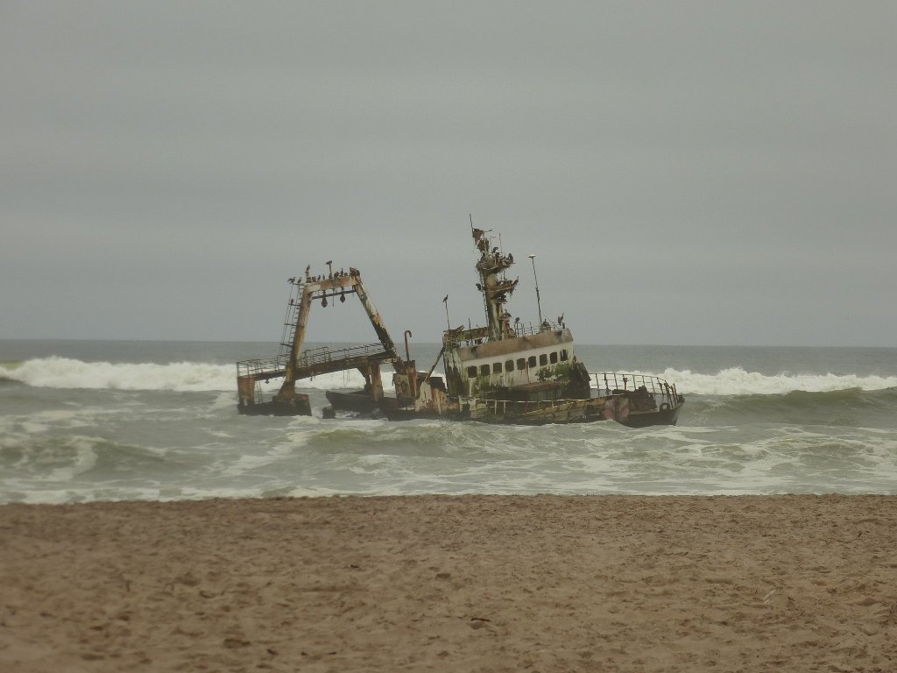
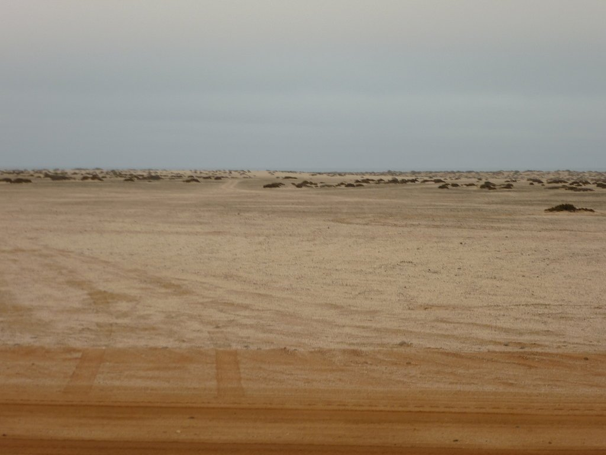
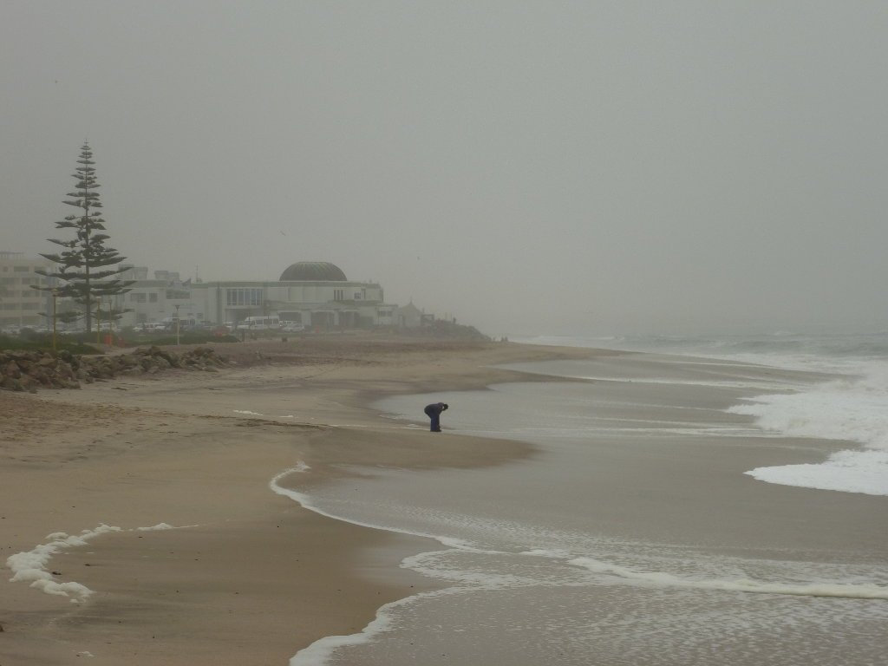
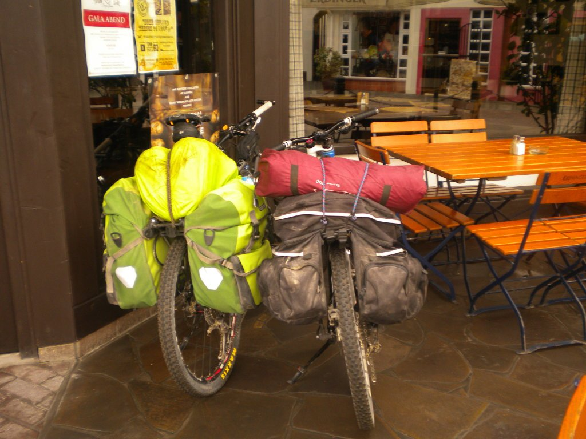
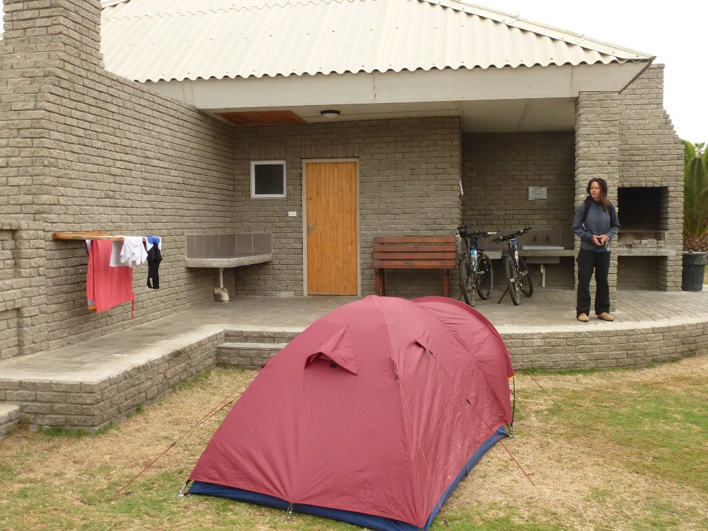
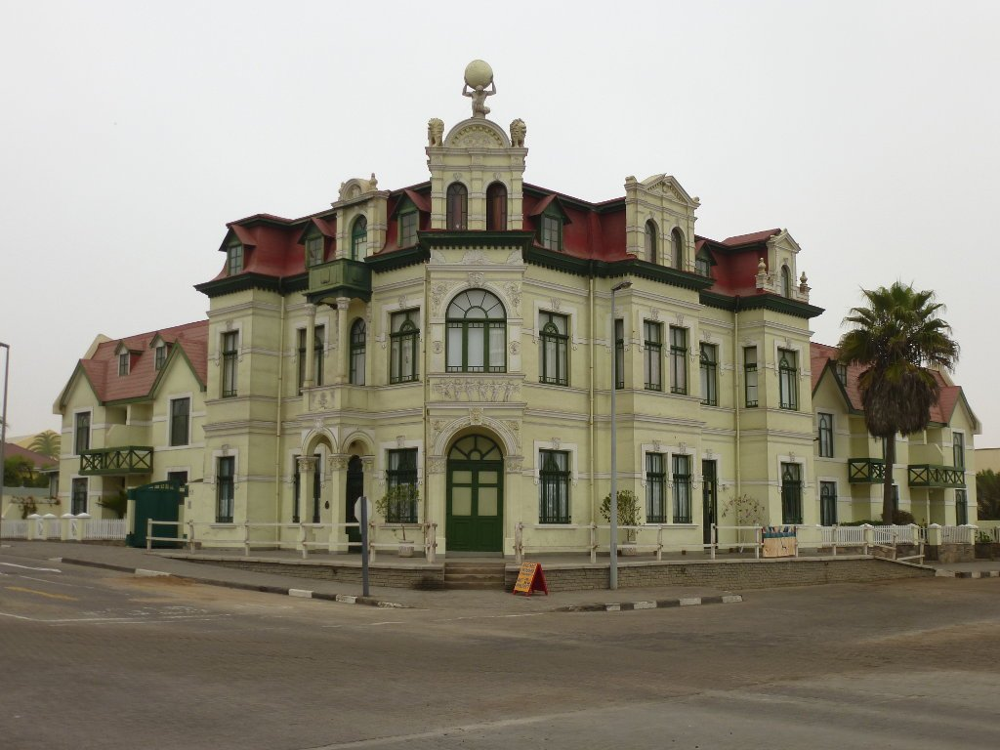

Hoy nos toca etapa llana y con buen firme. Vamos a recorrer la costa desde Henties Bay hasta Swakopmund, poco más de 70 kilómetros fáciles que vamos a agradecer después del día de ayer. El clima cambió totalmente, amaneció mucho más frío que días atrás y sobre todo mucho más húmedo, tanto es así que salimos con el chubasquero. Como en el camping no había cafetería, arrancamos la ruta sin desayunar con la esperanza de encontrar un buen sitio para hacerlo. Y así fue, nada más salir nos encontramos con una bonita cafetería donde pudimos tomar un gran desayuno, uno de los mejores del viaje. Nuevamente Henties Bay nos sorprendía gratamente.

Ya con el estómago lleno nos lanzamos a la pista. Totalmente llana y con buen firme, nos permitió rodar a buen ritmo mientras contemplamos la bonita costa namibia. El mar no estaba muy movido y aparentaba estar muy frío, por lo que ni se nos pasó por la cabeza meter un pie en el agua.

La pista nos conduce lentamente hacia el sur de Namibia. El cambio de paisaje ha sido radical, ahora pedaleamos con el océano a nuestra derecha y el desierto a nuestra izquierda.

Y no solo ha sido un brusco cambio de paisaje. El clima no tiene nada que ver, la temperatura ha bajado hasta unos frescos 17 grados con mucha humedad. Pedalear con este clima y sin viento ha sido tan confortable que casi sin darnos cuenta llegamos a las afueras de Swakopmund. Tardamos un rato en atravesar los barrios residenciales de esta ciudad hasta llegar al centro y, una vez allí y por primera vez en este viaje, nos apetece algo caliente. Hay tanta humedad que nos ha calado hasta los huesos y, aunque no se puede decir que haga frío, lo que más nos apetece en estos momentos es meter algo caliente para el cuerpo.

Tras un paseo por la costa entramos en el centro de la ciudad y encontramos un lugar donde tomar algo.

Nada más entrar en la ciudad nos damos cuenta de que realmente es una ciudad alemana en la costa africana. Con sus 35.000 habitantes, esta pequeña ciudad es un pedazo de Alemania en el desierto. Ni sus establecimientos ni sus habitantes nos recuerdan que estemos en África. Vamos, no creo que tengamos problemas si nos apetece cenar chucrut.

Como hemos llegado temprano, montamos la tienda en el que debe ser el camping más cómodo de todo el planeta y nos damos una vuelta por la ciudad. Esa puerta que veis frente a nuestra tienda es nuestro baño privado, al lado de nuestro tendal privado, fregadero, barbacoa... No sabíamos que existiesen sitios así, ¡y nos encantan!

Nada más salir del camping nos encontramos con el pequeño acuario de Swakopmund que bien merece una visita. Y sí, Swakopmund es bonito, pero... no es esto lo que buscamos en África. Aunque no se pueda negar que sea toda una curiosidad.

Una vuelta por la ciudad y poco más, mañana llegaremos a Walvis Bay, el final del camino. Solo 40 kilómetros de bici y habremos llegado al destino.
