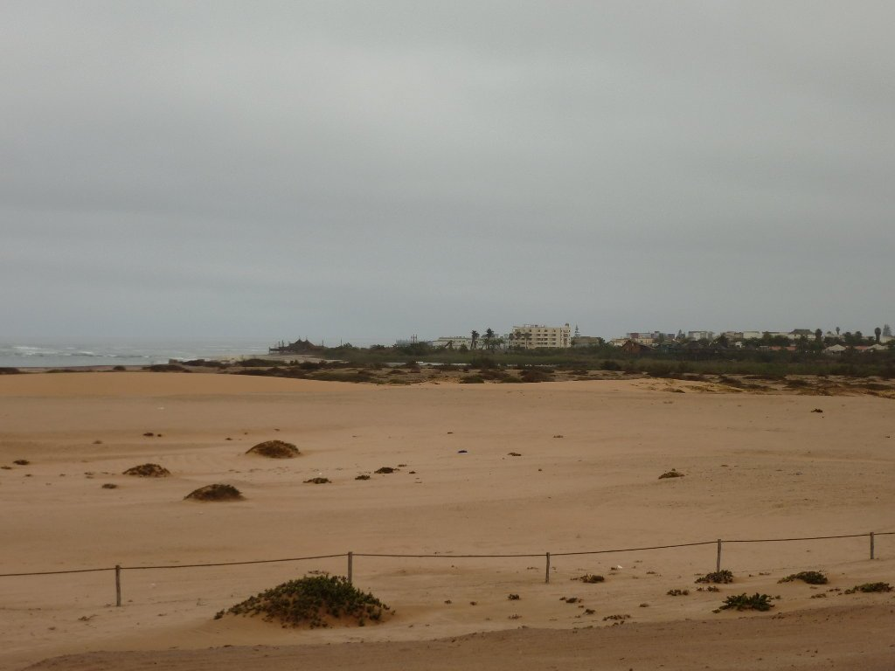
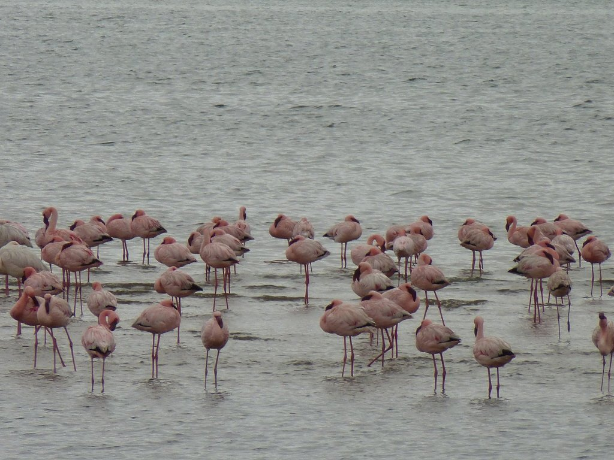
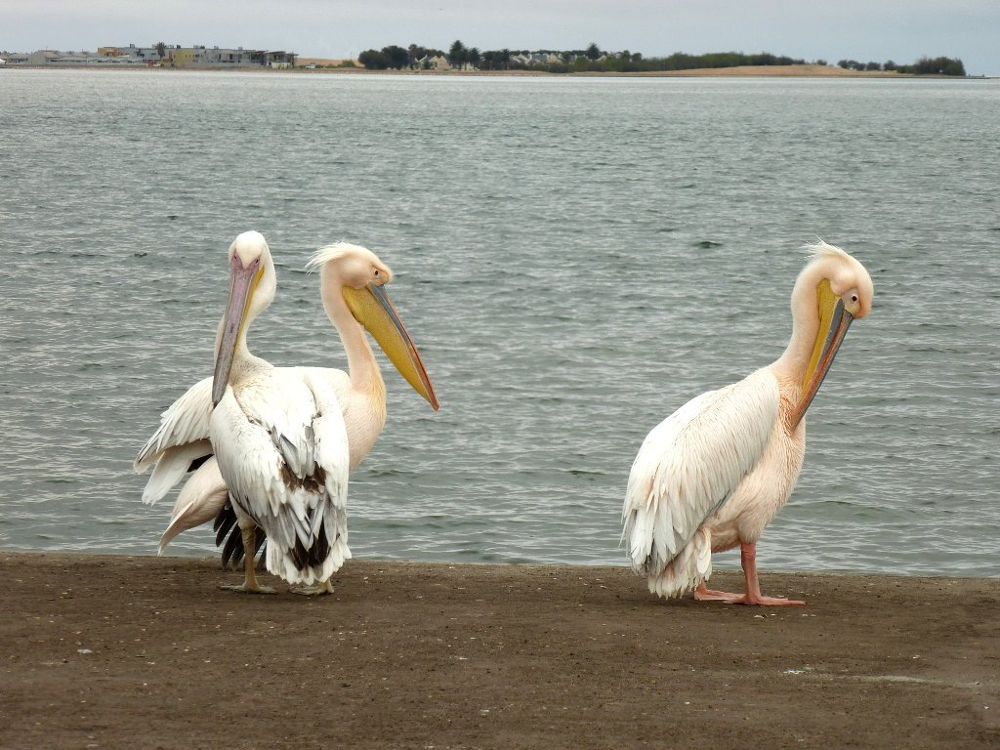
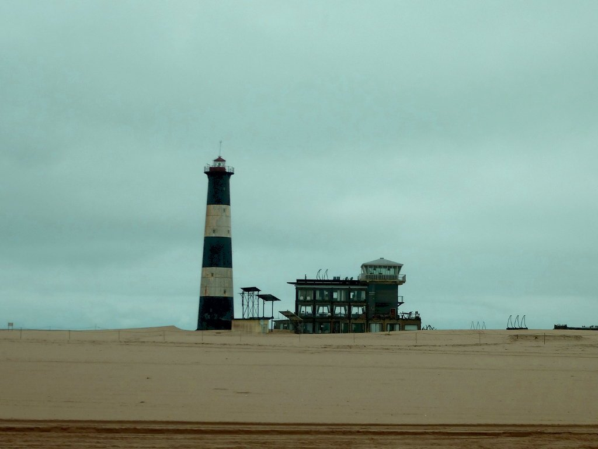

Último día, última etapa. Tan solo quedan 35 kilómetros por recorrer entre Swakopmund y Walvis Bay, sencillos y llanos, siguiendo rumbo sur por la costa por un terreno similar al de ayer. Podría darnos pena, y nos dará, pero el cansancio acumulado y el clima desapacible nos hacen tener muchas ganas de llegar a destino y descansar de la bici por unos días. Salimos abrigados, la bruma nos envuelve y la humedad cala. El asfalto es bueno y rápidamente dejamos Swakopmund atrás.

El paisaje es muy similar al de ayer. Arena a nuestra izquierda, el océano a nuestra derecha y asfalto al frente. Y mucho, demasiado tráfico, que nos obliga a transitar por el arcén. Y es una pena, porque la ruta es bonita, pero queda claro que no están acostumbrados a encontrarse con ciclistas. Solo los coches de turistas se separan de nosotros al adelantarnos. El resto nos pasa muy cerca, hasta que finalmente un camión casi nos tira y decidimos que era mejor transitar por el arcén, no asfaltado y muy bacheado, pero más seguro que la carretera.

En poco tiempo llegamos a las afueras de Walvis Bay. Hay arena hasta donde alcanza la vista, hemos llegado a las puertas del desierto.

Cruzamos Walvis Bay de norte a sur, hasta llegar al camping en el que pasaremos un par de días, ya que aprovecharemos la mañana siguiente para hacer kayak entre las focas. Rápidamente nos deshacemos de la ropa húmeda y nos abrigamos un poco. Nuevamente, aunque la temperatura no es muy baja, la humedad hace que el día no sea apacible. Aprovechamos la tarde para dar un paseo por la bahía y darnos cuenta de que Walvis Bay parece un pueblo fantasma. Tan solo los flamencos (que se cuentan por millares) y algunos pelícanos salen a nuestro paso.

Por cierto, no imaginaba tan grandes a los pelícanos. Tuvimos la suerte de que se nos acercasen tres, sobrevolando nuestras cabezas , y pudimos comprobar su gran envergadura.

Fue un día tranquilo y entretenido. No obstante nos vamos temprano para la tienda, mañana toca madrugar para acercarnos a ver a las focas a la bahía. En su parte más alejada, una pequeña península llamada <em>Pelican Point</em>, hay unas 10.000.

A la mañana siguiente pasan a buscarnos por el camping. Hoy sin bici, nos damos el gusto de movernos en todoterreno por la bahía. Atravesamos las refinerías salinas, uno de los grandes negocios de Walvis Bay junto con la pesca. Avanzamos por la arena viendo cientos de flamencos y, a lo lejos, algún chacal. Llegamos hasta lo que en su día fue un faro, construido para exportar a Japón pero que, tras diversos problemas económicos, se quedó en la bahía. Hoy día es un lodge de lujo, el <em>Pelican Point Lodge</em>, muy bonito y muy, muy caro. Y no es de extrañar, ya que desde él puedes disfrutar de la mejores vistas de la zona. No obstante, nosotros nos conformamos con verlo desde la arena.

Y hemos llegado. Es increíble, hay focas por todas partes. Unas 10.000 focas viven en esta bahía, con la tranquilidad de que nadie se mete con ellas y tan solo los turistas vienen a visitarlas de vez en cuando. Y la verdad, parecen encantadas.

Nos vestimos de capitán Pescanova y nos subimos a la piragua. Focas, pelícanos y hasta delfines, tan rápidos y escurridizos que no se dejaron fotografiar ni grabar. Le saqué buen partido a la GoPro.

<iframe src="https://www.youtube.com/embed/Bb_w8tgchnA" title="YouTube" loading="lazy" allowfullscreen></iframe>

Diría que las focas se lo pasaron mejor que nosotros si no fuese porque nosotros nos lo pasamos muy, muy bien. Fue una de esas experiencias que dibuja una sonrisa en tu cara cada vez que las recuerdas.

Mañana volvemos a a Windhoek, la capital, en autobús. Y si todo va bien, haremos otro día más de bici.
